                   +--------------------+
                   |      Angular       |
                   +--------------------+
                              ▲
                              │
                    WebSocket Adapter
                              ▲
                              │
                   REST Adapter (API)
                              ▲
                              │
                 -------------------------
                 |   Application Layer   |
                 -------------------------
                 | History Service       |
                 | Notification Service  |
                 | Scheduler             |
                 -------------------------
                              ▲
                              │
                 -------------------------
                 |     Domain Layer      |
                 -------------------------
                 | Signal Engine         |
                 | Realtime Cache        |
                 | Alarm Engine          |
                 -------------------------
                              ▲
                              │
                   Event Publisher
                              ▲
                              │
                  NestJS EventEmitter
                              ▲
                              │
                 -------------------------
                 | Infrastructure Layer  |
                 -------------------------
                 | Data Providers        |
                 | PostgreSQL            |
                 | InfluxDB              |
                 | Email Adapter         |
                 -------------------------
                              ▲
                              │
                 -------------------------
                 |       Sources         |
                 -------------------------
                 | Simulation            |
                 | OPC UA                |
                 -------------------------


# 2. Arquitectura de la Plataforma

## 2.1 Filosofía y Principios Arquitectónicos

---

# Introducción

EWControl es una plataforma web para la adquisición, procesamiento y visualización de datos industriales en tiempo real.

Su objetivo es ofrecer una solución flexible que permita conectar diferentes máquinas industriales, visualizar su estado en tiempo real, almacenar información histórica y gestionar alarmas desde una única aplicación.

Desde el inicio del proyecto se ha buscado una arquitectura sencilla, desacoplada y preparada para evolucionar, evitando la sobreingeniería y priorizando soluciones que aporten valor desde la primera versión del producto.

La arquitectura se ha diseñado para que la incorporación de nuevos protocolos de comunicación o nuevas funcionalidades no implique modificar el núcleo del sistema.

---

# Objetivos Arquitectónicos

La arquitectura de EWControl persigue los siguientes objetivos.

## Independencia del origen de los datos

La plataforma nunca dependerá directamente de un protocolo industrial.

Los datos siempre llegarán al sistema a través de un proveedor de datos (Data Provider), permitiendo sustituir el origen de la información sin modificar el resto de la aplicación.

En la primera versión existirán dos posibles orígenes:

- Simulador
- Servidor OPC UA

En el futuro podrán añadirse otros proveedores sin afectar a la lógica de negocio.

Ejemplos:

- MQTT
- Modbus
- API REST
- Edge Gateway
- Bases de datos externas

---

## Simplicidad

La arquitectura prioriza soluciones simples frente a diseños excesivamente complejos.

No se implementarán componentes pensados para necesidades futuras que actualmente no existen.

La plataforma evolucionará conforme aparezcan nuevos requisitos funcionales.

---

## Escalabilidad

El sistema deberá soportar el crecimiento progresivo del número de clientes, máquinas y señales sin modificar su arquitectura.

Objetivos iniciales del proyecto:

- Hasta 100 empresas.
- Entre 100 y 500 máquinas.
- Entre 1 y 20 señales por máquina.
- Actualización de datos cada segundo.

---

## Configuración dinámica

Toda la configuración del sistema estará almacenada en base de datos.

No existirán desarrollos específicos para un modelo de máquina.

Cada empresa podrá registrar sus propias máquinas y configurar qué señales desea visualizar, almacenar o supervisar mediante alarmas.

---

## Multiempresa

EWControl será una plataforma Multi-Tenant.

Toda la información pertenecerá a una empresa.

Los usuarios únicamente podrán acceder a los recursos asociados a su organización.

La separación de datos será un principio fundamental durante todo el desarrollo.

---

## Tiempo Real

El sistema mantendrá en memoria el último estado conocido de cada señal.

Las pantallas nunca consultarán directamente el PLC para mostrar información.

Toda la información en tiempo real se obtendrá desde una caché centralizada.

---

# Filosofía de Diseño

Durante el desarrollo del proyecto se seguirán los siguientes principios.

---

## Responsabilidad Única

Cada componente tendrá una única responsabilidad claramente definida.

Ejemplos:

- Obtener datos.
- Transformar datos.
- Mantener el estado en tiempo real.
- Evaluar alarmas.
- Guardar históricos.
- Enviar notificaciones.

Cada componente deberá hacer una única cosa y hacerla bien.

---

## Bajo Acoplamiento

Los módulos deberán depender de contratos e interfaces, nunca de implementaciones concretas.

Esto permitirá sustituir componentes sin afectar al resto del sistema.

Por ejemplo, el dominio nunca conocerá un servidor OPC UA.

Únicamente conocerá un proveedor de datos.

---

## Alta Cohesión

Toda la funcionalidad relacionada con un mismo dominio permanecerá agrupada.

Ejemplos de dominios:

- Autenticación.
- Clientes.
- Máquinas.
- Señales.
- Históricos.
- Alarmas.
- Dashboard.

---

## Evolución Controlada

La arquitectura únicamente evolucionará cuando exista un requisito funcional que lo justifique.

No se implementarán soluciones destinadas a resolver problemas hipotéticos.

Este principio evita la sobreingeniería y facilita el mantenimiento del proyecto.

---

## Comunicación mediante Eventos

Los módulos del sistema se comunicarán mediante eventos internos.

Para ello se utilizará el sistema de eventos de NestJS.

Esta decisión permite desacoplar los distintos componentes sin añadir infraestructura adicional.

En la primera versión no se utilizarán sistemas distribuidos de mensajería como Kafka o RabbitMQ.

---

# Arquitectura General

La plataforma se organiza como una secuencia de transformación de datos.

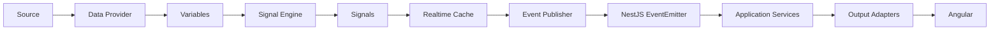

Cada componente tiene una única responsabilidad y desconoce el funcionamiento interno del resto.

---

# Conceptos del Dominio

## Source

Representa cualquier sistema capaz de proporcionar información.

Ejemplos:

- Simulador.
- Servidor OPC UA.

Un Source únicamente genera datos.

No conoce EWControl.

---

## Data Provider

El Data Provider es el encargado de comunicarse con un Source.

Su responsabilidad consiste en convertir la información recibida en Variables internas.

Cada protocolo tendrá su propio proveedor.

Ejemplos:

- SimulationProvider.
- OpcUaProvider.

---

## Variable

Una Variable representa un dato bruto recibido desde un origen externo.

Ejemplos:

- Temperature
- Pressure
- Voltage
- Current
- Running

Las Variables pertenecen únicamente al proveedor de datos.

Nunca serán utilizadas directamente por el resto de la plataforma.

---

## Signal

Una Signal representa un dato de negocio utilizado por EWControl.

Es la unidad de información consumida por toda la aplicación.

Existen dos tipos de Signals.

### Signal Directa

Obtiene su valor directamente desde una Variable.

Ejemplo:

Temperatura ← Temperature

---

### Signal Calculada

Obtiene su valor mediante una fórmula sencilla basada en Variables.

Ejemplo:

Potencia = Voltaje × Intensidad

Las expresiones estarán limitadas a operaciones simples en esta primera versión del proyecto.

---

## Realtime Cache

La Realtime Cache mantiene el último estado conocido de cada Signal.

Cada registro almacenará como mínimo:

- Valor actual.
- Timestamp.
- Calidad del dato.
- Última actualización.

Toda la información mostrada en el Dashboard procederá de esta caché.

Nunca se consultará directamente el PLC para representar información en pantalla.

---

# Beneficios de la Arquitectura

La arquitectura propuesta proporciona las siguientes ventajas.

- Independencia del protocolo industrial.
- Código sencillo y mantenible.
- Separación clara de responsabilidades.
- Bajo acoplamiento entre componentes.
- Configuración dinámica.
- Escalabilidad.
- Facilidad para realizar pruebas.
- Incorporación sencilla de nuevos proveedores de datos.
- Evolución progresiva del sistema sin rediseñar el núcleo.

---

# Principio Fundamental

Toda la plataforma trabaja exclusivamente con **Signals**.

Las Variables representan información técnica obtenida desde un origen de datos.

Las Signals representan información de negocio utilizada por el resto del sistema.

Dashboard, históricos, alarmas, notificaciones y futuras funcionalidades consumirán únicamente Signals.

Este principio constituye uno de los pilares fundamentales de la arquitectura de EWControl y deberá respetarse durante toda la evolución del proyecto.


## 2.2 Arquitectura General

---

# Introducción

EWControl se organiza mediante una arquitectura en capas con responsabilidades claramente definidas.

Cada capa tiene una única función y únicamente puede comunicarse con las capas necesarias para realizar su trabajo.

Este enfoque facilita el mantenimiento del sistema, reduce el acoplamiento entre componentes y permite incorporar nuevas funcionalidades sin modificar el núcleo de la aplicación.

La arquitectura está inspirada en los principios de Clean Architecture y Ports & Adapters, adaptándolos a las necesidades reales del proyecto y evitando complejidad innecesaria.

---

# Visión General

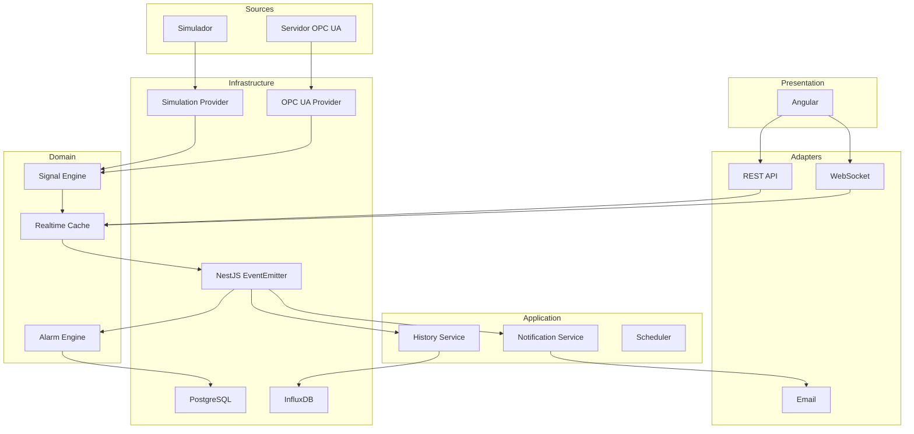

---

# Capas de la Plataforma

La aplicación se divide en seis capas principales.

## Sources

Los Sources representan cualquier origen capaz de proporcionar información al sistema.

Ejemplos:

- Simulador
- Servidor OPC UA

Un Source únicamente genera datos.

No conoce la existencia de EWControl.

No implementa reglas de negocio.

---

## Infrastructure

La infraestructura contiene todos los componentes encargados de comunicarse con sistemas externos.

Ejemplos:

- Data Providers
- PostgreSQL
- InfluxDB
- EventEmitter de NestJS

La infraestructura nunca contiene lógica de negocio.

Su única responsabilidad consiste en conectar la aplicación con el mundo exterior.

---

## Domain

El dominio representa el núcleo funcional de la plataforma.

Toda la lógica industrial se implementa aquí.

Actualmente está compuesto por:

- Signal Engine
- Realtime Cache
- Alarm Engine

El dominio no conoce:

- Angular
- Bases de datos
- OPC UA
- REST
- WebSocket
- Correo electrónico

Su única responsabilidad consiste en procesar información industrial.

---

## Application

La capa de aplicación implementa los casos de uso del sistema.

Coordina los distintos componentes del dominio y reacciona a los eventos generados durante el procesamiento.

Actualmente está formada por:

- History Service
- Notification Service
- Scheduler
- Auth Service

El Auth Service orquesta el caso de uso de autenticación (login, refresh, logout): valida credenciales contra el `User` del dominio (Documento 3, apartado 3.2.2), y emite/rota los tokens JWT descritos en el Documento 6, apartado 6.2. No implementa por sí mismo la verificación de tokens en cada petición; eso corresponde a un Input Adapter (ver más abajo).

Estos servicios no implementan reglas industriales.

Únicamente ejecutan acciones derivadas del estado del sistema.

---

## Adapters

Los Adapters permiten que la plataforma se comunique con aplicaciones externas.

Existen dos tipos de adaptadores.

### Input Adapters

Reciben solicitudes externas.

Ejemplos:

- REST API
- Auth Guard: intercepta toda petición entrante, valida el JWT (Documento 6, apartado 6.2) y resuelve el contexto de Company/rol antes de que la petición llegue a la capa de Application. Es el único punto donde se verifica un token; ningún caso de uso vuelve a comprobarlo.

---

### Output Adapters

Publican información hacia el exterior.

Ejemplos:

- WebSocket
- Email

Los Adapters nunca implementan lógica de negocio.

Únicamente transforman la información entre la aplicación y el sistema externo.

---

## Presentation

La capa de presentación corresponde a la interfaz de usuario.

En la primera versión estará desarrollada mediante Angular.

Su responsabilidad consiste exclusivamente en representar información al usuario y enviar solicitudes a la API.

Toda la lógica de negocio reside en el backend.

---

# Flujo de Datos

Toda la información sigue siempre el mismo recorrido.

```mermaid
flowchart LR

Source

↓

Provider

↓

Variables

↓

Signal Engine

↓

Signals

↓

Realtime Cache

↓

Eventos

↓

Servicios

↓

Adapters

↓

Angular
```

Cada componente realiza una única transformación antes de delegar el trabajo al siguiente.

---

# Flujo de una Actualización

Cuando una variable cambia en el PLC, el sistema ejecuta el siguiente proceso.

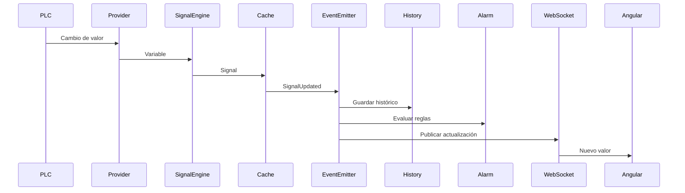

Este flujo será idéntico tanto para el simulador como para un servidor OPC UA.

La única diferencia será el Data Provider utilizado.

---

# Dependencias

Las dependencias siempre apuntarán hacia el dominio.

```text
Presentation
        │
        ▼
Adapters
        │
        ▼
Application
        │
        ▼
Domain
        ▲
        │
Infrastructure
        ▲
        │
Sources
```

Ningún componente del dominio podrá depender de Angular, PostgreSQL, OPC UA o cualquier otra tecnología externa.

---

# Equivalencia con Clean Architecture

Las seis capas anteriores son la nomenclatura propia de EWControl, pensada para describir este dominio concreto. Siguen, no obstante, los mismos principios que Clean Architecture (Documento 0, "Clean Architecture"): la regla de dependencia de la sección anterior es exactamente la regla de dependencia de Clean Architecture aplicada a este proyecto.

| Capa de EWControl | Capa canónica de Clean Architecture |
|---|---|
| Domain (Signal Engine, Realtime Cache, Alarm Engine; entidades del Documento 3) | Entities |
| Application (History Service, Notification Service, Scheduler, Auth Service) | Use Cases |
| Infrastructure (Data Providers, repositorios de PostgreSQL/InfluxDB) + Adapters (REST, WebSocket, Email, Auth Guard) | Interface Adapters |
| Sources (Simulador, servidor OPC UA) + Presentation (Angular) + motores/frameworks concretos (NestJS, PostgreSQL, InfluxDB) | Frameworks & Drivers |

Esta tabla no introduce una capa nueva ni renombra nada en el código: es una referencia para verificar, ante cualquier duda de diseño, que una clase nueva se ubica en la capa correcta según su nivel de dependencia respecto al dominio.

---

# Reglas Arquitectónicas

Durante todo el desarrollo deberán respetarse las siguientes reglas.

## Regla 1

El Dashboard nunca accederá directamente al PLC.

Siempre utilizará la información disponible en la Realtime Cache.

---

## Regla 2

Los Data Providers únicamente obtienen información.

Nunca realizan cálculos.

Nunca generan alarmas.

Nunca almacenan históricos.

---

## Regla 3

El Signal Engine transforma Variables en Signals.

No accede a bases de datos.

No envía notificaciones.

No conoce Angular.

---

## Regla 4

La Realtime Cache mantiene el estado actual de las Signals.

No consulta el PLC.

No almacena históricos.

---

## Regla 5

El Alarm Engine únicamente evalúa reglas configuradas.

Cuando detecta una condición genera los eventos correspondientes.

---

## Regla 6

Los Application Services reaccionan a eventos.

Nunca contienen lógica industrial.

---

## Regla 7

Los Adapters no contienen reglas de negocio.

Su responsabilidad consiste únicamente en comunicar la plataforma con sistemas externos.

---

## Regla 8

Toda la comunicación entre componentes se realizará mediante eventos internos utilizando el EventEmitter de NestJS.

---

# Beneficios

La arquitectura propuesta proporciona:

- Separación clara de responsabilidades.
- Bajo acoplamiento entre módulos.
- Código sencillo de mantener.
- Sustitución sencilla de proveedores de datos.
- Escalabilidad.
- Facilidad para realizar pruebas unitarias.
- Incorporación de nuevos adaptadores sin modificar el dominio.
- Evolución progresiva del sistema sin rediseñar la arquitectura.

---

# Decisión Arquitectónica

Toda nueva funcionalidad deberá incorporarse respetando las capas definidas en este documento.

Cuando aparezca una nueva necesidad funcional, se añadirá el componente correspondiente dentro de la capa adecuada sin alterar las responsabilidades existentes.

Este principio garantiza la estabilidad de la arquitectura y facilita la evolución del proyecto a largo plazo.

## 2.3 Modelo de Datos en Tiempo Real

---

# Introducción

El objetivo principal de EWControl es transformar datos industriales en información útil para el usuario.

Para conseguirlo, la plataforma define tres conceptos fundamentales:

- Variable
- Signal
- Realtime Cache

Cada uno representa una etapa diferente dentro del ciclo de vida de un dato.

Esta separación permite desacoplar el origen de la información de la lógica de negocio y de la presentación.

---

# Flujo del Dato

Todo dato seguirá siempre el mismo recorrido.

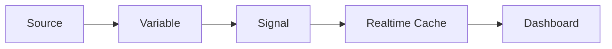

---

# Variable

Una Variable representa un dato técnico recibido desde un sistema externo.

Es la representación más cercana al origen de la información.

Una Variable únicamente existe porque un Source la proporciona.

Ejemplos:

```

Temperature

Pressure

Running

Voltage

Current

Pieces

```

Las Variables nunca contienen lógica de negocio.

No conocen usuarios.

No conocen dashboards.

No conocen alarmas.

Simplemente representan información recibida.

---

## Características

Una Variable dispone de la siguiente información.

| Campo | Descripción |
|---------|-------------|
| Identificador | Nombre único dentro de la máquina |
| Valor | Valor recibido |
| Tipo | Boolean, Integer, Float, String... |
| Timestamp | Momento de la lectura |
| Calidad | Estado del dato |

---

## Ejemplo

```

Variable

Nombre: Temperature

Valor: 24.8

Tipo: Float

Timestamp: 2026-07-02 18:30:15

Calidad: GOOD

```

---

# Signal

Una Signal representa un dato utilizado por la plataforma.

Es la unidad de información con la que trabajan todos los módulos de negocio.

Una Signal puede representar directamente una Variable o calcular su valor mediante una expresión sencilla.

---

## Tipos de Signal

### Signal Directa

Obtiene su valor directamente desde una Variable.

Ejemplo:

```

Signal: Temperatura

↓

Variable: Temperature

```

---

### Signal Calculada

Obtiene su valor mediante una fórmula simple.

Ejemplo:

```

Potencia

=

Voltaje × Intensidad

```

Las fórmulas estarán limitadas a operaciones sencillas durante la primera versión del proyecto.

No se implementará un motor avanzado de expresiones.

---

## Información de una Signal

Cada Signal almacenará:

| Campo | Descripción |
|---------|-------------|
| Identificador | Nombre interno |
| Nombre visible | Texto mostrado al usuario |
| Tipo | Directa o Calculada |
| Unidad | °C, bar, kW... |
| Valor | Último valor calculado |
| Timestamp | Última actualización |
| Calidad | Estado del dato |

---

# Realtime Cache

La Realtime Cache mantiene el estado actual de todas las Signals.

Es la única fuente de información utilizada por el Dashboard y por el resto de servicios de tiempo real.

Nunca se consultará directamente el PLC para mostrar información al usuario.

---

## Objetivos

La Realtime Cache permite:

- Acceso inmediato al último valor.
- Reducir las consultas al PLC.
- Compartir información entre servicios.
- Centralizar el estado del sistema.

---

## Información almacenada

Cada registro contendrá:

- Signal
- Valor actual
- Timestamp
- Calidad
- Última modificación

---

# Calidad del Dato

Cada Signal dispondrá de un estado de calidad.

Valores definidos:

| Estado | Descripción |
|---------|-------------|
| GOOD | Valor válido |
| BAD | Error de lectura |
| UNCERTAIN | Valor no fiable |
| OFFLINE | Máquina desconectada |

La calidad acompañará siempre al valor y será visible desde el Dashboard.

---

# Ciclo de Vida de una Signal

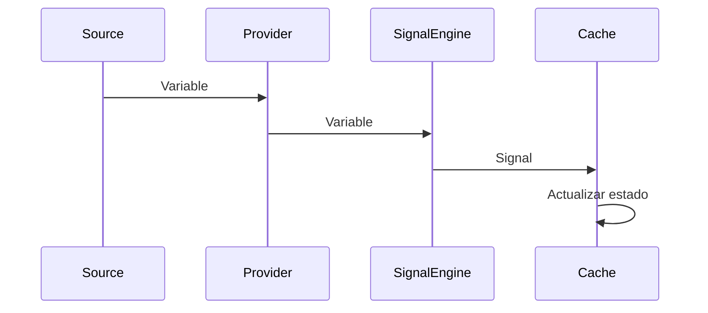

Cuando una Signal cambia, la Realtime Cache actualiza su estado y notifica al resto del sistema mediante eventos.

---

# Beneficios del Modelo

La separación entre Variables, Signals y Realtime Cache proporciona las siguientes ventajas.

- Independencia del protocolo de comunicación.
- Separación entre datos técnicos y datos de negocio.
- Acceso rápido al estado actual.
- Facilidad para generar históricos.
- Evaluación sencilla de alarmas.
- Escalabilidad.
- Reutilización de la información por distintos módulos.

---

# Decisión Arquitectónica

Toda la plataforma trabajará exclusivamente con **Signals**.

Las Variables representan información técnica obtenida desde un origen de datos.

La Realtime Cache representa el estado actual del sistema.

Ningún componente de la aplicación accederá directamente a Variables una vez hayan sido transformadas en Signals.

Este principio garantiza la independencia entre la adquisición de datos y el resto de la plataforma.

## 2.4 Data Providers

---

# Introducción

Los Data Providers son los componentes responsables de obtener información desde un origen de datos y transformarla en Variables que puedan ser procesadas por la plataforma.

Representan el único punto de entrada de información industrial hacia EWControl.

Gracias a esta capa, el resto de la aplicación permanece completamente independiente del protocolo de comunicación utilizado.

---

# Objetivo

El propósito de un Data Provider es muy sencillo.

1. Conectarse al origen de datos.
2. Leer o recibir cambios.
3. Convertir esos datos en Variables.
4. Enviarlas al Signal Engine.

No realiza ninguna otra tarea.

---

# Flujo General

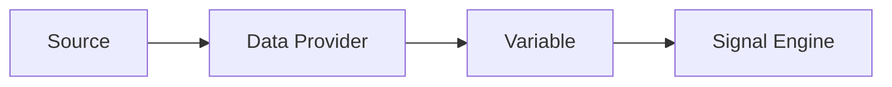

---

# Responsabilidades

Todo Data Provider deberá ser capaz de:

- Establecer conexión.
- Cerrar conexión.
- Detectar desconexiones.
- Recuperar la conexión automáticamente.
- Suscribirse a cambios de las variables.
- Publicar Variables al sistema.

No deberá:

- Calcular Signals.
- Evaluar alarmas.
- Guardar históricos.
- Enviar notificaciones.
- Acceder a la base de datos.

---

# Sources Soportados

La primera versión de EWControl contemplará dos posibles orígenes.

## Simulador

Será el proveedor utilizado durante el desarrollo del proyecto.

Generará valores automáticamente sin necesidad de disponer de un PLC real.

Permitirá desarrollar todo el backend y el frontend antes de conectarse a una máquina industrial.

El algoritmo de generación, las seeds por tipo de máquina, el aislamiento por Company y los mecanismos para forzar fallos controlados están especificados en el [Documento 10](10-simulador-datos-demo.md).

---

## Servidor OPC UA

Será el proveedor utilizado en producción.

Obtendrá los valores desde un servidor OPC UA utilizando **Subscriptions**, evitando consultas periódicas innecesarias.

El proveedor será responsable de mantener la conexión activa y detectar posibles pérdidas de comunicación.

El esquema de `ConnectionConfig` para OPC UA (endpoint, política de seguridad, mapeo de NodeId a Signal) y la traducción de su `StatusCode` a la calidad interna están especificados en el Documento 3, apartado 3.2.4.

---

# Modelo de Funcionamiento

Cada máquina tendrá asociado un único Data Provider.

```text
Máquina A
        │
        ▼
 SimulationProvider

Máquina B
        │
        ▼
 OpcUaProvider
```

El resto del sistema no conocerá qué proveedor está utilizando cada máquina.

---

# Variables Publicadas

Cada vez que un Data Provider detecte un cambio, generará una Variable.

Ejemplo:

| Campo | Valor |
|--------|-------|
| Nombre | Temperature |
| Valor | 24.8 |
| Tipo | Float |
| Timestamp | 2026-07-02 18:35:12 |
| Calidad | GOOD |

Estas Variables serán enviadas inmediatamente al Signal Engine.

---

# Reconexión Automática

Los Data Providers deberán gestionar automáticamente las pérdidas de conexión.

Cuando una máquina deje de responder:

1. Se marcará como desconectada.
2. Se registrará el evento.
3. Se iniciará un proceso de reconexión automática.
4. Cuando la comunicación se recupere, el sistema continuará funcionando sin intervención manual.

La lógica de reconexión pertenece exclusivamente al Data Provider.

---

# Gestión de Errores

Los errores producidos durante la comunicación con el origen de datos no deberán propagarse al resto del sistema.

El proveedor será responsable de:

- Registrar el error.
- Informar del estado de conexión.
- Continuar intentando recuperar la comunicación.

El dominio nunca deberá conocer los detalles del protocolo utilizado.

---

# Interfaz Común

Todos los Data Providers deberán implementar el mismo contrato.

```text
IDataProvider

connect()

disconnect()

subscribe()

unsubscribe()

isConnected()
```

Gracias a esta interfaz, el resto de la plataforma podrá trabajar con cualquier proveedor de forma transparente.

---

# Flujo Completo

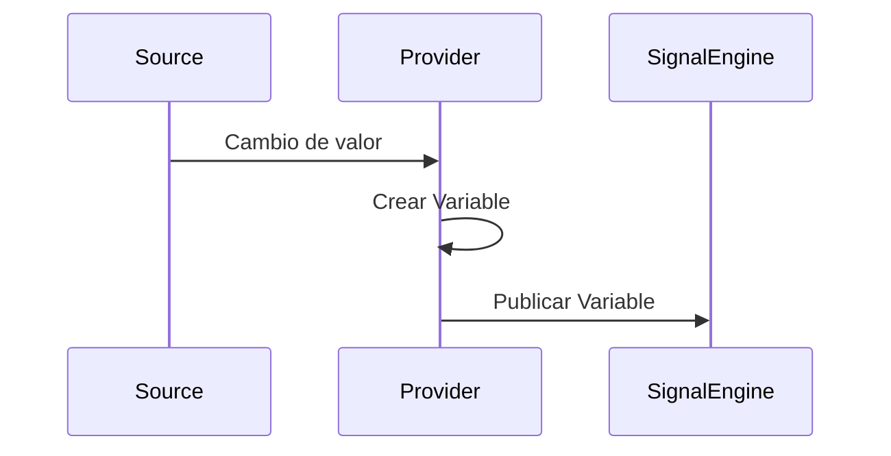

---

# Beneficios

La utilización de Data Providers aporta las siguientes ventajas.

- Independencia del protocolo de comunicación.
- Sustitución sencilla del origen de datos.
- Reutilización del núcleo de la aplicación.
- Facilidad para realizar pruebas mediante el simulador.
- Incorporación de nuevos protocolos sin modificar el dominio.

---

# Decisión Arquitectónica

Toda la información industrial deberá entrar en la plataforma a través de un Data Provider.

El dominio nunca accederá directamente a un PLC, un servidor OPC UA o cualquier otro sistema externo.

Esta decisión garantiza el desacoplamiento entre la adquisición de datos y la lógica de negocio, permitiendo evolucionar la plataforma sin afectar al núcleo de la aplicación.

## 2.5 Signal Engine

---

# Introducción

El Signal Engine es el núcleo de procesamiento de EWControl.

Su responsabilidad consiste en transformar las Variables recibidas desde los Data Providers en Signals que puedan ser utilizadas por el resto de la plataforma.

El Signal Engine representa la frontera entre la adquisición de datos y la lógica de negocio.

A partir de este punto, ningún componente trabajará directamente con Variables.

Toda la plataforma utilizará exclusivamente Signals.

---

# Objetivo

El Signal Engine tiene cuatro responsabilidades principales.

- Recibir Variables.
- Resolver la Signal asociada.
- Calcular su valor.
- Actualizar la Realtime Cache.

No realiza ninguna otra tarea.

---

# Flujo General

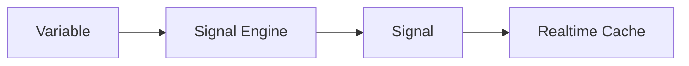

---

# Responsabilidades

El Signal Engine deberá ser capaz de:

- Recibir Variables.
- Identificar la Signal correspondiente.
- Calcular Signals de tipo DIRECT.
- Calcular Signals de tipo FORMULA.
- Validar tipos de datos.
- Actualizar el valor de la Signal.
- Enviar el resultado a la Realtime Cache.

No deberá:

- Guardar históricos.
- Evaluar alarmas.
- Enviar notificaciones.
- Acceder al Dashboard.
- Acceder a bases de datos.

---

# Tipos de Signals

En la primera versión existirán únicamente dos tipos.

## DIRECT

El valor de la Signal proviene directamente de una Variable.

Ejemplo

```
Signal

Temperatura

↓

Variable

Temperature
```

No existe ningún procesamiento adicional.

---

## FORMULA

El valor se obtiene aplicando una expresión sencilla sobre una o varias Variables.

Ejemplo

```
Potencia

=

Voltaje × Intensidad
```

Otro ejemplo

```
Producción Hora

=

Piezas × 60
```

Las expresiones estarán limitadas a operaciones simples.

No existirá un motor avanzado de dependencias.

---

# Resolución de una Signal

Cuando el Signal Engine recibe una Variable realiza el siguiente proceso.

```mermaid
flowchart TB

A[Variable]

↓

B[Buscar Signal]

↓

C{Tipo}

↓

D[DIRECT]

↓

E[FORMULA]

↓

F[Calcular Valor]

↓

G[Actualizar Signal]

↓

H[Realtime Cache]
```

---

# Validación

Antes de actualizar una Signal se comprobarán los siguientes aspectos.

- Tipo de dato.
- Calidad.
- Existencia de la Signal.
- Estado de la máquina.

Si la Variable no puede procesarse, el Signal Engine descartará la actualización y registrará el error correspondiente.

---

# Calidad del Dato

El Signal Engine mantendrá la calidad asociada a cada Signal.

Estados posibles.

| Estado | Descripción |
|---------|-------------|
| GOOD | Valor correcto |
| BAD | Error de lectura |
| UNCERTAIN | Valor poco fiable |
| OFFLINE | Máquina desconectada |

La calidad viajará siempre junto al valor.

---

# Ejemplo

Variable recibida

```
Temperature

25.4
```

Configuración

```
Signal

Temperatura

Tipo

DIRECT
```

Resultado

```
Signal

Temperatura

25.4
```

---

Otro ejemplo.

Variables

```
Voltage

230

Current

12
```

Configuración

```
Signal

Potencia

FORMULA

Voltage * Current
```

Resultado

```
Potencia

2760
```

---

# Errores

Si el cálculo de una Signal falla.

Ejemplos.

- División por cero.
- Variable inexistente.
- Tipo incorrecto.

El Signal Engine.

- Mantendrá el último valor válido.
- Actualizará la calidad.
- Registrará el error.
- Continuará procesando el resto de Signals.

Un error nunca deberá detener el procesamiento del resto de la plataforma.

---

# Rendimiento

El Signal Engine deberá procesar únicamente las Variables que cambien.

No realizará recálculos innecesarios.

Cada Variable será procesada de forma independiente.

Este comportamiento permite escalar el sistema a cientos de máquinas manteniendo un coste de procesamiento muy reducido.

---

# Flujo Completo

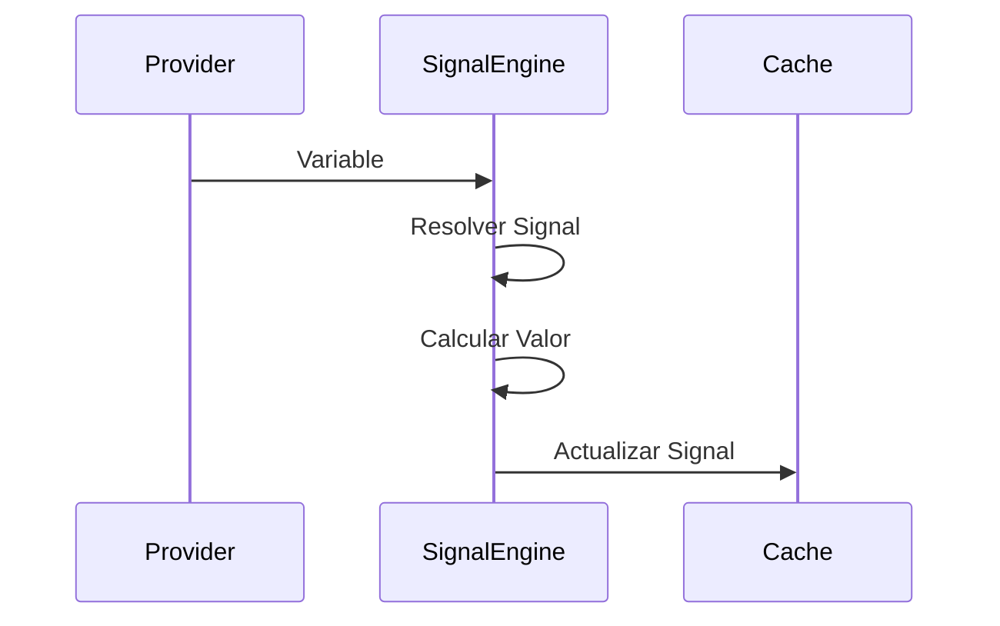

---

# Beneficios

El Signal Engine aporta las siguientes ventajas.

- Independencia entre adquisición y negocio.
- Transformación homogénea de la información.
- Centralización del cálculo.
- Reutilización de Signals.
- Simplicidad de mantenimiento.
- Alto rendimiento.

---

# Decisión Arquitectónica

El Signal Engine constituye el único componente autorizado para transformar Variables en Signals.

Ningún otro módulo del sistema realizará cálculos sobre Variables.

Este principio garantiza que toda la lógica de transformación permanezca centralizada, facilitando el mantenimiento y asegurando un comportamiento consistente en toda la plataforma.

## 2.6 Realtime Cache

---

# Introducción

La Realtime Cache es el componente encargado de mantener el estado actual de todas las Signals del sistema.

Representa la única fuente de información en tiempo real utilizada por el Dashboard, las alarmas y el resto de servicios de la plataforma.

Su objetivo es evitar consultas continuas al PLC y proporcionar acceso inmediato al último valor conocido de cada Signal.

---

# Objetivo

La Realtime Cache tiene una única responsabilidad:

> Mantener el estado actual de todas las Signals.

No calcula valores.

No obtiene datos del PLC.

No guarda históricos.

No evalúa alarmas.

Únicamente mantiene el estado más reciente de cada Signal.

---

# Flujo General

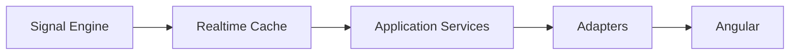

---

# Información almacenada

Cada Signal tendrá un único registro dentro de la Realtime Cache.

Como mínimo contendrá la siguiente información.

| Campo | Descripción |
|--------|-------------|
| signalId | Identificador único |
| value | Valor actual |
| quality | Estado del dato |
| timestamp | Fecha y hora del valor |
| updatedAt | Última actualización en la plataforma |

---

# Ejemplo

```
Signal

Temperatura
```

Estado actual

```json
{
  "signalId": 15,
  "value": 24.8,
  "quality": "GOOD",
  "timestamp": "2026-07-02T18:45:12Z",
  "updatedAt": "2026-07-02T18:45:12Z"
}
```

Siempre existirá un único estado por cada Signal.

---

# Actualización

Cuando el Signal Engine finaliza el procesamiento de una Variable:

1. Obtiene la Signal.
2. Calcula el nuevo valor.
3. Actualiza la Realtime Cache.
4. Publica el evento correspondiente.

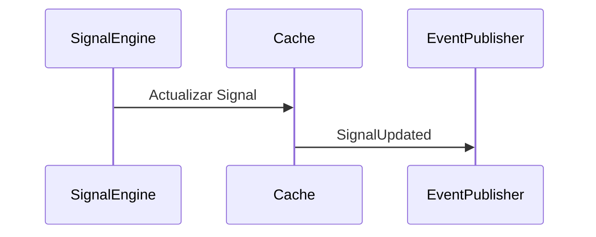

---

# Acceso

Todos los componentes que necesiten conocer el estado actual de una Signal deberán consultar la Realtime Cache.

Ejemplos:

- Dashboard
- Alarm Engine
- REST API
- WebSocket Adapter

Nunca accederán directamente al PLC.

---

# Gestión de Calidad

La Realtime Cache almacenará siempre la calidad asociada al valor.

Estados permitidos.

| Estado | Descripción |
|---------|-------------|
| GOOD | Valor válido |
| BAD | Error de lectura |
| UNCERTAIN | Valor recibido con advertencias |
| OFFLINE | Máquina sin comunicación |

La calidad formará parte del estado de la Signal.

---

# Gestión de Máquinas Desconectadas

Cuando un Data Provider detecte que una máquina ha perdido la comunicación:

- Las Signals conservarán el último valor conocido.
- La calidad cambiará a OFFLINE.
- Se actualizará el estado de la máquina.
- Se publicará el evento correspondiente.

Esto permitirá que el Dashboard siga mostrando el último valor recibido indicando claramente que la comunicación se ha perdido.

---

# Persistencia

La Realtime Cache es un componente de memoria.

No constituye una base de datos.

Su contenido podrá reconstruirse automáticamente a partir de nuevas lecturas procedentes de los Data Providers.

Por este motivo:

- No se realizarán copias de seguridad.
- No se almacenará en PostgreSQL.
- No se almacenará en InfluxDB.

---

# Rendimiento

La consulta de la Realtime Cache deberá realizarse en tiempo constante.

El acceso al estado actual de una Signal no dependerá del número de máquinas ni del volumen de históricos almacenados.

Esto garantiza tiempos de respuesta muy reducidos incluso con cientos de máquinas conectadas.

---

# Beneficios

La utilización de una Realtime Cache aporta las siguientes ventajas.

- Acceso inmediato al último valor.
- Eliminación de consultas innecesarias al PLC.
- Reducción de la carga sobre la infraestructura industrial.
- Compartición del estado entre múltiples servicios.
- Mejor experiencia de usuario en el Dashboard.

---

# Reglas Arquitectónicas

Durante el desarrollo deberán respetarse las siguientes reglas.

## Regla 1

Toda Signal tendrá un único estado dentro de la Realtime Cache.

---

## Regla 2

La Realtime Cache únicamente almacena el estado actual.

Nunca almacena históricos.

---

## Regla 3

El Dashboard siempre consultará la Realtime Cache.

Nunca accederá directamente al Data Provider.

---

## Regla 4

La actualización de la Realtime Cache únicamente podrá realizarla el Signal Engine.

Ningún otro componente podrá modificar su contenido.

---

## Regla 5

Cada actualización deberá generar el evento correspondiente para que el resto de la plataforma pueda reaccionar.

---

# Decisión Arquitectónica

La Realtime Cache constituye la fuente oficial del estado en tiempo real de la plataforma.

Todos los módulos que necesiten conocer el valor actual de una Signal deberán consultar este componente.

Esta decisión garantiza un acceso homogéneo a la información y desacopla completamente el resto del sistema de los protocolos industriales y de los Data Providers.

## 2.7 Sistema de Eventos

---

# Introducción

EWControl utiliza un sistema de eventos interno para comunicar los distintos componentes de la plataforma.

Este mecanismo permite desacoplar los módulos de negocio evitando dependencias directas entre ellos.

Cuando ocurre un cambio relevante en el sistema, se publica un evento que podrá ser procesado por uno o varios servicios interesados.

Esta estrategia simplifica el mantenimiento del código y facilita la incorporación de nuevas funcionalidades sin modificar los componentes existentes.

---

# Objetivo

El sistema de eventos tiene como finalidad:

- Reducir el acoplamiento entre módulos.
- Facilitar la evolución del sistema.
- Permitir que varios servicios reaccionen al mismo evento.
- Evitar llamadas directas entre componentes de negocio.

---

# Arquitectura

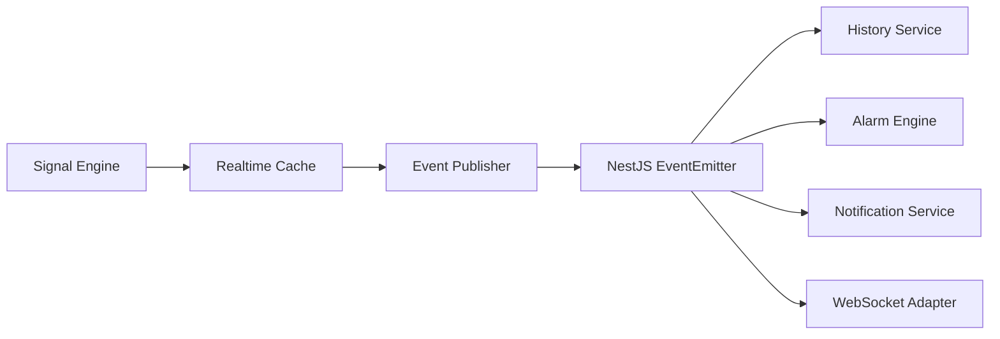

---

# Funcionamiento

Cada vez que la Realtime Cache actualiza una Signal:

1. Actualiza su estado.
2. Publica un evento.
3. El EventEmitter distribuye dicho evento.
4. Cada servicio decide si debe actuar.

El componente que genera el evento desconoce completamente quién lo recibirá.

---

# Event Publisher

La publicación de eventos se realizará siempre mediante un único componente denominado **Event Publisher**.

Su responsabilidad consiste en encapsular el uso del EventEmitter.

Ningún componente del dominio utilizará directamente el EventEmitter de NestJS.

Esta decisión permite sustituir el mecanismo de comunicación en el futuro sin modificar la lógica de negocio.

---

# Eventos Principales

En la primera versión del proyecto existirán los siguientes eventos.

| Evento | Descripción |
|----------|-------------|
| SignalUpdated | Una Signal ha sido actualizada |
| MachineConnected | La máquina ha establecido conexión |
| MachineDisconnected | La máquina ha perdido la comunicación |
| AlarmTriggered | Se ha activado una alarma |
| AlarmCleared | Una alarma ha sido resuelta |

Estos eventos cubren todas las necesidades funcionales de la primera versión.

---

# Flujo de una Actualización

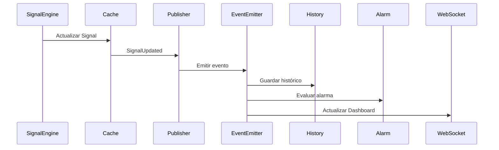

---

# Características

Los eventos publicados deberán cumplir las siguientes características.

- Ser inmutables.
- Contener toda la información necesaria.
- No depender del estado interno de otros componentes.
- Representar hechos ya ocurridos.

Un evento nunca solicitará una acción.

Únicamente informará de que algo ha sucedido.

---

# Ejemplo

Evento publicado.

```json
{
  "event": "SignalUpdated",
  "machineId": 8,
  "signalId": 15,
  "value": 24.8,
  "quality": "GOOD",
  "timestamp": "2026-07-02T19:00:00Z"
}
```

Cualquier servicio podrá reaccionar utilizando esta información.

---

# Ventajas

La utilización de eventos internos proporciona:

- Bajo acoplamiento.
- Mayor reutilización del código.
- Incorporación sencilla de nuevos servicios.
- Separación entre procesamiento y acciones posteriores.
- Código más fácil de mantener.

---

# Limitaciones

En esta primera versión el sistema de eventos será exclusivamente interno.

No persistirá eventos.

No garantizará entrega.

No implementará reintentos automáticos.

No sustituye una cola de mensajería.

Estas características no son necesarias para los requisitos actuales del proyecto.

---

# Evolución Futura

Si el crecimiento de la plataforma lo requiere, el Event Publisher permitirá sustituir el EventEmitter por otras tecnologías.

Ejemplos:

- RabbitMQ
- Kafka
- Azure Service Bus

El resto del sistema permanecerá inalterado.

---

# Reglas Arquitectónicas

## Regla 1

Todo evento representa un hecho ya ocurrido.

---

## Regla 2

Los componentes publican eventos.

Nunca invocan directamente otros servicios de negocio.

---

## Regla 3

Los consumidores de eventos son independientes entre sí.

La incorporación de un nuevo consumidor nunca requerirá modificar el productor.

---

## Regla 4

El dominio nunca utilizará directamente el EventEmitter.

Siempre utilizará el Event Publisher.

---

# Decisión Arquitectónica

El sistema de eventos constituye el mecanismo oficial de comunicación entre los componentes de la plataforma.

Toda interacción entre módulos deberá realizarse mediante eventos internos publicados a través del Event Publisher.

Esta decisión garantiza un bajo acoplamiento entre componentes y facilita la evolución futura de EWControl sin incrementar la complejidad de la primera versión.

## 2.8 Alarm Engine

---

# Introducción

El Alarm Engine es el componente encargado de supervisar continuamente el estado de las Signals y determinar si alguna de ellas incumple las condiciones definidas por el usuario.

Su función consiste en evaluar las reglas configuradas para cada Signal y generar los eventos correspondientes cuando una alarma se activa o se resuelve.

El Alarm Engine trabaja exclusivamente con Signals almacenadas en la Realtime Cache.

Nunca consulta directamente el PLC.

---

# Objetivo

El Alarm Engine tiene las siguientes responsabilidades.

- Evaluar las reglas de alarma.
- Detectar activaciones.
- Detectar recuperaciones.
- Evitar alarmas duplicadas.
- Mantener el estado actual de cada alarma.
- Publicar eventos cuando cambia el estado.

No realiza ninguna otra tarea.

---

# Flujo General

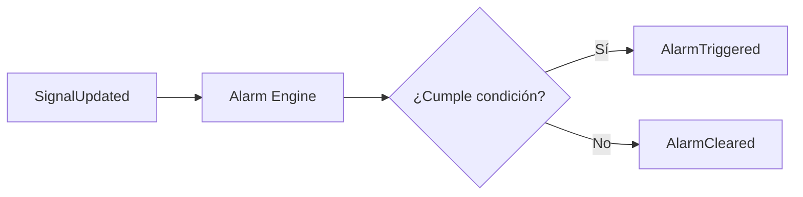

---

# Funcionamiento

Cada vez que una Signal cambia:

1. Se recibe el evento `SignalUpdated`.
2. Se obtienen las reglas configuradas para esa Signal.
3. Se evalúan las condiciones.
4. Se determina si el estado de la alarma cambia.
5. Si existe un cambio, se publica el evento correspondiente.

Si el estado no cambia, no se realiza ninguna acción.

---

# Estado de una Alarma

Cada alarma únicamente puede encontrarse en uno de los siguientes estados.

| Estado | Descripción |
|---------|-------------|
| INACTIVE | La condición no se cumple |
| ACTIVE | La condición se cumple |

El Alarm Engine mantendrá el estado actual de cada alarma para evitar generar eventos repetidos.

---

# Tipos de Condición

En la primera versión se soportarán los siguientes operadores.

| Operador | Ejemplo |
|-----------|----------|
| > | Temperatura > 80 |
| >= | Presión >= 10 |
| < | Nivel < 20 |
| <= | Voltaje <= 210 |
| == | Running == true |
| != | Estado != OK |

Estos operadores cubren la mayoría de escenarios industriales habituales.

---

# Ejemplo

Configuración.

| Signal | Operador | Valor |
|----------|-----------|-------|
| Temperatura | > | 80 |

Estado de la Signal.

```
Temperatura

84
```

Resultado.

```
Alarma

Temperatura Alta

Estado

ACTIVE
```

---

# Recuperación

Cuando la condición deja de cumplirse:

```
Temperatura

75
```

Resultado.

```
Estado

INACTIVE
```

En este momento el Alarm Engine publicará el evento `AlarmCleared`.

---

# Alarmas Duplicadas

Una alarma únicamente podrá activarse una vez mientras permanezca activa.

Ejemplo.

```
81

82

84

86
```

Aunque el valor cambie varias veces, únicamente se generará un evento `AlarmTriggered`.

El siguiente evento solo se producirá cuando la alarma vuelva al estado INACTIVE y posteriormente se active de nuevo.

---

# Calidad del Dato

Las reglas únicamente se evaluarán cuando la Signal tenga calidad GOOD.

Si la calidad es:

- BAD
- UNCERTAIN
- OFFLINE

la evaluación quedará suspendida hasta recibir un nuevo valor válido.

---

# Eventos Generados

El Alarm Engine podrá publicar los siguientes eventos.

| Evento | Descripción |
|----------|-------------|
| AlarmTriggered | La alarma se activa |
| AlarmCleared | La alarma vuelve a estado normal |

Estos eventos serán utilizados por otros servicios.

Ejemplos:

- Notification Service
- Histórico de Alarmas
- Dashboard

---

# Flujo Completo

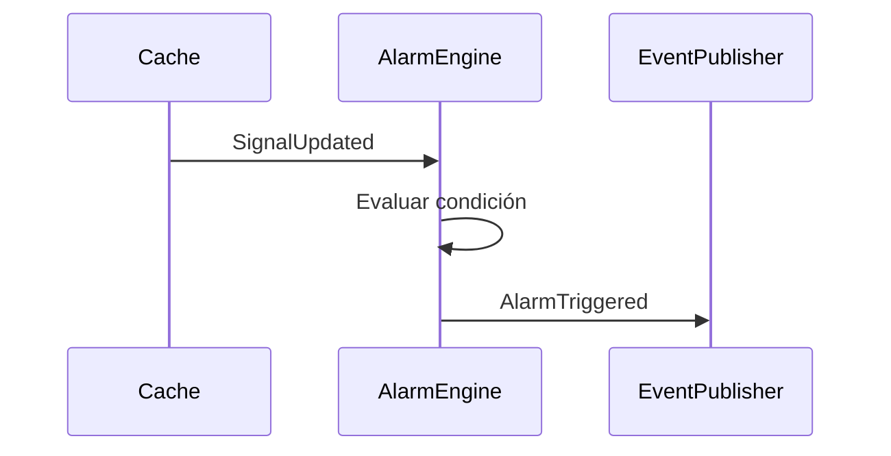

---

# Rendimiento

El Alarm Engine únicamente evaluará las alarmas asociadas a la Signal que ha cambiado.

Nunca recorrerá todas las alarmas del sistema.

Esta estrategia permite escalar la plataforma manteniendo un coste de procesamiento constante.

---

# Beneficios

El Alarm Engine proporciona:

- Evaluación automática.
- Evita alarmas duplicadas.
- Separación entre reglas y notificaciones.
- Alto rendimiento.
- Configuración dinámica por el usuario.

---

# Reglas Arquitectónicas

## Regla 1

El Alarm Engine nunca consulta el PLC.

---

## Regla 2

El Alarm Engine trabaja exclusivamente con Signals.

---

## Regla 3

Las alarmas únicamente se evaluarán cuando una Signal cambie.

---

## Regla 4

Una alarma activa no volverá a generar eventos hasta que haya sido resuelta.

---

## Regla 5

El Alarm Engine nunca enviará correos electrónicos ni mostrará mensajes al usuario.

Únicamente publicará eventos.

---

# Decisión Arquitectónica

El Alarm Engine constituye el único componente autorizado para evaluar las condiciones de alarma configuradas por los usuarios.

La generación de notificaciones, el almacenamiento histórico y la visualización de alarmas serán responsabilidades de otros módulos de la plataforma.

Esta separación garantiza un bajo acoplamiento y facilita la incorporación de nuevos canales de notificación sin modificar la lógica de evaluación.

## 2.9 History Service

---

# Introducción

El History Service es el componente encargado de almacenar el histórico de las Signals configuradas para ello.

Su responsabilidad consiste en recibir los eventos generados por el sistema, persistir los valores en la base de datos de series temporales y ejecutar las agregaciones definidas por la política de retención.

El History Service trabaja exclusivamente con Signals.

Nunca recibe Variables directamente desde un Data Provider.

---

# Objetivo

El History Service tiene las siguientes responsabilidades.

- Guardar históricos.
- Aplicar la política de retención.
- Generar agregaciones.
- Servir como origen para consultas históricas.

No realiza ninguna otra tarea.

---

# Flujo General

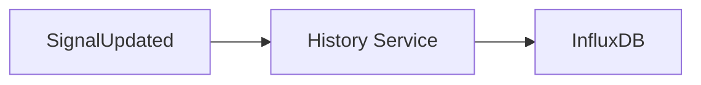

---

# ¿Qué Signals se almacenan?

No todas las Signals generan histórico.

Cada Signal podrá configurarse individualmente.

Ejemplo.

| Signal | Histórico |
|---------|-----------|
| Temperatura | Sí |
| Presión | Sí |
| Estado Motor | No |
| Producción | Sí |

Esta configuración será completamente dinámica.

---

# Frecuencia de almacenamiento

En la primera versión del proyecto:

- Las máquinas actualizarán datos cada segundo.
- Cada cambio generará un evento.
- Si la Signal tiene histórico habilitado, se almacenará el nuevo valor.

---

# Base de Datos

Los históricos se almacenarán exclusivamente en **InfluxDB**.

PostgreSQL no contendrá datos históricos.

La separación de responsabilidades será la siguiente.

| Base de datos | Información |
|---------------|-------------|
| PostgreSQL | Configuración |
| InfluxDB | Series temporales |

---

# Política de Retención

La plataforma utilizará una estrategia híbrida.

## Primer nivel

Se conservarán todos los valores durante siete días.

Resolución:

```
1 segundo
```

---

## Segundo nivel

A partir del séptimo día se conservará la media por minuto.

---

## Tercer nivel

Posteriormente se generará la media por hora.

---

## Cuarto nivel

Después se conservará la media diaria.

---

## Quinto nivel

Finalmente se conservará la media mensual.

---

# Agregaciones

Las agregaciones se ejecutarán automáticamente mediante tareas programadas.

Se calcularán las siguientes métricas.

- Media.
- Valor mínimo.
- Valor máximo.
- Último valor.

Estas métricas permitirán representar gráficos históricos sin necesidad de conservar todos los valores originales.

---

# Flujo de Agregación

```mermaid
flowchart LR

A[Datos cada segundo]

↓

B[Media minuto]

↓

C[Media hora]

↓

D[Media día]

↓

E[Media mes]
```

---

# Desconexión de Máquinas

Si una máquina pierde la comunicación:

- No se generarán nuevos históricos.
- Se registrará el evento de desconexión.
- El último valor permanecerá disponible en la Realtime Cache.

Cuando la conexión se recupere, el almacenamiento continuará automáticamente.

---

# Consultas Históricas

Las consultas de históricos siempre se realizarán sobre InfluxDB.

El Dashboard nunca consultará PostgreSQL para obtener datos históricos.

Las consultas podrán solicitar.

- Intervalo temporal.
- Resolución.
- Signal.
- Máquina.

---

# Ejemplo

Consulta.

```
Temperatura

Últimos 30 días
```

Resultado.

```
Media diaria
```

Consulta.

```
Temperatura

Últimas 6 horas
```

Resultado.

```
Datos por segundo
```

El usuario obtendrá automáticamente la resolución más adecuada según el rango solicitado.

---

# Rendimiento

El almacenamiento de históricos será completamente independiente del Dashboard y del Alarm Engine.

Un aumento del número de consultas históricas no afectará al procesamiento en tiempo real.

---

# Beneficios

El History Service proporciona:

- Históricos ilimitados.
- Alto rendimiento.
- Optimización del almacenamiento.
- Consultas rápidas.
- Separación entre tiempo real e histórico.

---

# Reglas Arquitectónicas

## Regla 1

Solo se almacenarán las Signals configuradas para histórico.

---

## Regla 2

Los históricos se almacenarán únicamente en InfluxDB.

---

## Regla 3

El History Service nunca accederá directamente al PLC.

---

## Regla 4

Las agregaciones se realizarán mediante tareas programadas.

---

## Regla 5

La resolución de las consultas dependerá del intervalo solicitado.

---

# Decisión Arquitectónica

El History Service constituye el único componente responsable de la persistencia de datos históricos.

Toda la información histórica se almacenará en InfluxDB utilizando una política de retención jerárquica que permita combinar precisión reciente con eficiencia en el almacenamiento a largo plazo.

Esta estrategia proporciona un equilibrio entre rendimiento, capacidad de almacenamiento y calidad de la información histórica.

## 2.10 Notification Service

---

# Introducción

El Notification Service es el componente encargado de gestionar el envío de notificaciones cuando ocurre un evento relevante dentro de la plataforma.

Su responsabilidad consiste en reaccionar a los eventos publicados por el sistema y utilizar el Adapter correspondiente para comunicar la información al usuario.

El Notification Service nunca evalúa alarmas ni consulta el estado de las máquinas.

Únicamente procesa eventos ya generados.

---

# Objetivo

El Notification Service tiene las siguientes responsabilidades.

- Escuchar eventos del sistema.
- Determinar si debe enviarse una notificación.
- Seleccionar el canal adecuado.
- Delegar el envío al Adapter correspondiente.
- Registrar el resultado del envío.

No realiza ninguna otra tarea.

---

# Flujo General

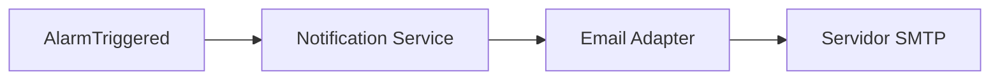

---

# Funcionamiento

Cuando el sistema publica un evento de alarma:

1. El Notification Service recibe el evento.
2. Comprueba la configuración de la alarma.
3. Determina si debe notificarse.
4. Selecciona el canal correspondiente.
5. Envía la información mediante el Adapter.

El servicio nunca conoce cómo se envía un correo electrónico.

Esa responsabilidad pertenece al Email Adapter.

---

# Eventos Procesados

En la primera versión se procesarán los siguientes eventos.

| Evento | Acción |
|----------|--------|
| AlarmTriggered | Enviar notificación |
| AlarmCleared | Actualizar estado (sin correo por defecto) |
| MachineDisconnected | Registrar evento (opcionalmente notificar) |

La lista podrá ampliarse en futuras versiones.

---

# Canales Disponibles

La primera versión incluirá un único canal.

| Canal | Estado |
|---------|--------|
| Email | Disponible |

La arquitectura permitirá incorporar nuevos canales sin modificar el Notification Service.

Ejemplos.

- Microsoft Teams
- Telegram
- SMS
- WhatsApp
- Slack
- Push Notifications

---

# Configuración

Cada alarma podrá definir su comportamiento.

Ejemplo.

| Opción | Valor |
|---------|-------|
| Mostrar en Dashboard | Sí |
| Guardar en histórico | Sí |
| Enviar email | Sí |

La configuración será completamente dinámica.

---

# Frecuencia de Envío

Para evitar el envío masivo de correos:

- La notificación se enviará únicamente cuando la alarma pase de INACTIVE a ACTIVE.
- Mientras la alarma permanezca activa no se enviarán nuevos correos.
- Cuando vuelva a estado normal podrá volver a notificarse en una futura activación.

---

# Contenido de una Notificación

Ejemplo.

```
Empresa

Metalúrgica López

Máquina

Prensa 01

Signal

Temperatura

Valor

84 °C

Límite

80 °C

Fecha

2026-07-02 18:45:22
```

El formato definitivo del correo se definirá durante el desarrollo del módulo de Email.

---

# Gestión de Errores

Si el envío falla:

- Se registrará el error.
- No se volverá a evaluar la alarma.
- El estado de la alarma permanecerá inalterado.

El fallo de una notificación nunca afectará al resto del sistema.

---

# Rendimiento

El envío de notificaciones deberá realizarse de forma asíncrona.

El Alarm Engine no esperará la finalización del envío del correo.

Esto evita bloquear el procesamiento de nuevas Signals.

---

# Flujo Completo

```mermaid
sequenceDiagram

participant AlarmEngine

participant EventPublisher

participant NotificationService

participant EmailAdapter

participant SMTP

AlarmEngine->>EventPublisher: AlarmTriggered

EventPublisher->>NotificationService: Evento

NotificationService->>EmailAdapter: Enviar correo

EmailAdapter->>SMTP: Email
```

---

# Beneficios

El Notification Service proporciona.

- Bajo acoplamiento.
- Facilidad para añadir nuevos canales.
- Procesamiento asíncrono.
- Separación entre reglas y comunicación.
- Mayor mantenibilidad.

---

# Reglas Arquitectónicas

## Regla 1

El Notification Service nunca evalúa alarmas.

---

## Regla 2

El Notification Service únicamente procesa eventos.

---

## Regla 3

Los canales de comunicación se implementan mediante Adapters.

---

## Regla 4

El fallo de una notificación nunca interrumpirá el funcionamiento del sistema.

---

## Regla 5

Las notificaciones solo se enviarán cuando cambie el estado de una alarma.

---

# Decisión Arquitectónica

El Notification Service constituye el único componente responsable de gestionar las notificaciones de la plataforma.

La lógica de evaluación permanecerá en el Alarm Engine, mientras que el envío de información al usuario se realizará exclusivamente mediante Adapters especializados.

Esta separación permite ampliar los canales de comunicación sin modificar el núcleo de la aplicación.

## 2.11 Adapters

---

# Introducción

Los Adapters constituyen la capa responsable de comunicar EWControl con sistemas externos.

Su función consiste en transformar la información entre el modelo interno de la plataforma y los distintos protocolos o tecnologías utilizadas por aplicaciones de terceros.

Los Adapters no contienen lógica de negocio.

Únicamente adaptan la información entre ambos mundos.

---

# Objetivo

Los Adapters tienen las siguientes responsabilidades.

- Recibir solicitudes externas.
- Obtener información desde la aplicación.
- Transformar los datos al formato requerido.
- Enviar respuestas o notificaciones.

Nunca realizan cálculos industriales.

Nunca modifican las reglas de negocio.

---

# Tipos de Adapters

La plataforma distingue dos tipos de adaptadores.

## Input Adapters

Permiten que aplicaciones externas interactúen con EWControl.

Ejemplos.

- REST API

---

## Output Adapters

Permiten enviar información desde EWControl hacia otros sistemas.

Ejemplos.

- WebSocket
- Email

En futuras versiones podrán incorporarse nuevos adaptadores sin modificar el dominio.

---

# Arquitectura

```mermaid
flowchart LR

A[Angular]

B[REST Adapter]

C[Application]

D[Domain]

E[Realtime Cache]

F[WebSocket Adapter]

G[Email Adapter]

A --> B

B --> C

C --> D

D --> E

E --> F

C --> G
```

---

# REST Adapter

El REST Adapter constituye el punto de entrada principal de la aplicación.

Su responsabilidad consiste en.

- Recibir peticiones HTTP.
- Validar la entrada.
- Invocar el caso de uso correspondiente.
- Transformar la respuesta.

Nunca implementará reglas de negocio.

El catálogo completo de endpoints, convenciones de paginación/error y reglas de autenticación está especificado en el [Documento 11](11-api-rest.md).

---

# WebSocket Adapter

El WebSocket Adapter proporciona información en tiempo real al Dashboard.

Obtendrá siempre los datos desde la Realtime Cache.

Nunca accederá al PLC.

Nunca realizará cálculos.

Cada actualización enviada al cliente procederá de un evento generado por la plataforma.

El contrato de eventos publicados por este Adapter (payload, autenticación del canal) está formalizado en el Documento 11, sección "WebSocket".

---

# Email Adapter

El Email Adapter encapsula toda la comunicación con el servidor SMTP.

Su responsabilidad consiste únicamente en enviar correos electrónicos.

El Notification Service delegará siempre el envío en este Adapter.

Esto permite sustituir fácilmente la tecnología utilizada sin modificar el resto del sistema.

---

# Flujo REST

```mermaid
sequenceDiagram

participant Angular

participant REST

participant Application

participant Domain

Angular->>REST: HTTP Request

REST->>Application: Caso de uso

Application->>Domain: Ejecutar

Domain-->>Application: Resultado

Application-->>REST: DTO

REST-->>Angular: JSON
```

---

# Flujo WebSocket

```mermaid
sequenceDiagram

participant Cache

participant EventEmitter

participant WebSocket

participant Angular

Cache->>EventEmitter: SignalUpdated

EventEmitter->>WebSocket: Evento

WebSocket->>Angular: Nuevo valor
```

---

# Flujo Email

```mermaid
sequenceDiagram

participant Notification

participant EmailAdapter

participant SMTP

Notification->>EmailAdapter: Enviar correo

EmailAdapter->>SMTP: Email
```

---

# Beneficios

La utilización de Adapters proporciona.

- Bajo acoplamiento.
- Independencia tecnológica.
- Sustitución sencilla de protocolos.
- Reutilización del dominio.
- Mayor facilidad de pruebas.

---

# Reglas Arquitectónicas

## Regla 1

Los Adapters nunca implementan lógica de negocio.

---

## Regla 2

Los Adapters nunca accederán directamente al PLC.

---

## Regla 3

Toda comunicación con sistemas externos se realizará mediante Adapters.

---

## Regla 4

Los Adapters transforman información.

Nunca la procesan.

---

## Regla 5

El dominio nunca conocerá la existencia de los Adapters.

---

# Evolución

La arquitectura permite incorporar nuevos adaptadores sin modificar el núcleo de la aplicación.

Ejemplos.

- Telegram Adapter
- Microsoft Teams Adapter
- SMS Adapter
- WhatsApp Adapter
- MQTT Adapter
- Export PDF Adapter
- Export Excel Adapter

Cada nuevo Adapter respetará las mismas responsabilidades definidas en este documento.

---

# Decisión Arquitectónica

Los Adapters constituyen la única capa autorizada para comunicar EWControl con aplicaciones externas.

Toda interacción con usuarios, sistemas o servicios de terceros deberá realizarse mediante un Adapter especializado.

Esta decisión garantiza la independencia del dominio respecto a tecnologías concretas y facilita la evolución futura de la plataforma.

## 2.12 Flujo Completo de la Plataforma

---

# Introducción

Una vez definidos todos los componentes de la arquitectura, este capítulo describe el recorrido completo que realiza un dato desde que se genera en una máquina hasta que es visualizado por el usuario.

El objetivo es comprender cómo colaboran los distintos módulos de EWControl respetando las responsabilidades definidas en los capítulos anteriores.

---

# Flujo General

Todo dato seguirá siempre el mismo recorrido.

```mermaid
flowchart LR

A[PLC / Simulador]

B[Data Provider]

C[Variable]

D[Signal Engine]

E[Signal]

F[Realtime Cache]

G[Event Publisher]

H[NestJS EventEmitter]

I[Alarm Engine]

J[History Service]

K[Notification Service]

L[WebSocket Adapter]

M[Angular Dashboard]

A --> B
B --> C
C --> D
D --> E
E --> F
F --> G
G --> H

H --> I
H --> J
H --> K
H --> L

L --> M
```

---

# Paso 1 - Adquisición

El proceso comienza cuando una máquina genera un nuevo valor.

El origen puede ser:

- Simulador.
- Servidor OPC UA.

El Data Provider recibe la información y crea una Variable.

Ejemplo.

```
Temperature

24.8
```

---

# Paso 2 - Procesamiento

La Variable se envía al Signal Engine.

El Signal Engine:

- Identifica la Signal correspondiente.
- Calcula su valor.
- Valida el tipo de dato.
- Mantiene la calidad asociada.

Como resultado obtiene una Signal lista para ser utilizada por el resto del sistema.

---

# Paso 3 - Actualización

La Signal se almacena en la Realtime Cache.

Si la Signal ya existía:

- Se actualiza su valor.
- Se actualiza el timestamp.
- Se actualiza la calidad.

La Realtime Cache mantiene siempre un único estado para cada Signal.

---

# Paso 4 - Publicación

Tras actualizar la Realtime Cache se publica un evento.

Ejemplo.

```
SignalUpdated
```

Este evento representa un hecho ya ocurrido.

No solicita ninguna acción.

Únicamente informa de que la plataforma ha cambiado de estado.

---

# Paso 5 - Procesamiento Paralelo

Todos los servicios interesados reciben el mismo evento.

```mermaid
flowchart TB

SignalUpdated

↓

NestJS EventEmitter

↓

History Service

Alarm Engine

Notification Service

WebSocket Adapter
```

Cada componente trabaja de forma independiente.

El productor del evento desconoce quién lo recibirá.

---

# Paso 6 - Históricos

Si la Signal tiene histórico habilitado:

- Se almacena en InfluxDB.
- Posteriormente se aplicarán las políticas de agregación definidas por el Scheduler.

Las consultas históricas nunca utilizarán la Realtime Cache.

---

# Paso 7 - Alarmas

El Alarm Engine evalúa únicamente las alarmas asociadas a la Signal modificada.

Si cambia el estado:

```
INACTIVE

↓

ACTIVE
```

se publica un nuevo evento.

```
AlarmTriggered
```

---

# Paso 8 - Notificaciones

El Notification Service escucha los eventos de alarma.

Si la configuración de la alarma lo requiere:

- Selecciona los destinatarios.
- Utiliza el Email Adapter.
- Envía la notificación.

El Alarm Engine nunca envía correos directamente.

---

# Paso 9 - Dashboard

El WebSocket Adapter recibe el evento correspondiente.

Obtiene el estado actualizado desde la Realtime Cache.

Envía únicamente la información necesaria al cliente conectado.

Angular actualiza automáticamente el Dashboard.

El navegador nunca consulta directamente el PLC.

---

# Flujo de una Actualización

```mermaid
sequenceDiagram

participant PLC

participant Provider

participant SignalEngine

participant Cache

participant EventPublisher

participant EventEmitter

participant History

participant Alarm

participant Notification

participant WebSocket

participant Angular

PLC->>Provider: Nuevo valor

Provider->>SignalEngine: Variable

SignalEngine->>Cache: Signal

Cache->>EventPublisher: SignalUpdated

EventPublisher->>EventEmitter: Publicar evento

EventEmitter->>History: Guardar histórico

EventEmitter->>Alarm: Evaluar reglas

Alarm->>EventPublisher: AlarmTriggered

EventPublisher->>EventEmitter: Publicar evento

EventEmitter->>Notification: Notificar

EventEmitter->>WebSocket: Actualizar Dashboard

WebSocket->>Angular: Nuevo valor
```

---

# Flujo durante una Desconexión

Cuando un Data Provider pierde la comunicación con una máquina:

1. Se detecta la desconexión.
2. La máquina pasa a estado OFFLINE.
3. Las Signals conservan el último valor conocido.
4. Se publica el evento `MachineDisconnected`.
5. El Dashboard refleja el nuevo estado.
6. El Data Provider inicia automáticamente la reconexión.

Cuando la comunicación se recupera, el procesamiento continúa de forma automática.

---

# Flujo de Consulta Histórica

Cuando un usuario solicita un gráfico histórico:

1. Angular realiza una petición REST.
2. El REST Adapter invoca el caso de uso correspondiente.
3. El History Service consulta InfluxDB.
4. Los datos se transforman al formato requerido.
5. Angular representa la información.

Los históricos nunca se obtienen desde la Realtime Cache.

---

# Resumen de Responsabilidades

| Componente | Responsabilidad |
|------------|-----------------|
| Data Provider | Obtener datos del origen |
| Signal Engine | Transformar Variables en Signals |
| Realtime Cache | Mantener el estado actual |
| Event Publisher | Publicar eventos |
| Alarm Engine | Evaluar reglas |
| History Service | Guardar históricos |
| Notification Service | Gestionar notificaciones |
| Adapters | Comunicar con sistemas externos |
| Angular | Representar la información |

---

# Principios Fundamentales

Durante toda la ejecución del sistema se mantienen los siguientes principios.

- El PLC nunca es consultado directamente por el Dashboard.
- Toda la lógica industrial reside en el backend.
- Las Signals constituyen la unidad de información de la plataforma.
- La comunicación entre componentes se realiza mediante eventos.
- Los Adapters son la única vía de comunicación con el exterior.
- Cada componente mantiene una única responsabilidad.

---

# Decisión Arquitectónica

Toda la plataforma seguirá el flujo descrito en este documento.

Cualquier nueva funcionalidad deberá integrarse respetando este recorrido y las responsabilidades definidas para cada componente.

Este principio garantiza la coherencia de la arquitectura, facilita el mantenimiento del código y permite que EWControl evolucione de forma controlada sin comprometer la estabilidad del sistema.