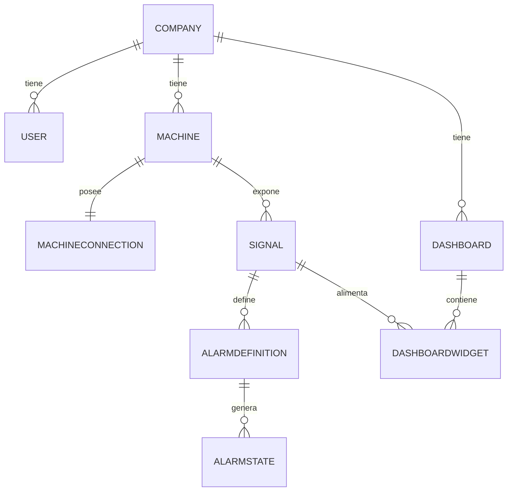

# Documento 3
# Modelo del Dominio

3.1 Introducción

3.2 Modelo del Dominio

    3.2.1 Company
    3.2.2 User
    3.2.3 Machine
    3.2.4 MachineConnection
    3.2.5 Signal
    3.2.6 AlarmDefinition
    3.2.7 AlarmState
    3.2.8 Dashboard
    3.2.9 DashboardWidget

3.3 Relaciones del Dominio

3.4 Value Objects

    ConnectionConfig
    SignalSource
    WidgetConfig

3.5 Enumeraciones del Dominio

    UserRole
    ProviderType
    SignalType
    AlarmPriority
    AlarmStateType
    WidgetType

3.6 Reglas Generales del Dominio

3.7 Decisiones Arquitectónicas

3.8 Evolución del Modelo

---

# 3.1 Introducción

## Objetivo

El presente documento define el modelo de dominio de EWControl.

Su propósito es describir los conceptos de negocio que forman parte de la plataforma, las relaciones existentes entre ellos y las reglas que gobiernan su comportamiento.

Este documento constituye la referencia principal para el desarrollo del Backend y del Frontend, garantizando que ambas capas compartan el mismo lenguaje y las mismas reglas de negocio.

El modelo descrito aquí es independiente de cualquier tecnología de persistencia, protocolo industrial o framework utilizado durante la implementación.

---

## Alcance

El documento define exclusivamente el dominio funcional de la aplicación.

No describe la arquitectura software, las comunicaciones entre servicios ni el modelo físico de bases de datos.

Estos aspectos se documentan en documentos independientes.

En este documento se modelan únicamente los conceptos propios del negocio.

---

## Principios de Diseño

El modelo del dominio se ha construido siguiendo una serie de principios que servirán como guía durante todo el desarrollo del proyecto.

### Separación entre dominio e infraestructura

El dominio nunca dependerá de tecnologías concretas.

Conceptos como OPC UA, PostgreSQL, InfluxDB, WebSockets o Angular pertenecen a la infraestructura y podrán cambiar sin afectar al modelo de negocio.

---

### Responsabilidad única

Cada entidad del dominio tendrá una única responsabilidad claramente definida.

Las entidades describen conceptos del negocio.

La lógica de ejecución pertenecerá a los servicios de aplicación.

---

### Bajo acoplamiento

Las entidades estarán desacopladas entre sí siempre que sea posible.

Cada entidad conocerá únicamente la información necesaria para cumplir su responsabilidad.

Este principio facilita la evolución del sistema y reduce el impacto de futuros cambios.

---

### Configuración sobre implementación

La plataforma se construirá mediante configuraciones.

Los usuarios definirán qué máquinas monitorizar, qué señales utilizar, qué históricos almacenar, qué alarmas generar y cómo visualizar la información.

La aplicación interpretará dichas configuraciones sin necesidad de modificar código.

---

### Independencia del protocolo industrial

El dominio nunca trabajará directamente con protocolos industriales.

Las entidades desconocen si la información proviene de OPC UA, MQTT, Modbus o cualquier otra fuente.

La obtención de datos será responsabilidad de los Adapters definidos en el Documento 2.

---

### Independencia del almacenamiento

El dominio tampoco conoce cómo se almacenan los datos.

Las entidades no dependen de PostgreSQL, InfluxDB ni de ningún otro sistema de persistencia.

La infraestructura decidirá dónde almacenar cada tipo de información.

---

### Separación entre configuración y ejecución

El modelo distingue claramente entre la configuración del sistema y su estado de ejecución.

Ejemplos.

- Machine representa una máquina industrial.
- MachineConnection define cómo conectarse a ella.
- Signal define un dato industrial.
- El valor actual de la Signal pertenece a la Realtime Cache.
- AlarmDefinition define una regla.
- AlarmState representa el resultado de dicha regla.

Esta separación permite mantener un dominio estable mientras el sistema procesa información en tiempo real.

---

## Modelo del Dominio

El dominio de EWControl se compone de nueve entidades principales.

- Company
- User
- Machine
- MachineConnection
- Signal
- AlarmDefinition
- AlarmState
- Dashboard
- DashboardWidget

Estas entidades representan los conceptos fundamentales del negocio y constituyen la base sobre la que se desarrollarán el resto de componentes de la plataforma.

---

## Value Objects

Además de las entidades principales, el dominio incorpora varios Value Objects que encapsulan información técnica o configuraciones específicas.

En la primera versión del sistema se definen los siguientes.

- ConnectionConfig
- SignalSource
- WidgetConfig

Estos objetos no poseen identidad propia y únicamente existen como parte de otra entidad.

---

## Enumeraciones

El dominio utiliza diferentes enumeraciones para limitar determinados valores y facilitar la evolución del modelo.

Entre ellas.

- UserRole
- ProviderType
- SignalType
- AlarmPriority
- AlarmStateType
- WidgetType

Estas enumeraciones serán desarrolladas en los apartados posteriores del documento.

---

## Objetivos del Modelo

El modelo de dominio ha sido diseñado para cumplir los siguientes objetivos.

- Mantener independencia respecto a la infraestructura.
- Facilitar la incorporación de nuevos protocolos industriales.
- Permitir la configuración dinámica de máquinas y señales.
- Soportar adquisición de datos en tiempo real.
- Gestionar históricos y alarmas de forma desacoplada.
- Facilitar la evolución futura del sistema sin modificar el núcleo del dominio.

---

## Relación con el resto de la documentación

Este documento complementa al resto de documentos del proyecto.

- Documento 0 — Metodología y Calidad.
- Documento 1 — Visión General del Producto.
- Documento 2 — Arquitectura del Sistema.
- Documento 4 — Persistencia de Datos (PostgreSQL e InfluxDB).
- Documento 5 — Despliegue e Infraestructura.
- Documento 6 — Seguridad Global.
- Documento 7 — Observabilidad y Monitorización.
- Documento 8 — Frontend Dashboard (Angular).
- Documento 9 — Conclusión y Visión Global.
- Documento 10 — Simulador y Datos Demo.
- Documento 11 — API REST.

Todos los documentos posteriores tomarán este modelo como referencia principal.

---

## Decisión Arquitectónica

El modelo del dominio constituye el núcleo funcional de EWControl.

Las entidades representan exclusivamente conceptos de negocio y permanecen completamente desacopladas de protocolos industriales, tecnologías de almacenamiento y frameworks de desarrollo.

Esta separación garantiza que la evolución de la infraestructura no afecte a las reglas fundamentales del negocio y permite que la plataforma pueda crecer de forma progresiva sin comprometer la estabilidad del dominio.

# 3.2 Modelo del Dominio

## Objetivo

El modelo del dominio representa los conceptos principales sobre los que se construye EWControl.

Cada entidad refleja un elemento real del negocio y posee una responsabilidad claramente definida.

El objetivo del modelo es proporcionar una representación estable del dominio, independiente de la tecnología utilizada para su implementación.

Todas las funcionalidades de la plataforma se apoyan sobre este modelo.

---

## Principios del Modelo

El dominio de EWControl se ha diseñado siguiendo una serie de principios que garantizan un modelo limpio, mantenible y preparado para evolucionar.

### Identidad propia

Cada entidad representa un concepto único dentro del sistema.

Su identidad permanece constante durante todo su ciclo de vida, independientemente de los cambios que puedan producirse en su configuración.

Por ejemplo, una Machine seguirá siendo la misma aunque cambie su dirección IP o el protocolo utilizado para comunicarse con ella.

---

### Relaciones explícitas

Las relaciones entre entidades representan vínculos reales del negocio.

Cada relación tiene un propósito definido y evita dependencias innecesarias entre los distintos componentes del sistema.

---

### Separación de responsabilidades

Cada entidad tiene una única responsabilidad.

Las entidades describen el dominio.

Los servicios ejecutan la lógica.

Los Adapters obtienen información del exterior.

La infraestructura almacena los datos.

Esta separación reduce el acoplamiento y facilita el mantenimiento de la aplicación.

---

### Configuración frente a estado

El dominio diferencia claramente entre la configuración del sistema y su estado de ejecución.

Ejemplos.

- Machine describe una máquina.
- MachineConnection describe cómo conectarse a ella.
- Signal describe un dato industrial.
- El valor actual pertenece a la Realtime Cache.
- AlarmDefinition describe una regla.
- AlarmState representa el resultado de evaluarla.

Gracias a esta separación, el dominio permanece estable mientras el sistema procesa datos en tiempo real.

---

## Entidades del Dominio

El dominio está compuesto por nueve entidades principales.

| Entidad | Responsabilidad |
|----------|-----------------|
| Company | Representa una empresa que utiliza la plataforma |
| User | Representa un usuario autenticado dentro de una Company |
| Machine | Representa un activo industrial monitorizado |
| MachineConnection | Define cómo acceder a la Machine |
| Signal | Representa un dato industrial configurable |
| AlarmDefinition | Define una regla de supervisión |
| AlarmState | Representa el estado e histórico de una alarma |
| Dashboard | Define una vista de supervisión |
| DashboardWidget | Representa un elemento visual del Dashboard |

Cada una de estas entidades será desarrollada en los siguientes apartados.

---

## Organización del Dominio

Las entidades pueden agruparse según su responsabilidad dentro del sistema.

### Gestión empresarial

Responsables de la organización y el control de acceso.

- Company
- User

---

### Dominio industrial

Representan los activos monitorizados y los datos obtenidos desde ellos.

- Machine
- MachineConnection
- Signal

---

### Supervisión

Gestionan la detección y seguimiento de incidencias.

- AlarmDefinition
- AlarmState

---

### Visualización

Definen cómo se presenta la información al usuario.

- Dashboard
- DashboardWidget

---

## Flujo Conceptual del Dominio

De forma simplificada, el funcionamiento del dominio puede entenderse mediante el siguiente flujo.

```text
Company
    │
    ├── Users
    │
    ├── Machines
    │      │
    │      ├── MachineConnection
    │      │
    │      └── Signals
    │              │
    │              ├── AlarmDefinitions
    │              │        │
    │              │        └── AlarmStates
    │              │
    │              └── DashboardWidgets
    │
    └── Dashboards
            │
            └── DashboardWidgets
```

Este esquema muestra únicamente las relaciones principales del dominio.

Las cardinalidades y reglas de negocio se desarrollarán en los siguientes apartados.

---

## Relación con la Arquitectura

El modelo del dominio constituye el núcleo de la plataforma.

Los componentes descritos en el Documento 2 interactúan con estas entidades sin modificar su responsabilidad.

- Los Adapters obtienen datos del exterior.
- El Signal Engine procesa las Signals.
- El Alarm Engine evalúa las AlarmDefinitions.
- El History Service almacena históricos.
- El Notification Service envía notificaciones.
- La Realtime Cache mantiene el estado temporal de la aplicación.

Ninguno de estos componentes altera el modelo del dominio.

---

## Decisión Arquitectónica

El modelo del dominio se organiza alrededor de la entidad **Signal**, que constituye el punto de unión entre la adquisición de datos, el procesamiento, la generación de alarmas, el almacenamiento histórico y la visualización.

Esta decisión permite desacoplar completamente el dominio de la infraestructura y facilita la incorporación de nuevas funcionalidades sin modificar las entidades principales del sistema.

## 3.2.1 Company

### Introducción

La entidad **Company** representa una empresa que utiliza la plataforma EWControl.

Constituye el límite organizativo y de seguridad de la aplicación, agrupando todos los recursos pertenecientes a una misma organización.

Toda la información gestionada por la plataforma pertenece siempre a una única Company.

Una Company no representa un cliente comercial ni una licencia del sistema.

Representa el espacio de trabajo donde una organización administra sus máquinas, usuarios y configuraciones.

---

### Objetivo

La finalidad de Company es establecer el contexto empresarial sobre el que opera la plataforma.

Toda la información del dominio se organiza a partir de esta entidad, garantizando el aislamiento entre empresas y evitando que los recursos puedan compartirse entre organizaciones distintas.

---

### Responsabilidades

Company es responsable de:

- Representar una empresa dentro de la plataforma.
- Agrupar todos los recursos pertenecientes a dicha empresa.
- Delimitar el ámbito de acceso de los usuarios.
- Actuar como raíz del dominio para el aislamiento multiempresa.

No es responsable de:

- Gestionar usuarios.
- Gestionar máquinas.
- Procesar datos industriales.
- Gestionar alarmas.
- Almacenar históricos.

Estas responsabilidades pertenecen a otras entidades o servicios del sistema.

---

### Relaciones

Cada Company puede contener:

- Muchos Users.
- Muchas Machines.
- Muchos Dashboards.

A través de las Machines se accede al resto del dominio industrial:

- Signals.
- AlarmDefinitions.
- AlarmStates.

Todas las entidades del sistema pertenecen, directa o indirectamente, a una única Company.

---

### Ciclo de Vida

Una Company es creada por un SuperAdmin durante el alta de un nuevo cliente.

Una vez creada podrá:

- Incorporar usuarios.
- Registrar máquinas.
- Configurar dashboards.
- Configurar señales y alarmas.

La desactivación de una Company impedirá el acceso a todos sus recursos sin necesidad de eliminarlos físicamente.

---

### Reglas del Dominio

**Regla 1**

Toda entidad del dominio pertenece a una única Company.

---

**Regla 2**

Ningún usuario puede acceder a recursos pertenecientes a otra Company.

---

**Regla 3**

Las relaciones entre entidades de distintas Companies no están permitidas.

---

**Regla 4**

Company constituye el límite de seguridad del sistema.

---

### Evolución

El modelo permite incorporar futuras funcionalidades sin modificar la responsabilidad principal de la entidad.

Por ejemplo:

- Múltiples plantas (`Site`).
- Configuración regional.
- Idioma por empresa.
- Preferencias corporativas.
- Integraciones externas.

Estas capacidades podrán añadirse manteniendo el mismo modelo de dominio.

---

### Decisión Arquitectónica

Company es la **Aggregate Root** principal del contexto organizativo.

Toda la seguridad de la plataforma se basa en esta entidad.

Cada petición autenticada se ejecutará siempre dentro del contexto de una Company, garantizando el aislamiento entre empresas y simplificando la implementación de la autorización y el filtrado de datos.

## 3.2.2 User

### Introducción

La entidad **User** representa una persona autorizada para utilizar la plataforma EWControl.

Todo User pertenece a una única Company y desarrolla su actividad exclusivamente dentro del contexto de dicha empresa.

El usuario constituye la identidad funcional desde la que se realizan todas las operaciones sobre el sistema.

---

### Objetivo

La finalidad de User es representar a las personas que interactúan con la plataforma.

El usuario determina quién realiza una acción y qué operaciones puede ejecutar dentro de su Company.

La autenticación y la gestión de sesiones pertenecen a la infraestructura de la aplicación y no forman parte del dominio.

---

### Responsabilidades

User es responsable de:

- Representar una identidad dentro de la plataforma.
- Pertenecer a una Company.
- Disponer de uno o varios roles.
- Ser propietario de sus preferencias funcionales.

No es responsable de:

- Gestionar máquinas.
- Procesar Signals.
- Evaluar alarmas.
- Gestionar conexiones industriales.

Estas responsabilidades pertenecen a otras entidades o servicios.

---

### Roles

En la primera versión del sistema existirán dos roles.

| Rol | Descripción |
|------|-------------|
| SuperAdmin | Administración completa de la plataforma. |
| AdminCliente | Administración de los recursos de su Company. |

El modelo permitirá incorporar nuevos roles sin modificar la estructura de la entidad.

Ejemplos futuros:

- Operador.
- Técnico de mantenimiento.
- Supervisor.
- Usuario de solo lectura.

---

### Relaciones

Todo User pertenece a una única Company.

Una Company puede ser propietaria de múltiples Users.

Un User podrá:

- Configurar Machines.
- Configurar Signals.
- Configurar AlarmDefinitions.
- Configurar Dashboards.

Estas acciones quedarán registradas por los servicios de aplicación cuando sea necesario.

---

### Ciclo de Vida

Un User es creado por un administrador autorizado.

Durante su ciclo de vida podrá:

- Modificar su información personal.
- Cambiar sus preferencias.
- Cambiar su contraseña mediante los servicios de autenticación.
- Ser deshabilitado.
- Ser reactivado.

La eliminación física de usuarios no forma parte de la primera versión de la plataforma.

---

### Reglas del Dominio

**Regla 1**

Todo User pertenece a una única Company.

---

**Regla 2**

Todo User dispone de al menos un rol.

---

**Regla 3**

Un User nunca podrá operar fuera del contexto de su Company.

---

**Regla 4**

Los permisos de un User vendrán determinados por sus roles.

---

### Evolución

La entidad permitirá incorporar nuevas funcionalidades sin modificar su responsabilidad principal.

Por ejemplo:

- Preferencias de idioma.
- Zona horaria.
- Dashboard por defecto.
- Avatar.
- Auditoría de actividad.
- Autenticación multifactor (MFA).

Estas capacidades podrán añadirse sin alterar el modelo del dominio.

---

### Decisión Arquitectónica

User representa la identidad funcional de una persona dentro de la plataforma.

La entidad permanece completamente desacoplada de los mecanismos de autenticación, autorización y gestión de sesiones, permitiendo sustituir la infraestructura de seguridad sin afectar al modelo de negocio.

Esta separación mantiene el dominio limpio y facilita la evolución futura del sistema.

## 3.2.3 Machine

### Introducción

La entidad **Machine** representa un activo industrial monitorizado por la plataforma.

Es la unidad principal sobre la que se organiza la adquisición de datos, la supervisión, la generación de alarmas y la visualización de información.

Machine representa la máquina que el cliente desea controlar.

No representa un PLC, un servidor OPC UA ni un protocolo de comunicación.

---

### Objetivo

La finalidad de Machine es agrupar toda la información funcional relacionada con un activo industrial.

Cada Machine actúa como el contexto donde se definen las Signals que serán monitorizadas y, a partir de ellas, se construyen el resto de funcionalidades del sistema.

---

### Responsabilidades

Machine es responsable de:

- Representar un activo industrial.
- Agrupar las Signals asociadas.
- Servir de contexto para alarmas e históricos.
- Mantener su configuración funcional.

No es responsable de:

- Establecer conexiones.
- Obtener datos del PLC.
- Procesar valores en tiempo real.
- Gestionar estados de comunicación.

Estas responsabilidades pertenecen a MachineConnection y a los servicios de adquisición de datos.

---

### Relaciones

Toda Machine pertenece a una única Company.

Cada Company puede ser propietaria de múltiples Machines.

Cada Machine posee:

- Una MachineConnection.
- Muchas Signals.

A través de las Signals se relaciona indirectamente con:

- AlarmDefinitions.
- AlarmStates.
- DashboardWidgets.

Machine no conoce estas entidades de forma directa.

---

### Ciclo de Vida

Una Machine es creada por un administrador de la Company.

Posteriormente podrá:

- Configurar su conexión.
- Crear Signals.
- Configurar alarmas.
- Incorporarse a uno o varios Dashboards.
- Consultar históricos.

La eliminación de una Machine implicará la eliminación lógica o desactivación de todos los elementos asociados, según la política definida por la plataforma.

---

### Reglas del Dominio

**Regla 1**

Toda Machine pertenece a una única Company.

---

**Regla 2**

Toda Machine dispone de una única MachineConnection.

---

**Regla 3**

Toda Signal pertenece a una única Machine.

---

**Regla 4**

Machine representa un activo industrial, independientemente de la tecnología utilizada para comunicarse con él.

---

**Regla 5**

Los cambios en la configuración de conexión no modifican la identidad de la Machine.

---

### Evolución

El modelo permite ampliar la información asociada a una Machine sin modificar su responsabilidad principal.

Ejemplos:

- Fabricante.
- Modelo.
- Número de serie.
- Año de fabricación.
- Ubicación física.
- Manuales técnicos.
- Etiquetas.
- Planes de mantenimiento.

En futuras versiones también será posible introducir una entidad `Site` para representar múltiples plantas o centros de producción dentro de una misma Company, manteniendo intacta la estructura del dominio.

---

### Decisión Arquitectónica

Machine es la **Aggregate Root** del dominio industrial.

Toda la información técnica relacionada con un activo industrial se organiza alrededor de esta entidad.

La separación entre Machine y MachineConnection desacopla el modelo de negocio de la infraestructura de comunicaciones, permitiendo modificar protocolos, direcciones o configuraciones sin afectar al resto del sistema.

Las entidades del dominio nunca interactúan directamente con PLCs o protocolos industriales; siempre lo hacen a través de las abstracciones definidas en la arquitectura del sistema.

## 3.2.4 MachineConnection

### Introducción

La entidad **MachineConnection** representa la configuración necesaria para que la plataforma pueda comunicarse con una Machine.

Su responsabilidad consiste exclusivamente en definir cómo acceder al origen de datos asociado a la máquina.

MachineConnection no representa una conexión activa.

No mantiene sesiones abiertas.

No almacena estados temporales.

Únicamente describe la configuración que utilizarán los Adapters para establecer la comunicación.

---

### Objetivo

La finalidad de MachineConnection es desacoplar completamente la infraestructura de comunicaciones del dominio industrial.

Gracias a esta separación, una Machine puede mantener su identidad aunque cambien aspectos técnicos como:

- El protocolo utilizado.
- La dirección del servidor.
- Las credenciales.
- La configuración de seguridad.

El dominio continúa siendo exactamente el mismo.

Únicamente cambia la forma de obtener la información.

---

### Responsabilidades

MachineConnection es responsable de:

- Definir el tipo de conexión.
- Mantener la configuración necesaria para acceder al origen de datos.
- Asociarse al Adapter adecuado mediante su tipo de proveedor.
- Permitir modificar la infraestructura sin afectar al dominio.

No es responsable de:

- Abrir conexiones.
- Gestionar reconexiones.
- Detectar desconexiones.
- Leer variables.
- Mantener el estado de la comunicación.

Estas responsabilidades pertenecen a los Adapters y a los servicios de adquisición definidos en el Documento 2.

---

### Relaciones

Toda MachineConnection pertenece a una única Machine.

Cada Machine posee una única MachineConnection.

MachineConnection será utilizada por un Adapter especializado para obtener la información de la máquina.

La entidad no conoce la implementación concreta del Adapter.

Únicamente mantiene la configuración necesaria para que pueda trabajar.

---

### Configuración

MachineConnection mantiene dos elementos principales:

- El tipo de proveedor (`ProviderType`).
- La configuración de conexión (`ConnectionConfig`).

`ProviderType` indica qué Adapter debe utilizar la plataforma.

Ejemplos:

- Simulator
- OPC UA
- MQTT
- Modbus TCP

`ConnectionConfig` encapsula todos los parámetros específicos del proveedor.

Cuando `ProviderType = Simulator`, la estructura y las señales seed disponibles están especificadas en el Documento 10, apartado 10.3.

Cuando `ProviderType = OpcUa`, `ConnectionConfig` incluye:

```json
{
  "endpointUrl": "opc.tcp://192.168.1.10:4840",
  "securityPolicy": "Basic256Sha256",
  "securityMode": "SignAndEncrypt",
  "authMode": "Certificate",
  "certificateRef": "machine-42-client-cert",
  "timeoutMs": 5000,
  "nodeMapping": [
    { "nodeId": "ns=2;s=Line1.WindingSpeed", "signalVariableName": "WindingSpeed" },
    { "nodeId": "ns=2;s=Line1.MotorTemp", "signalVariableName": "MotorTemperature" }
  ]
}
```

- `endpointUrl`, `securityPolicy`, `securityMode`, `authMode`, `certificateRef`, `timeoutMs`: parámetros de conexión y seguridad del canal OPC UA (ver Documento 6, apartado 6.3, para el modelo de confianza en el edge).
- `nodeMapping`: la lista de correspondencias entre un `NodeId` de OPC UA y el nombre de Variable interno (el mismo `variableName` que utiliza `SignalSource`, apartado 3.4, para resolver una Signal `DIRECT`). Sin esta lista, el `OpcUaProvider` no sabría a qué Signal corresponde cada NodeId suscrito.

### Traducción de calidad

El `StatusCode` nativo de OPC UA se traduce al enum de calidad interno (Documento 2, apartado 2.5) según la siguiente tabla:

| StatusCode OPC UA | Calidad interna |
|---|---|
| Good | GOOD |
| Uncertain (cualquier subcódigo) | UNCERTAIN |
| Bad (cualquier subcódigo) | BAD |
| Sin lectura / sesión caída | OFFLINE |

Esta traducción la realiza el propio `OpcUaProvider`, antes de publicar la Variable (Documento 2, apartado 2.4): el resto de la plataforma nunca ve un `StatusCode` de OPC UA, solo la calidad interna ya traducida.

Mientras que un simulador utiliza una configuración completamente distinta (Documento 10).

Esta separación evita que la entidad MachineConnection dependa de un protocolo concreto.

---

### Ciclo de Vida

MachineConnection se crea junto con la Machine o inmediatamente después de ella.

Durante su vida útil podrá:

- Modificar su configuración.
- Cambiar el proveedor.
- Actualizar credenciales.
- Cambiar parámetros de comunicación.

Estos cambios no afectan a la identidad de la Machine ni a las Signals configuradas.

---

### Reglas del Dominio

**Regla 1**

Toda Machine dispone de una única MachineConnection.

---

**Regla 2**

MachineConnection almacena configuración, nunca estado.

---

**Regla 3**

El estado de la comunicación pertenece a la Realtime Cache y a los Adapters.

---

**Regla 4**

La configuración de conexión es independiente del protocolo utilizado.

---

**Regla 5**

Los cambios en MachineConnection nunca modifican la identidad de la Machine.

---

### Evolución

El modelo permite incorporar nuevos proveedores de datos sin modificar esta entidad.

Bastará con:

- Añadir un nuevo valor en `ProviderType`.
- Implementar un nuevo Adapter.
- Definir la estructura correspondiente de `ConnectionConfig`.

El dominio permanecerá inalterado.

---

### Decisión Arquitectónica

MachineConnection constituye la frontera entre el dominio y la infraestructura de adquisición de datos.

La entidad permanece completamente desacoplada de los protocolos industriales y únicamente mantiene la configuración necesaria para que un Adapter especializado pueda establecer la comunicación.

El uso del Value Object `ConnectionConfig` evita que la entidad crezca con propiedades específicas de cada protocolo y permite incorporar nuevos proveedores de forma sencilla, manteniendo un modelo limpio, extensible e independiente de la tecnología.

## 3.2.5 Signal

### Introducción

La entidad **Signal** representa el dato de negocio configurable que consume toda la plataforma.

Es la evolución de una Variable técnica hacia un concepto entendible por el usuario, tal y como se define en el Signal Engine (Documento 2, apartado 2.5).

Toda funcionalidad de EWControl — históricos, alarmas, dashboards — se construye exclusivamente sobre Signals.

---

### Objetivo

La finalidad de Signal es representar, de forma dinámica y configurable por el usuario, un dato industrial de interés para el negocio.

Una Signal nunca se programa en el código de la aplicación; siempre se configura por el usuario dentro de una Machine.

---

### Responsabilidades

Signal es responsable de:

- Pertenecer a una única Machine.
- Definir su tipo (`SignalType`): DIRECT o FORMULA.
- Definir su origen (`SignalSource`): la Variable o la fórmula de la que depende.
- Definir su unidad de medida.
- Indicar si genera histórico.

No es responsable de:

- Mantener su valor actual (pertenece a la Realtime Cache, Documento 2).
- Evaluar alarmas (pertenece al Alarm Engine).
- Calcular su propio valor (pertenece al Signal Engine).

---

### Relaciones

Toda Signal pertenece a una única Machine.

Una Signal puede tener asociadas varias AlarmDefinitions.

Una Signal puede aparecer referenciada en varios DashboardWidgets.

---

### Ciclo de Vida

Una Signal es creada por un administrador al configurar una Machine.

Durante su vida útil podrá:

- Modificar su unidad o su fórmula.
- Activar o desactivar su histórico.
- Deshabilitarse sin eliminar los datos históricos ya generados.

---

### Reglas del Dominio

**Regla 1**

Toda Signal pertenece a una única Machine.

---

**Regla 2**

Una Signal de tipo FORMULA únicamente puede referenciar Variables de la misma Machine.

---

**Regla 3**

El valor en tiempo real de una Signal nunca se almacena como parte del dominio; pertenece a la Realtime Cache.

---

**Regla 4**

Una Signal deshabilitada no genera histórico ni evalúa alarmas.

---

### Evolución

El modelo permite incorporar en el futuro:

- Conversión automática de unidades.
- Fórmulas más complejas o dependientes de otras Signals.
- Signals derivadas de varias Machines.

---

### Decisión Arquitectónica

Signal constituye el objeto central del dominio de EWControl.

Todas las capacidades de la plataforma — tiempo real, históricos, alarmas y visualización — se organizan alrededor de esta entidad, garantizando que el negocio trabaje siempre con información homogénea independientemente de su origen técnico.

## 3.2.6 AlarmDefinition

### Introducción

La entidad **AlarmDefinition** representa una regla de supervisión configurada por el usuario sobre una Signal.

Define únicamente la condición que deberá evaluar el Alarm Engine (Documento 2, apartado 2.8); no evalúa nada por sí misma.

---

### Objetivo

La finalidad de AlarmDefinition es permitir que un usuario establezca cuándo una Signal debe considerarse en estado de alarma, sin necesidad de modificar código.

---

### Responsabilidades

AlarmDefinition es responsable de:

- Pertenecer a una única Signal.
- Definir el operador de comparación y el valor umbral.
- Definir su prioridad (`AlarmPriority`).
- Definir si debe notificarse por email y si debe mostrarse en el Dashboard.

No es responsable de:

- Evaluar la condición de forma continua (pertenece al Alarm Engine).
- Mantener el estado actual de la alarma (pertenece a AlarmState).
- Enviar notificaciones (pertenece al Notification Service).

---

### Relaciones

Toda AlarmDefinition pertenece a una única Signal.

Una AlarmDefinition genera múltiples AlarmState a lo largo del tiempo, uno por cada ciclo de activación y resolución.

---

### Ciclo de Vida

Una AlarmDefinition es creada por un administrador de la Company.

Durante su vida útil podrá modificarse su umbral, su prioridad o su canal de notificación, y podrá desactivarse sin eliminarse.

---

### Reglas del Dominio

**Regla 1**

Toda AlarmDefinition pertenece a una única Signal.

---

**Regla 2**

El Alarm Engine es el único componente autorizado para evaluar una AlarmDefinition.

---

**Regla 3**

Una AlarmDefinition desactivada no genera nuevos AlarmState.

---

### Evolución

El modelo permite incorporar en el futuro condiciones compuestas entre varias Signals, umbrales dinámicos y políticas de escalado de alarmas.

---

### Decisión Arquitectónica

AlarmDefinition separa la regla configurada por el usuario del resultado de evaluarla, respetando el principio de "configuración frente a estado" establecido en el apartado 3.1 de este documento.

## 3.2.7 AlarmState

### Introducción

La entidad **AlarmState** representa el resultado de evaluar una AlarmDefinition: su estado actual y su historial de activaciones.

Mientras que AlarmDefinition describe la regla, AlarmState describe lo que realmente ha ocurrido.

---

### Objetivo

La finalidad de AlarmState es proporcionar trazabilidad histórica de cada alarma sin mezclar esa información con su configuración.

---

### Responsabilidades

AlarmState es responsable de:

- Pertenecer a una única AlarmDefinition.
- Almacenar el estado actual (`AlarmStateType`): INACTIVE o ACTIVE.
- Almacenar la fecha de activación y, en su caso, la fecha de resolución.

No es responsable de evaluar condiciones ni de enviar notificaciones.

---

### Relaciones

Cada AlarmDefinition puede tener muchos AlarmState a lo largo del tiempo, pero únicamente un AlarmState vigente en cada momento.

---

### Reglas del Dominio

**Regla 1**

Un AlarmState únicamente puede ser creado o actualizado por el Alarm Engine.

---

**Regla 2**

Un AlarmState nunca se crea ni modifica manualmente.

---

**Regla 3**

El conjunto de AlarmState de una AlarmDefinition constituye el histórico de alarmas de la plataforma.

---

### Evolución

El modelo permite incorporar en el futuro el reconocimiento manual de alarmas (ACK), comentarios del operador y asignación de responsables.

---

### Decisión Arquitectónica

AlarmState constituye el registro histórico y el estado runtime de una alarma, completamente desacoplado de su definición, lo que permite modificar una regla sin perder la trazabilidad de sus activaciones anteriores.

## 3.2.8 Dashboard

### Introducción

La entidad **Dashboard** representa una vista de supervisión configurada por el usuario, conforme al principio de "Dashboard dinámico" descrito en el Documento 1.

---

### Objetivo

La finalidad de Dashboard es agrupar la información que un usuario desea supervisar, sin necesidad de desarrollar pantallas específicas por máquina.

---

### Responsabilidades

Dashboard es responsable de:

- Pertenecer a una única Company.
- Tener un nombre identificativo.
- Agrupar uno o varios DashboardWidgets.

No es responsable de obtener datos; esa función corresponde a los widgets a través del Backend.

---

### Relaciones

Todo Dashboard pertenece a una única Company.

Un Dashboard contiene muchos DashboardWidgets.

---

### Ciclo de Vida

Un Dashboard es creado por un usuario administrador, quien podrá añadir, reordenar o eliminar widgets, y eliminar el propio Dashboard.

---

### Reglas del Dominio

**Regla 1**

Todo Dashboard pertenece a una única Company.

---

**Regla 2**

Un Dashboard nunca muestra información perteneciente a otra Company.

---

### Evolución

El modelo permite incorporar en el futuro dashboards compartidos entre usuarios, un dashboard por defecto por rol y plantillas predefinidas.

---

### Decisión Arquitectónica

Dashboard constituye exclusivamente configuración de presentación; nunca contiene lógica de negocio ni reglas de cálculo.

## 3.2.9 DashboardWidget

### Introducción

La entidad **DashboardWidget** representa un elemento visual individual dentro de un Dashboard: un valor, un gráfico, un indicador o una lista de alarmas.

---

### Objetivo

La finalidad de DashboardWidget es mostrar el valor o el histórico de una o varias Signals según la configuración definida por el usuario.

---

### Responsabilidades

DashboardWidget es responsable de:

- Pertenecer a un único Dashboard.
- Referenciar una o varias Signals.
- Definir su tipo (`WidgetType`).
- Mantener su configuración visual (`WidgetConfig`).

No es responsable de calcular valores ni de acceder directamente a un origen de datos.

---

### Relaciones

Todo DashboardWidget pertenece a un único Dashboard.

Un DashboardWidget referencia una o varias Signals; nunca referencia Variables directamente.

---

### Reglas del Dominio

**Regla 1**

Un DashboardWidget nunca accede directamente al PLC ni a Variables; siempre referencia Signals.

---

**Regla 2**

Todo DashboardWidget pertenece a un único Dashboard.

---

### Evolución

El modelo permite incorporar en el futuro widgets combinados con varias Signals, disposición mediante arrastrar y soltar, y tipos de widget adicionales.

---

### Decisión Arquitectónica

DashboardWidget delega toda la obtención de datos en el Backend a través de Signals, manteniendo la capa de presentación completamente desacoplada de la adquisición de datos.

# 3.3 Relaciones del Dominio

## Objetivo

Este apartado consolida en un único diagrama las relaciones de cardinalidad entre las nueve entidades del dominio descritas en el apartado 3.2.

---

## Diagrama General



---

## Reglas de Integridad

**Regla 1**

Ninguna relación puede cruzar el límite de una Company: dos entidades relacionadas siempre pertenecen, directa o indirectamente, a la misma Company.

---

**Regla 2**

Una Machine posee exactamente una MachineConnection.

---

**Regla 3**

Una AlarmDefinition pertenece exactamente a una Signal; una Signal puede tener cero, una o varias AlarmDefinitions.

---

**Regla 4**

Un DashboardWidget referencia Signals, nunca Variables ni entidades técnicas de infraestructura.

---

## Decisión Arquitectónica

Las relaciones del dominio se han diseñado para que Company actúe como límite de seguridad y Signal como punto de unión funcional entre adquisición, supervisión, histórico y visualización, evitando dependencias cruzadas entre Companies o entre capas técnicas distintas.

# 3.4 Value Objects

## Objetivo

Este apartado describe los Value Objects del dominio: objetos sin identidad propia que encapsulan información de configuración perteneciente a otra entidad.

---

## ConnectionConfig

Encapsula los parámetros de conexión específicos de cada `ProviderType`, utilizados por MachineConnection (apartado 3.2.4).

Su estructura varía según el proveedor: para OPC UA incluye endpoint, política de seguridad y el mapeo `NodeId → Signal` (esquema detallado en el apartado 3.2.4); para el Simulador, la lista de señales seed y sus parámetros de generación (Documento 10, apartado 10.3).

Esta variabilidad se mantiene fuera de la entidad MachineConnection para evitar que crezca con propiedades específicas de cada protocolo.

---

## SignalSource

Encapsula el origen del valor de una Signal (apartado 3.2.5).

Si la Signal es de tipo DIRECT, contiene el nombre de la Variable de la que depende.

Si la Signal es de tipo FORMULA, contiene la expresión y las Variables que intervienen en ella.

Este Value Object evita que la entidad Signal conozca los detalles internos del Signal Engine (Documento 2, apartado 2.5).

---

## WidgetConfig

Encapsula la configuración visual de un DashboardWidget (apartado 3.2.9): tipo de gráfico, rango temporal por defecto, límites de escala o formato de presentación.

Permite que cada widget se personalice sin necesidad de ampliar la estructura de la entidad DashboardWidget.

---

## Decisión Arquitectónica

Los Value Objects permiten que las entidades principales del dominio permanezcan estables mientras la información técnica y de configuración específica de cada protocolo o presentación evoluciona de forma independiente.

# 3.5 Enumeraciones del Dominio

## Objetivo

Este apartado formaliza las enumeraciones utilizadas por las entidades del dominio para restringir sus valores posibles.

---

## Tabla de Enumeraciones

| Enumeración | Valores | Utilizada por |
|---|---|---|
| UserRole | SuperAdmin, AdminCliente | User |
| ProviderType | Simulator, OpcUa, Mqtt, ModbusTcp | MachineConnection |
| SignalType | DIRECT, FORMULA | Signal |
| AlarmPriority | LOW, MEDIUM, HIGH, CRITICAL | AlarmDefinition |
| AlarmStateType | INACTIVE, ACTIVE | AlarmState |
| WidgetType | VALUE, CHART, GAUGE, TABLE, ALARM_LIST | DashboardWidget |

---

## Decisión Arquitectónica

Las enumeraciones se mantienen como parte del dominio porque representan conceptos de negocio estables. La incorporación de un nuevo valor (por ejemplo, un nuevo `ProviderType`) nunca requiere modificar la estructura de las entidades que lo utilizan.

# 3.6 Reglas Generales del Dominio

## Objetivo

Este apartado consolida las reglas transversales que complementan las reglas específicas descritas para cada entidad.

---

## Reglas Transversales

**Regla 1 — Aislamiento multiempresa**

Toda entidad del dominio pertenece, directa o indirectamente, a una única Company. Ninguna relación puede vincular entidades de Companies distintas.

---

**Regla 2 — Separación entre configuración y estado**

El dominio distingue siempre entre la configuración (Machine, MachineConnection, Signal, AlarmDefinition, Dashboard, DashboardWidget) y el estado de ejecución (Realtime Cache, AlarmState), que pertenece a la infraestructura o a entidades específicas de histórico.

---

**Regla 3 — Independencia tecnológica**

Ninguna entidad del dominio depende de un protocolo industrial, un motor de base de datos o un framework concreto.

---

**Regla 4 — Signal como unidad de negocio**

Toda funcionalidad de negocio (histórico, alarmas, visualización) se construye exclusivamente sobre Signals, nunca sobre Variables.

---

## Decisión Arquitectónica

Estas reglas transversales garantizan la coherencia del dominio a medida que se incorporan nuevas entidades, evitando que futuras ampliaciones rompan los principios fundamentales establecidos en el apartado 3.1.

# 3.7 Decisiones Arquitectónicas

## Objetivo

Este apartado resume, a modo de referencia rápida, las decisiones arquitectónicas ya justificadas individualmente en cada entidad.

---

## Resumen de Decisiones

| Entidad | Decisión |
|---|---|
| Company | Aggregate Root del contexto organizativo; límite de seguridad de la plataforma |
| User | Identidad funcional desacoplada de la infraestructura de autenticación |
| Machine | Aggregate Root del dominio industrial |
| MachineConnection | Frontera entre el dominio y la infraestructura de adquisición de datos |
| Signal | Objeto central del dominio; unidad de información de negocio |
| AlarmDefinition | Regla de supervisión, separada de su resultado |
| AlarmState | Estado runtime y trazabilidad histórica de una alarma |
| Dashboard | Configuración de presentación, sin lógica de negocio |
| DashboardWidget | Presentación desacoplada de la adquisición de datos, siempre a través de Signals |

---

## Decisión Arquitectónica

El dominio de EWControl se sostiene sobre dos Aggregate Roots (Company y Machine) y una entidad de unión (Signal), manteniendo el resto de entidades como configuración o estado subordinado a ellas.

# 3.8 Evolución del Modelo

## Objetivo

Este apartado consolida las líneas de evolución ya apuntadas en cada entidad, como referencia para futuras versiones del dominio.

---

## Líneas de Evolución

- Incorporación de una entidad `Site` para representar varias plantas dentro de una misma Company.
- Nuevos roles de usuario (Operador, Técnico de mantenimiento, Supervisor, Solo lectura) y autenticación multifactor.
- Nuevos valores de `ProviderType` (MQTT, Modbus TCP) sin modificar MachineConnection.
- Signals derivadas de fórmulas más complejas o dependientes de otras Machines.
- Condiciones de alarma compuestas entre varias Signals y políticas de escalado.
- Reconocimiento manual de alarmas (ACK) y asignación de responsables.
- Dashboards compartidos, plantillas predefinidas y widgets combinados.

---

## Decisión Arquitectónica

Todas las líneas de evolución descritas se incorporarán respetando los principios establecidos en el apartado 3.1: separación entre dominio e infraestructura, configuración frente a estado, y aislamiento multiempresa. Ninguna evolución futura debe requerir modificar estos principios fundamentales.