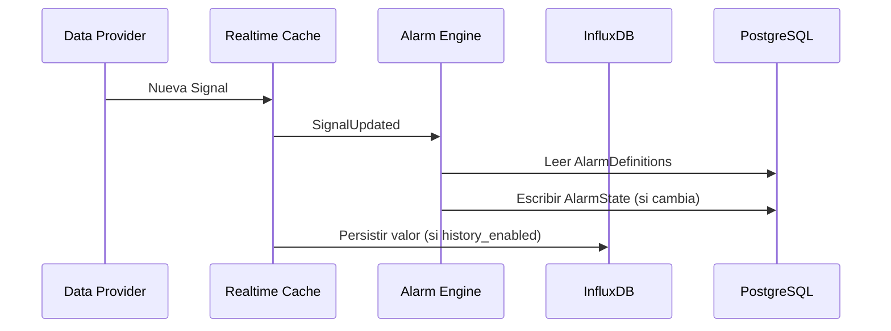

# Documento 4
# Persistencia de Datos

# 4.1 Introducción y Filosofía de Persistencia

## Objetivo

Este documento define la estrategia de persistencia de datos de EWControl: cómo y dónde se almacena la información generada y utilizada por la plataforma, diferenciando entre la configuración del sistema y los datos generados durante su funcionamiento.

El diseño busca un alto rendimiento en la adquisición de datos industriales, consultas históricas eficientes y un dominio (Documento 3) completamente desacoplado de la infraestructura de almacenamiento.

---

## Alcance

Este documento cubre el modelo relacional de PostgreSQL, el modelo temporal de InfluxDB, la relación entre ambos, la política de retención y agregación, y el papel de la persistencia dentro del flujo de datos de la plataforma.

No cubre el modelo del dominio (Documento 3), el detalle de la API REST ni el Frontend, que se documentan por separado.

---

## Clasificación de la Información

EWControl distingue dos tipos de información, cada uno almacenado en el motor de base de datos adecuado.

| Tipo | Ejemplos | Almacenamiento |
|---|---|---|
| Configuración | Companies, Users, Machines, MachineConnections, Signals, AlarmDefinitions, Dashboards, DashboardWidgets | PostgreSQL |
| Temporal | Valores de Signals, históricos, agregaciones | InfluxDB |

La configuración cambia con poca frecuencia y requiere consistencia transaccional. Los datos temporales se generan continuamente y priorizan rendimiento de escritura y consulta por rango de tiempo.

El estado más reciente de cada Signal (para consumo inmediato del Dashboard y del Alarm Engine) no se considera un tercer tipo de almacenamiento persistente: vive en la Realtime Cache, un componente en memoria ya descrito en el Documento 2 (apartado 2.6) y retomado en el apartado 4.4 de este documento desde la perspectiva de la persistencia.

---

## Arquitectura General

```text
                +--------------------+
                |     PostgreSQL     |
                |--------------------|
                | Company            |
                | User               |
                | Machine            |
                | MachineConnection  |
                | Signal             |
                | AlarmDefinition    |
                | AlarmState         |
                | Dashboard          |
                | DashboardWidget    |
                +--------------------+
                         ▲
                         │
                  signal_id
                         │
                         ▼
                +--------------------+
                |      InfluxDB      |
                |--------------------|
                | timestamp          |
                | signal_id          |
                | value              |
                +--------------------+
```

La única relación entre ambas bases de datos es el identificador de la Signal (`signal_id`). InfluxDB no almacena nombres de máquinas, usuarios, empresas ni ninguna otra información descriptiva del dominio.

---

## Principios de Diseño

**PostgreSQL como fuente de verdad.** Toda la configuración del sistema reside exclusivamente en PostgreSQL, considerado el *System of Record* de la plataforma.

**InfluxDB como almacén temporal.** InfluxDB almacena únicamente series temporales; no contiene información descriptiva de las entidades del dominio.

**Relación mediante identificadores.** PostgreSQL e InfluxDB se relacionan exclusivamente mediante `signal_id`, evitando duplicar información y permitiendo modificar la configuración sin afectar a los históricos existentes.

**Independencia del dominio.** Las entidades del dominio (Documento 3) desconocen dónde se almacena la información; la elección de motor de persistencia pertenece exclusivamente a la infraestructura.

---

## Decisión Arquitectónica

EWControl adopta una estrategia de persistencia híbrida: PostgreSQL como sistema de registro de la configuración del dominio, InfluxDB como almacén especializado de series temporales, y la Realtime Cache como estado efímero en memoria. Las tres piezas permanecen desacopladas entre sí y se relacionan únicamente mediante identificadores, garantizando un modelo escalable y preparado para adquisición continua de datos industriales.

# 4.2 PostgreSQL

## Objetivo

PostgreSQL almacena toda la información estructural y permanente de EWControl. La configuración necesaria para que el sistema funcione puede reconstruirse íntegramente a partir de lo almacenado aquí. No almacena valores actuales de Signals, históricos, series temporales ni agregaciones — esa información pertenece a InfluxDB (apartado 4.3) o a la Realtime Cache (apartado 4.4).

---

## Tablas

Cada entidad del dominio (Documento 3) tiene su tabla correspondiente, en `snake_case` y plural, con clave primaria `id` y claves foráneas `<entidad>_id`.

| Tabla | Entidad del dominio | Descripción |
|---|---|---|
| companies | Company | Empresas registradas en la plataforma |
| users | User | Usuarios pertenecientes a una empresa |
| machines | Machine | Activos industriales monitorizados |
| machine_connections | MachineConnection | Configuración de conexión de cada máquina |
| signals | Signal | Definición de las señales industriales |
| alarm_definitions | AlarmDefinition | Reglas de generación de alarmas |
| alarm_states | AlarmState | Estado e histórico de las alarmas |
| dashboards | Dashboard | Paneles de visualización |
| dashboard_widgets | DashboardWidget | Componentes visuales de un Dashboard |

```text
companies
│
├── users
│
├── machines
│      │
│      ├── machine_connections
│      │
│      └── signals
│             │
│             ├── alarm_definitions ── alarm_states
│             │
│             └── dashboard_widgets
│
└── dashboards
       │
       └── dashboard_widgets
```

Todas las relaciones son 1:N salvo Machine → MachineConnection (1:1) y Signal ↔ DashboardWidget (N:M, mediante tabla intermedia). Todas están protegidas mediante claves foráneas: no se permiten registros huérfanos ni referencias a entidades inexistentes.

---

## ORM y Migraciones

El acceso a PostgreSQL desde el Backend se realiza mediante **TypeORM**.

Se descarta Prisma pese a ofrecer mejor experiencia de desarrollo (autocompletado sobre un schema declarativo propio) porque exige regenerar su cliente en cada cambio de schema y su integración con NestJS es una capa añadida, no oficial. TypeORM, en cambio, se integra directamente vía `@nestjs/typeorm`, es la opción más documentada para este framework, y resuelve de forma automática el mapeo entre las columnas `snake_case` de PostgreSQL (tal como se nombran en este documento) y las propiedades `camelCase` de las entidades TypeScript (Documento 0, convención de naming de Backend).

Todo cambio de esquema se aplica mediante migraciones versionadas de TypeORM, nunca mediante sincronización automática (`synchronize: true`) fuera de un entorno de test aislado: el esquema de producción y desarrollo se mantiene siempre reproducible a partir del historial de migraciones.

---

## Índices

Además del índice automático sobre cada clave primaria, se indexan las claves foráneas y columnas usadas habitualmente en filtros:

| Tabla | Columna indexada | Motivo |
|---|---|---|
| users | company_id, email (unique), role | Filtrado por empresa, autenticación, permisos |
| machines | company_id, name | Listado por empresa, búsqueda |
| machine_connections | machine_id (unique) | Una única conexión por máquina |
| signals | machine_id, history_enabled | Señales por máquina, selección para histórico |
| alarm_definitions | signal_id, enabled | Alarmas por señal, filtrado de activas |
| alarm_states | alarm_definition_id, status, activated_at | Historial y consultas cronológicas |
| dashboards / dashboard_widgets | company_id / dashboard_id | Paneles por empresa, widgets por panel |

Los índices se crean únicamente cuando responden a un patrón de acceso real; un índice mejora la lectura pero penaliza la escritura, por lo que se evita la indexación preventiva.

---

## Estrategia de Borrado

No toda la información se elimina físicamente. La estrategia depende de la naturaleza de cada entidad:

- **Eliminación lógica** (desactivación) para Company, User y Machine, que preservan trazabilidad.
- **Restricción de eliminación** para Signal, AlarmDefinition y Company mientras existan dependencias activas (AlarmDefinitions, DashboardWidgets, Users, Machines respectivamente).
- **Conservación permanente** para AlarmState, que constituye el historial operativo de alarmas y nunca se elimina manualmente.
- **Eliminación física libre** para DashboardWidget, que no tiene dependencias ni valor histórico propio.

La eliminación de una entidad en PostgreSQL nunca elimina automáticamente los históricos asociados en InfluxDB; ambas bases de datos gestionan su propio ciclo de vida de forma independiente.

---

## Auditoría

Las operaciones de creación, modificación y eliminación/desactivación sobre la configuración del sistema se registran con: usuario, Company, entidad afectada, identificador, acción y fecha. La auditoría es funcional (registra qué ocurrió, no un diff campo a campo) y solo cubre configuración — nunca valores de Signals, históricos ni actualizaciones de la Realtime Cache. Es un mecanismo transversal de infraestructura, ajeno al dominio.

---

## Decisión Arquitectónica

El modelo relacional de PostgreSQL refleja directamente las entidades del Documento 3, protegidas con integridad referencial e índices orientados a los patrones de acceso reales de la plataforma. La estrategia de borrado combina eliminación física, lógica y restricciones según el valor histórico de cada entidad, y la auditoría queda como capacidad transversal desacoplada del dominio.

# 4.3 InfluxDB

## Objetivo

InfluxDB almacena los valores históricos de las Signals que tienen habilitado el registro de histórico. A diferencia de PostgreSQL, está optimizada para escrituras continuas de alto volumen y consultas por rango temporal. No almacena ninguna entidad del dominio (Companies, Users, Machines, Signals...); esa configuración permanece siempre en PostgreSQL y se referencia únicamente mediante `signal_id`.

---

## Modelo de Datos

EWControl utiliza una estructura deliberadamente simple:

| Elemento | Valor | Motivo |
|---|---|---|
| Bucket | `signals_history` | Un único bucket para todas las Companies, simplificando administración, backups y retención |
| Measurement | `signal_values` | Una única measurement para todas las Signals; la diferenciación se hace por Tags |
| Tags | `company_id`, `machine_id`, `signal_id` | Identificadores indexados para filtrar; nunca información descriptiva (esa vive en PostgreSQL) |
| Field | `value` (float) | Único valor medido por punto, normalizado independientemente del tipo de Signal |

Ejemplo conceptual de un punto almacenado:

| Elemento | Valor |
|---|---|
| Measurement | `signal_values` |
| Tags | company_id=3, machine_id=12, signal_id=45 |
| Field | value=72.5 |
| Timestamp | 2026-07-02T10:15:00Z |

El aislamiento entre empresas dentro de un mismo bucket es responsabilidad del Backend, que siempre filtra por `company_id` al construir las consultas; InfluxDB no aplica reglas de autorización.

---

## Retención

Se aplica una política de retención única y global sobre el bucket `signals_history`, configurable con un valor por defecto de 365 días. Transcurrido ese plazo los datos se eliminan automáticamente. Esta eliminación no afecta a PostgreSQL, a la Realtime Cache ni a las alarmas activas: son sistemas completamente independientes.

---

## Agregaciones

Para optimizar las consultas sobre rangos amplios se definen agregaciones estándar por media: minuto, hora, día y mes. Son una capa derivada — no sustituyen ni modifican los valores originales — y pueden calcularse bajo demanda o de forma periódica según el rendimiento requerido.

---

## Patrones de Consulta

| Consulta | Filtro principal |
|---|---|
| Histórico de una Signal | `signal_id` + rango temporal |
| Histórico de una Machine | `machine_id` + rango temporal |
| Comparativa a nivel Company | `company_id` + rango temporal |
| Tendencias y agregaciones | `signal_id`/`machine_id` + intervalo de agregación |

Las consultas en tiempo real (último valor) nunca se resuelven contra InfluxDB: siempre se obtienen desde la Realtime Cache. InfluxDB queda reservado exclusivamente para consultas de rango temporal.

---

## Decisión Arquitectónica

EWControl adopta InfluxDB como base de datos especializada en series temporales, con un modelo deliberadamente simple (un bucket, una measurement, tres tags, un field) que prioriza rendimiento de escritura y facilidad de administración sobre flexibilidad de esquema. Su fallo afecta únicamente a la disponibilidad de históricos, nunca al funcionamiento en tiempo real del sistema.

# 4.4 Realtime Cache y Persistencia

## Objetivo

La Realtime Cache ya se describe como componente arquitectónico en el Documento 2 (apartado 2.6). Este apartado aclara exclusivamente su relación con las dos bases de datos persistentes.

---

## Naturaleza no Persistente

La Realtime Cache es un almacén en memoria, no una base de datos. Su contenido se reconstruye automáticamente a partir de los Data Providers en cuanto vuelven a reportar valores tras un reinicio. Por este motivo, no se realizan copias de seguridad de la Realtime Cache ni se replica su contenido en PostgreSQL o InfluxDB.

---

## Relación con PostgreSQL

La Realtime Cache se construye a partir de la configuración almacenada en PostgreSQL (qué Machines y Signals existen, qué AlarmDefinitions deben evaluarse). PostgreSQL nunca almacena el estado en tiempo real; solo lo define.

---

## Relación con InfluxDB

Realtime Cache e InfluxDB reciben el mismo flujo de datos pero cumplen funciones complementarias y no se sincronizan directamente entre sí: la Realtime Cache expone el último valor conocido, InfluxDB conserva su evolución en el tiempo. El Backend es quien combina ambas fuentes cuando una consulta lo requiere.

---

## Decisión Arquitectónica

La Realtime Cache permanece fuera del alcance de la estrategia de persistencia de este documento: es un componente de estado efímero cuya fuente de verdad estructural es PostgreSQL y cuyo complemento histórico es InfluxDB.

# 4.5 Alarm Engine y Persistencia

## Objetivo

El Alarm Engine se describe como componente en el Documento 2 (apartado 2.8) y sus entidades de dominio en el Documento 3 (apartados 3.2.6 y 3.2.7). Este apartado aclara exclusivamente qué persiste y dónde.

---

## Qué se Persiste

| Elemento | Tabla | Naturaleza |
|---|---|---|
| Regla de alarma (operador, umbral, prioridad) | `alarm_definitions` | Configuración, cambia con poca frecuencia |
| Activación, reconocimiento y resolución | `alarm_states` | Historial operativo, se conserva indefinidamente |

El Alarm Engine evalúa siempre contra el estado de la Realtime Cache, nunca contra InfluxDB: la evaluación de reglas es una operación en tiempo real, no un análisis histórico.

---

## Flujo de Persistencia

1. La Realtime Cache notifica un cambio de Signal.
2. El Alarm Engine recupera las `alarm_definitions` asociadas desde PostgreSQL.
3. Si la condición se activa o se resuelve, se crea o actualiza un registro en `alarm_states`.
4. El nuevo estado se refleja también en la Realtime Cache para su consumo inmediato por el Dashboard.

---

## Decisión Arquitectónica

La separación entre `alarm_definitions` (regla) y `alarm_states` (resultado), ya justificada en el Documento 3, se traduce en PostgreSQL como dos tablas independientes: la primera cambia por decisión del usuario, la segunda se genera automáticamente por el Alarm Engine y nunca se edita manualmente.

# 4.6 Backend: Orquestación de la Persistencia

## Objetivo

El Backend (NestJS, Documento 2) es el único componente que accede directamente a PostgreSQL e InfluxDB. Actúa como capa de orquestación: ningún cliente externo ni Adapter accede a las bases de datos de forma directa.

---

## Principios

- **Stateless.** El Backend no mantiene estado propio; toda la información proviene de PostgreSQL, InfluxDB o la Realtime Cache. Esto permite escalarlo horizontalmente sin coordinación entre instancias (desarrollado en el Capítulo 5).
- **Selección de fuente según el dato.** El Backend decide de qué sistema leer según el tipo de información solicitada.

| Tipo de dato | Fuente |
|---|---|
| Estado actual (valor de una Signal, alarmas activas) | Realtime Cache |
| Histórico y agregaciones | InfluxDB |
| Configuración (Machines, Signals, Dashboards...) | PostgreSQL |

- **Consistencia híbrida.** Fuerte en PostgreSQL (transaccional), eventual en la Realtime Cache, temporal en InfluxDB. El Backend es responsable de combinar estas fuentes sin presentar al cliente una inconsistencia confusa.

---

## Casos de Uso Representativos

| Caso de uso | Fuentes combinadas |
|---|---|
| Obtener Dashboard completo | PostgreSQL (estructura) + Realtime Cache (valores actuales) + InfluxDB (histórico) |
| Consultar histórico de una Signal | InfluxDB (serie) + PostgreSQL (metadatos: unidad, nombre) |
| Obtener alarmas activas | Realtime Cache |
| Obtener historial de alarmas | PostgreSQL (`alarm_states`) |
| Crear Machine / Signal / AlarmDefinition | PostgreSQL (transacción) |

---

## Decisión Arquitectónica

El Backend concentra toda la lógica de orquestación entre PostgreSQL, InfluxDB y la Realtime Cache detrás de una única API, manteniéndose stateless para poder escalar horizontalmente sin comprometer la consistencia de cada fuente de datos subyacente.

# 4.7 Adquisición de Datos y Persistencia

## Objetivo

Este apartado aclara cómo los Data Providers (Documento 2, apartado 2.4 — Simulador, Servidor OPC UA) se relacionan con la persistencia, evitando confundirlos con los Adapters de salida descritos en el Documento 2 (apartado 2.11 — REST API, WebSocket, Email), que cumplen un rol distinto.

---

## Relación con la Persistencia

Un Data Provider nunca escribe directamente en PostgreSQL ni en InfluxDB. Su único destino es el Signal Engine, que a su vez actualiza la Realtime Cache (Documento 2, apartado 2.5). A partir de ahí, es el Backend quien decide si el nuevo valor debe además persistirse como histórico en InfluxDB, según si la Signal tiene el histórico habilitado.

```text
Data Provider → Signal Engine → Realtime Cache → (si history_enabled) → InfluxDB
```

---

## Despliegue

En la primera versión, los Data Providers se ejecutan junto al Backend. La arquitectura no impide, sin embargo, desplegarlos de forma distribuida cerca de cada máquina o planta industrial cuando el volumen o la latencia de red lo justifiquen; esta variante de despliegue se desarrolla en el Capítulo 5 (Despliegue e Infraestructura).

---

## Decisión Arquitectónica

Los Data Providers permanecen fuera del alcance de la persistencia: son productores de Variables, no consumidores de PostgreSQL o InfluxDB. Esta separación permite que su ubicación de despliegue (junto al Backend o distribuida en el edge) evolucione sin afectar al modelo de persistencia descrito en este documento.

# 4.8 Flujo Global de Persistencia

## Objetivo

Este apartado consolida, desde la perspectiva de la persistencia, el recorrido completo de un dato ya descrito de forma general en el Documento 2 (apartado 2.12).

---

## Flujo de Escritura



Solo dos escrituras persistentes ocurren en este flujo: el valor histórico en InfluxDB (condicionado a la configuración de la Signal) y, en caso de cambio de estado, el nuevo `AlarmState` en PostgreSQL. Ninguna escritura es transaccional entre sistemas: se acepta consistencia eventual entre la Realtime Cache y las dos bases de datos.

---

## Flujo de Lectura

| Consulta | Fuente | Enriquecimiento |
|---|---|---|
| Tiempo real | Realtime Cache | — |
| Histórico | InfluxDB | Metadatos desde PostgreSQL (nombre, unidad) |
| Configuración | PostgreSQL | Opcionalmente combinado con Realtime Cache |

El Backend nunca recalcula datos en el momento de la consulta: cada tipo de dato se obtiene siempre de su fuente designada.

---

## Tolerancia a Fallos

Un fallo de InfluxDB no interrumpe el tiempo real: la Realtime Cache y el Alarm Engine siguen operando con normalidad, y los históricos pendientes pueden almacenarse con retraso una vez se recupera. Un fallo de PostgreSQL bloquea la creación de nueva configuración pero no detiene el flujo de datos ya configurado. Un fallo de la Realtime Cache se recupera reconstruyendo el estado a partir de los siguientes valores reportados por los Data Providers.

---

## Decisión Arquitectónica

El flujo de persistencia de EWControl separa siempre la escritura en tiempo real (Realtime Cache), la escritura histórica (InfluxDB) y la escritura de configuración (PostgreSQL), aceptando consistencia eventual entre ellas a cambio de baja latencia y tolerancia a fallos parciales sin interrupción del servicio.
