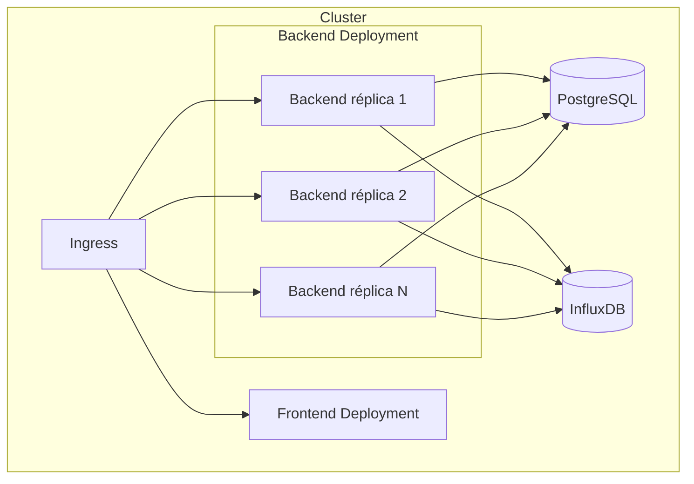
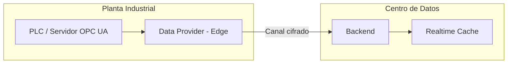
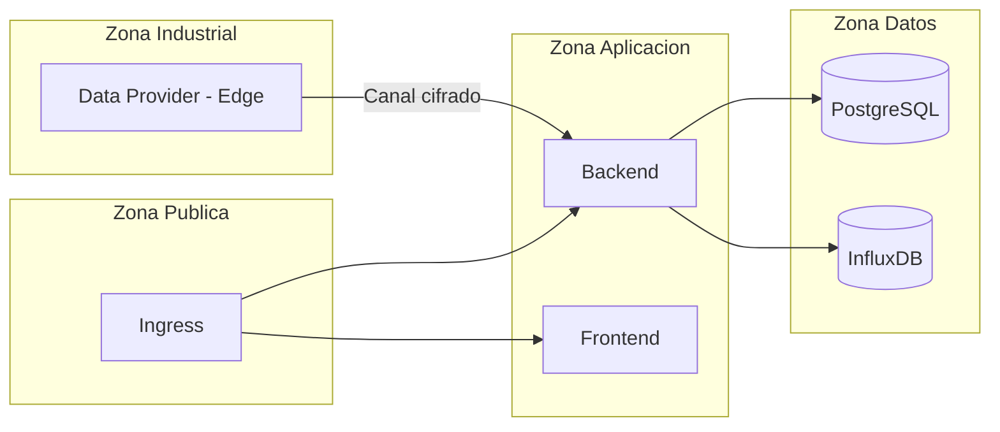

# Documento 5
# Despliegue e Infraestructura

# 5.1 Introducción y Objetivos

## Introducción

Los documentos 1 a 4 definen qué es EWControl, cómo se organiza su arquitectura, su dominio y su estrategia de persistencia. Este documento define **cómo se ejecuta el sistema en la vida real**: en qué contenedores, sobre qué orquestador, con qué estrategia de escalado y qué garantías de disponibilidad y recuperación ante desastres.

---

## Objetivo

Este documento establece:

- Cómo se empaqueta cada componente de la plataforma.
- Cómo se orquestan en desarrollo y en producción.
- Cómo se despliegan los Data Providers cuando deben ejecutarse cerca de la máquina industrial.
- Cómo escala el Backend y cómo se garantiza alta disponibilidad.
- Cómo se protege la plataforma frente a la pérdida de datos.

---

## Alcance

Este documento cubre infraestructura y despliegue. No cubre el pipeline de integración y entrega continua (CI/CD), documentado de forma independiente en el [Documento 13](13-cicd-devops.md), ni los aspectos de seguridad a nivel de sistema, que se desarrollan en el Capítulo 6.

---

## Estado de este documento

Coherente con el principio de "Evolución Controlada" (más abajo), no todo lo descrito en este documento aplica a la fase actual del proyecto (Documento 0, Fase 1 — fundación backend):

- **Aplican ya**: 5.1 y 5.2 (contenedores Docker), y el entorno de desarrollo con Docker Compose descrito en el [README](../README.md).
- **Diseño de referencia — diferido hasta que exista la necesidad real**: 5.3 (orquestación con Kubernetes), 5.4 (despliegue en el Edge), 5.5 (escalado del Backend), 5.6 (bases de datos en producción con réplica/failover), 5.7 (networking entre nodos), 5.8 (alta disponibilidad) y 5.9 (backups/disaster recovery). Estas secciones no se implementan mientras el proyecto opera con datos demo y una sola instancia de cada servicio; se mantienen documentadas para no tener que rediseñarlas cuando llegue el momento.

---

## Principios

Se mantienen los mismos principios de diseño establecidos en el Documento 2, aplicados ahora a la infraestructura:

- **Simplicidad.** La primera versión prioriza un despliegue sencillo (Docker Compose) sobre una infraestructura distribuida compleja que hoy no es necesaria.
- **Evolución controlada.** Kubernetes, HA multi-región o el escalado del Edge se incorporan cuando exista una necesidad real de carga o de clientes, no de forma preventiva.
- **Independencia del entorno.** El mismo conjunto de imágenes Docker se ejecuta en desarrollo, staging y producción; solo cambia la configuración externa (variables de entorno, secretos, réplicas).

---

## Decisión Arquitectónica

EWControl adopta una estrategia de despliegue basada en contenedores, escalable de un único host en desarrollo hasta un clúster orquestado en producción, sin necesidad de reescribir la aplicación al pasar de un entorno a otro.

# 5.2 Contenedores (Docker)

## Objetivo

Cada componente de la plataforma se empaqueta como una imagen Docker independiente, con una única responsabilidad, siguiendo el mismo principio de separación de responsabilidades aplicado al resto de la arquitectura (Documento 2).

---

## Imágenes de la Plataforma

| Imagen | Contenido | Naturaleza |
|---|---|---|
| `ewcontrol-backend` | API NestJS, Signal Engine, Realtime Cache, Alarm Engine | Stateless |
| `ewcontrol-frontend` | Build estático de Angular servido por Nginx | Stateless |
| `postgres` | PostgreSQL oficial | Stateful (volumen persistente) |
| `influxdb` | InfluxDB oficial | Stateful (volumen persistente) |

No existirá una imagen única para todo el sistema. Cada imagen se construye, versiona y despliega de forma independiente, permitiendo actualizar el Frontend sin reiniciar el Backend o las bases de datos.

---

## Construcción de Imágenes

Las imágenes de Backend y Frontend se construyen mediante *builds* multi-etapa:

1. Una etapa de compilación con las dependencias de desarrollo (TypeScript, Angular CLI).
2. Una etapa final que copia únicamente los artefactos compilados sobre una imagen base mínima.

Esto mantiene las imágenes de producción ligeras y reduce su superficie de exposición.

---

## Persistencia de Datos

Las imágenes `postgres` e `influxdb` nunca almacenan datos dentro del propio contenedor. Sus directorios de datos se montan sobre volúmenes persistentes gestionados por el orquestador, de forma que la destrucción o actualización del contenedor nunca implique pérdida de información.

---

## Reglas Arquitectónicas

**Regla 1.** Los contenedores de Backend y Frontend son stateless; pueden destruirse y recrearse sin pérdida de información.

**Regla 2.** Ningún contenedor combina dos responsabilidades (por ejemplo, Backend y base de datos en la misma imagen).

**Regla 3.** Los datos de PostgreSQL e InfluxDB residen siempre en volúmenes persistentes externos al ciclo de vida del contenedor.

---

## Decisión Arquitectónica

EWControl empaqueta cada componente como una imagen Docker independiente y stateless salvo las bases de datos, cuya persistencia se delega siempre a volúmenes externos, permitiendo actualizar o reemplazar cualquier componente sin afectar a los demás.

# 5.3 Orquestación

## Objetivo

Definir cómo se coordinan los contenedores descritos en el apartado 5.2 en desarrollo y en producción.

---

## Desarrollo: Docker Compose

En desarrollo, todos los servicios se ejecutan en un único host mediante Docker Compose: Backend, Frontend, PostgreSQL e InfluxDB conectados a través de una red interna de Docker, sin necesidad de balanceo de carga ni réplicas.

Este entorno prioriza la simplicidad: un único comando levanta la plataforma completa para desarrollo local.

---

## Producción: Kubernetes

En producción, la plataforma se despliega sobre Kubernetes.

| Componente | Recurso Kubernetes |
|---|---|
| Backend | Deployment con múltiples réplicas + Service |
| Frontend | Deployment con réplicas + Service |
| PostgreSQL | Instancia gestionada externa o StatefulSet con volumen persistente |
| InfluxDB | Instancia gestionada externa o StatefulSet con volumen persistente |
| Entrada de tráfico | Ingress con TLS terminado en el borde del clúster |

---

## Diferencias entre Entornos

| Aspecto | Desarrollo | Producción |
|---|---|---|
| Orquestador | Docker Compose | Kubernetes |
| Réplicas de Backend | 1 | N, según carga |
| Bases de datos | Contenedores locales | Gestionadas o con alta disponibilidad |
| TLS | No requerido | Obligatorio (Capítulo 6) |

---

## Reglas Arquitectónicas

**Regla 1.** Las bases de datos nunca se ejecutan como un Deployment sin volumen persistente asociado.

**Regla 2.** El número de réplicas del Backend se ajusta a la carga observada, nunca de forma fija e indefinida.

**Regla 3.** La configuración específica de cada entorno (credenciales, endpoints) se inyecta mediante variables de entorno y secretos, nunca embebida en la imagen.

---

## Decisión Arquitectónica

EWControl utiliza Docker Compose para desarrollo, priorizando la simplicidad, y Kubernetes para producción, priorizando escalabilidad y alta disponibilidad, sin que ello implique diferencias en el código de la aplicación entre ambos entornos.

# 5.4 Despliegue en el Edge

## Objetivo

Definir cómo se despliegan los Data Providers (Documento 2, apartado 2.4) cuando deben ejecutarse cerca de la máquina industrial en lugar de junto al Backend, tal y como se anticipó en el Documento 4 (apartado 4.7).

---

## Cuándo Distribuir un Data Provider

En la primera versión, los Data Providers se ejecutan junto al Backend. Esto es suficiente mientras el simulador o un número reducido de servidores OPC UA sean accesibles directamente desde el centro de datos.

Un Data Provider se desplegará en el edge, cerca de la planta industrial, cuando concurra alguna de estas condiciones:

- La red industrial (OT) no permite conexiones entrantes desde fuera de la planta.
- La latencia hacia el centro de datos es demasiado alta para las Subscriptions de OPC UA.
- El volumen de señales de la planta justifica pre-procesar o filtrar datos antes de enviarlos.

---

## Modelo de Despliegue

El Data Provider desplegado en el edge se comporta exactamente igual que si estuviera embebido junto al Backend: se conecta al Source, transforma la información en Variables y las envía. La única diferencia es la ubicación física del proceso y el canal de red que debe atravesar para llegar al Backend.

---

## Resiliencia en el Edge

Un Data Provider desplegado en el edge debe tolerar cortes de conectividad hacia el centro de datos:

- Mantiene un búfer local de los últimos eventos generados durante el corte.
- Reintenta el envío de forma automática al recuperar la conexión.
- Nunca descarta silenciosamente información: si el búfer se agota, registra el evento como pérdida y continúa operando.

---

## Reglas Arquitectónicas

**Regla 1.** Un Data Provider desplegado en el edge nunca accede directamente a PostgreSQL ni a InfluxDB; su único destino es el Backend.

**Regla 2.** El canal entre el edge y el Backend siempre viaja cifrado (desarrollado en el Capítulo 6).

**Regla 3.** La pérdida de conectividad con el edge no debe afectar al procesamiento de las demás máquinas conectadas al sistema.

---

## Decisión Arquitectónica

Los Data Providers pueden desplegarse embebidos junto al Backend o distribuidos en el edge según las condiciones de red y volumen de cada planta, sin que esta decisión de despliegue requiera modificar su implementación ni el resto de la arquitectura.

# 5.5 Escalado del Backend

## Objetivo

Definir cómo escala horizontalmente el Backend, aprovechando su naturaleza stateless ya establecida en el Documento 4 (apartado 4.6).

---

## Balanceo de Carga

Múltiples réplicas del Backend se sitúan detrás de un balanceador de carga que distribuye las peticiones HTTP entrantes. Cada réplica es intercambiable: cualquiera de ellas puede atender cualquier petición, ya que ninguna mantiene estado que las demás no puedan reconstruir a partir de PostgreSQL, InfluxDB o la Realtime Cache.

El balanceador comprueba periódicamente la salud de cada réplica mediante un endpoint de *health check* y retira automáticamente las instancias que no respondan.

---

## El Reto de Escalar WebSocket

El Documento 2 define la Realtime Cache y el WebSocket Adapter como componentes en memoria de una única instancia del Backend. Al escalar horizontalmente, esto introduce una consideración que no existía con una sola instancia: un cliente conectado por WebSocket a la réplica A no recibe automáticamente los eventos procesados por la réplica B.

En la primera versión de la plataforma, con un volumen de máquinas moderado, esta situación se resuelve mediante **sesiones persistentes** (*sticky sessions*) en el balanceador: cada cliente permanece conectado siempre a la misma réplica del Backend durante toda su sesión.

La evolución hacia múltiples réplicas completamente intercambiables para WebSocket —mediante un canal de publicación/suscripción compartido entre instancias— queda como línea de evolución futura, a incorporar únicamente cuando el volumen de conexiones simultáneas lo justifique, conforme al principio de evolución controlada del Documento 2.

---

## Criterios de Escalado

| Métrica | Acción |
|---|---|
| Uso de CPU sostenido por encima del umbral configurado | Añadir réplicas |
| Latencia de respuesta de la API por encima del objetivo | Añadir réplicas |
| Baja utilización sostenida | Reducir réplicas |

---

## Reglas Arquitectónicas

**Regla 1.** Ninguna instancia del Backend almacena información que las demás no puedan recuperar desde PostgreSQL, InfluxDB o la Realtime Cache.

**Regla 2.** El escalado del Backend nunca requiere coordinación manual entre instancias.

**Regla 3.** Toda réplica expone el mismo endpoint de salud, verificado por el balanceador antes de recibir tráfico.

---

## Decisión Arquitectónica

El Backend escala horizontalmente mediante réplicas idénticas y stateless detrás de un balanceador de carga, resolviendo en la primera versión el reto de las conexiones WebSocket mediante sesiones persistentes, y dejando un canal de mensajería compartido entre instancias como evolución futura cuando el volumen de conexiones lo requiera.

# 5.6 Bases de Datos en Producción

## Objetivo

Definir los requisitos de producción de PostgreSQL e InfluxDB, complementando lo ya definido en el Documento 4 sobre su modelo de datos.

---

## PostgreSQL en Producción

| Aspecto | Estrategia |
|---|---|
| Disponibilidad | Instancia primaria con réplica de lectura/espera |
| Backups | Automáticos, según la estrategia del apartado 5.9 |
| Acceso | Únicamente desde la red interna del Backend, nunca expuesta a internet |
| Dimensionamiento | Volumen moderado (configuración del dominio), no requiere almacenamiento masivo |

---

## InfluxDB en Producción

| Aspecto | Estrategia |
|---|---|
| Disponibilidad | Instancia única en la primera versión; la recuperación ante fallo se apoya en backups (apartado 5.9), no en réplica activa |
| Backups | Snapshots periódicos del bucket `signals_history` |
| Acceso | Únicamente desde la red interna del Backend |
| Dimensionamiento | Disco optimizado para escritura secuencial de alto volumen |

La versión utilizada de InfluxDB no ofrece clustering nativo. Si el crecimiento de la plataforma exige alta disponibilidad activa para los históricos, la evolución natural es migrar a una oferta gestionada con soporte de clustering, sin que ello afecte al modelo de datos definido en el Documento 4.

---

## Reglas Arquitectónicas

**Regla 1.** Ninguna base de datos se expone directamente a internet; el acceso siempre pasa por la red interna del clúster.

**Regla 2.** Las credenciales de acceso a las bases de datos se gestionan como secretos del orquestador, nunca como variables embebidas en la imagen.

**Regla 3.** El dimensionamiento de cada base de datos se revisa según su naturaleza: PostgreSQL por número de entidades, InfluxDB por volumen y frecuencia de escritura.

---

## Decisión Arquitectónica

PostgreSQL se despliega con réplica de lectura/espera desde el inicio por ser la fuente de verdad transaccional del sistema; InfluxDB se despliega como instancia única respaldada por backups periódicos, aplazando el clustering activo hasta que el volumen de históricos lo justifique.

# 5.7 Networking y Comunicación entre Nodos

## Objetivo

Definir cómo se organiza la red entre los distintos componentes de la plataforma, minimizando la superficie de exposición.

---

## Zonas de Red

Cada zona solo puede comunicarse con la zona inmediatamente adyacente, nunca saltándose una capa intermedia. La Zona Industrial nunca se comunica directamente con la Zona de Datos.

---

## Comunicación entre Nodos

| Origen | Destino | Protocolo |
|---|---|---|
| Cliente / Angular | Ingress | HTTPS / WSS |
| Ingress | Backend | HTTP interno |
| Backend | PostgreSQL | TCP cifrado dentro del clúster |
| Backend | InfluxDB | HTTP interno cifrado |
| Data Provider (Edge) | Backend | Canal cifrado a través de internet (detallado en el Capítulo 6) |

---

## Reglas Arquitectónicas

**Regla 1.** Ningún tráfico atraviesa dos zonas de red sin pasar por el componente de control definido en la zona intermedia.

**Regla 2.** La Zona de Datos nunca es accesible desde fuera de la Zona Aplicación.

**Regla 3.** Toda comunicación que atraviese una red pública (edge, clientes) viaja cifrada.

---

## Decisión Arquitectónica

La red de EWControl se organiza en zonas concéntricas (pública, aplicación, datos, industrial), donde cada zona solo confía en la adyacente, reduciendo la superficie de ataque y alineándose con los principios de seguridad desarrollados en el Capítulo 6.

# 5.8 Alta Disponibilidad

## Objetivo

Definir el nivel de disponibilidad de cada componente de la plataforma y la estrategia para mantener el servicio ante el fallo de una instancia.

---

## Estrategia por Componente

| Componente | Estrategia de HA | Impacto de un fallo |
|---|---|---|
| Frontend | Múltiples réplicas sin estado | Ninguno; el balanceador redirige el tráfico |
| Backend | Múltiples réplicas + health checks + reinicio automático | Ninguno si quedan réplicas sanas |
| PostgreSQL | Réplica de lectura/espera con failover | Interrupción breve durante el failover |
| InfluxDB | Instancia única respaldada por backups | Pérdida temporal de consultas históricas; el tiempo real no se ve afectado |
| Data Provider (Edge) | Reconexión automática con búfer local | Pérdida temporal de datos de una planta, sin afectar a las demás |

---

## Principio General

El fallo de un componente nunca debe propagarse al resto del sistema. Esto ya es un principio establecido en el Documento 2 (el fallo de una Signal no detiene el procesamiento de las demás) y se extiende aquí a nivel de infraestructura: el fallo de InfluxDB no afecta al tiempo real, el fallo de una réplica del Backend no afecta a las demás, el fallo de un Data Provider en una planta no afecta a otra.

---

## Reglas Arquitectónicas

**Regla 1.** Todo componente stateless (Backend, Frontend) se despliega con un mínimo de dos réplicas en producción.

**Regla 2.** El failover de PostgreSQL es automático y no requiere intervención manual.

**Regla 3.** La indisponibilidad de InfluxDB nunca bloquea el procesamiento en tiempo real ni la evaluación de alarmas.

---

## Decisión Arquitectónica

EWControl garantiza alta disponibilidad mediante redundancia en los componentes stateless y failover automático en PostgreSQL, aceptando conscientemente que InfluxDB sea un punto único de fallo en la primera versión, mitigado mediante backups y sin impacto sobre el procesamiento en tiempo real.

# 5.9 Backups y Disaster Recovery

## Objetivo

Definir la estrategia de copias de seguridad y el procedimiento de recuperación ante un desastre que afecte a las bases de datos de la plataforma.

---

## Estrategia de Backups

| Base de datos | Mecanismo | Frecuencia |
|---|---|---|
| PostgreSQL | Backup completo + registro de escritura continuo (WAL) | Diario + continuo |
| InfluxDB | Snapshot del bucket `signals_history` | Diario |

---

## Objetivos de Recuperación

| Métrica | Objetivo |
|---|---|
| RPO (pérdida máxima de datos asumible) | Minutos para PostgreSQL (gracias al WAL continuo); hasta 24 horas para InfluxDB |
| RTO (tiempo máximo de recuperación) | Minutos para PostgreSQL mediante failover; horas para una restauración completa de InfluxDB |

---

## Procedimiento de Restauración

1. Restaurar primero PostgreSQL, ya que define los `signal_id` que InfluxDB referencia.
2. Restaurar InfluxDB a partir del snapshot más reciente.
3. Verificar la integridad de la relación entre ambas bases de datos comprobando una muestra de Signals.
4. Reiniciar el Backend para que la Realtime Cache se reconstruya a partir de los Data Providers.

---

## Reglas Arquitectónicas

**Regla 1.** Todo backup se prueba periódicamente mediante una restauración real; un backup no verificado no se considera válido.

**Regla 2.** Los backups se almacenan en una ubicación distinta a la de las bases de datos originales.

**Regla 3.** La pérdida de InfluxDB nunca implica la pérdida de la configuración del dominio, almacenada de forma independiente en PostgreSQL.

---

## Decisión Arquitectónica

EWControl prioriza la protección de PostgreSQL, por representar la configuración irremplazable del dominio, con RPO/RTO más exigentes que InfluxDB, cuya pérdida parcial es tolerable al tratarse de datos derivables de la operación continua de las máquinas.

# 5.10 Decisión Arquitectónica

## Resumen

El despliegue de EWControl combina:

- Contenedores Docker para cada componente, con Docker Compose en desarrollo y Kubernetes en producción.
- Data Providers desplegables junto al Backend o distribuidos en el edge según las condiciones de cada planta.
- Un Backend stateless escalable horizontalmente, con sesiones persistentes para WebSocket en la primera versión.
- PostgreSQL con failover automático e InfluxDB como instancia única respaldada por backups.
- Una red organizada en zonas concéntricas que limita la comunicación entre capas.
- Una estrategia de backups y recuperación que prioriza la configuración del dominio sobre los datos históricos derivados.

---

## Decisión

Esta estrategia de despliegue permite que EWControl comience con una infraestructura simple y de bajo coste operativo, y evolucione hacia un despliegue distribuido y de alta disponibilidad a medida que el número de clientes, máquinas y plantas industriales lo requiera, sin necesidad de rediseñar la aplicación descrita en los documentos anteriores.
