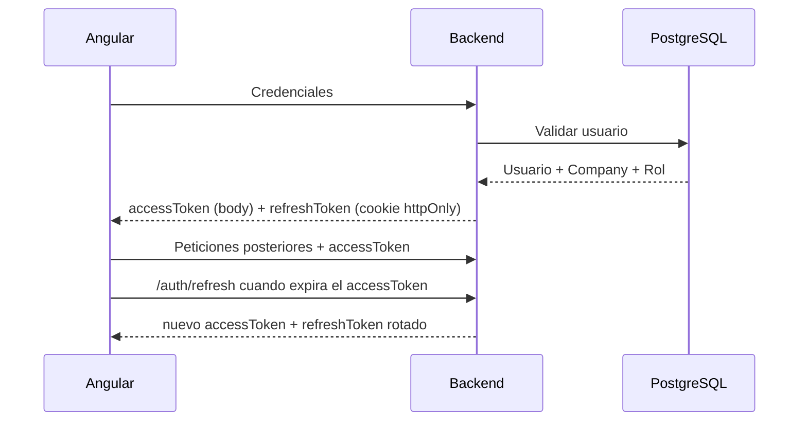
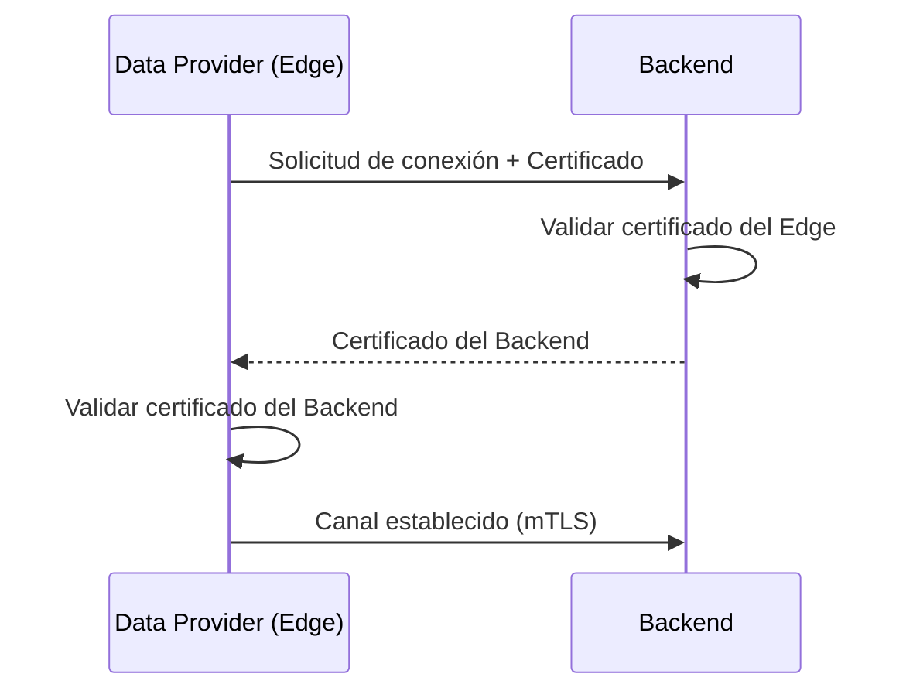
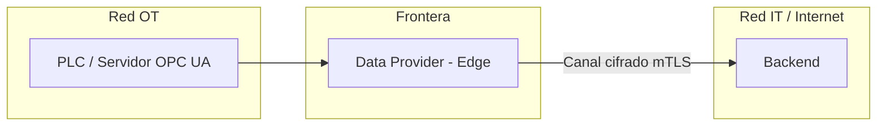

# Documento 6

# Seguridad Global

# 6.1 Introducción y Alcance

## Introducción

Los documentos anteriores mencionan aspectos puntuales de seguridad: la autenticación de usuarios (Documento 3, entidad User), el aislamiento multiempresa (Documento 3, entidad Company) o el acceso restringido a las bases de datos (Documento 5). Este documento consolida la seguridad **a nivel de sistema completo**, cubriendo aspectos que ningún documento anterior desarrolla en profundidad: autenticación global, certificados entre componentes distribuidos, seguridad del entorno industrial, encriptación extremo a extremo y auditoría.

---

## Alcance

Este documento no repite el detalle de autorización por endpoint de la API REST (documentado en el [Documento 11](11-api-rest.md)). Se centra en las decisiones de seguridad que afectan a la arquitectura completa: cómo se autentica un usuario, cómo confía el Backend en un Data Provider remoto, cómo se protege la red industrial y cómo se traza cualquier acción sobre el sistema.

---

## Estado de este documento

No todo lo descrito aquí aplica a la fase actual del proyecto (Documento 0, Fase 1 — fundación backend):

- **Aplican ya**: 6.2 (Autenticación Global, JWT access+refresh), 6.6 (Auditoría), 6.7 (Aislamiento multiempresa) y 6.10 (Checklist OWASP Top 10).
- **Diseño de referencia — diferido hasta que exista despliegue Edge real**: 6.3 (certificados mTLS entre Data Providers y Backend) y 6.4 (segmentación de red OT/IT), que solo aplican cuando haya Data Providers desplegados fuera del centro de datos (Documento 5, apartado 5.4). Mientras el Simulador corre embebido junto al Backend (Documento 10), estas capas no son necesarias.

---

## Principios

- **Seguridad por capas.** Ninguna protección es la única línea de defensa; la autenticación de usuarios, el aislamiento por Company y el cifrado de red se aplican de forma independiente y acumulativa.
- **Mínimo privilegio.** Cada componente y cada usuario acceden únicamente a lo estrictamente necesario para su función.
- **Confianza explícita, nunca implícita.** Ningún componente de la plataforma confía en otro por estar en la misma red; toda comunicación entre componentes se autentica.

---

## Decisión Arquitectónica

EWControl trata la seguridad como una responsabilidad transversal a toda la arquitectura, no como una capa añadida sobre la API. Las decisiones de este documento se aplican por igual al Backend, a los Data Providers, a la red interna del clúster y a los canales que conectan la planta industrial con el centro de datos.

# 6.2 Autenticación Global

## Objetivo

Definir cómo se autentica un usuario frente a la plataforma y cómo esa identidad se propaga durante toda su sesión.

---

## Modelo de Autenticación

EWControl utiliza autenticación basada en tokens JWT, con dos tokens de vida distinta: un **access token** y un **refresh token**. Tras un login válido contra las credenciales almacenadas en PostgreSQL (Documento 4, apartado 4.2), el Backend emite ambos, firmados con HS256.

Cada petición posterior incluye el `accessToken` en la cabecera `Authorization`, que el Backend valida y utiliza para resolver el contexto de la petición: qué Company, qué permisos. El flujo completo (login, refresh, logout) está especificado como caso de uso en [specs/05-auth-login.md](specs/05-auth-login.md).

### Access token

Vida útil de **15 minutos**. Se envía en el cuerpo de la respuesta de login y en cada renovación; el Frontend lo mantiene únicamente en memoria (nunca en `localStorage`/`sessionStorage`), para reducir su exposición ante un ataque XSS (ver "Checklist OWASP Top 10", A03).

### Refresh token

Vida útil de **7 días**. Se entrega en una cookie `httpOnly`, `Secure`, `SameSite=Strict`, inaccesible desde JavaScript del navegador. Cada uso de `/auth/refresh` **rota** el refresh token: el anterior queda invalidado y se emite uno nuevo. Si un refresh token ya rotado se vuelve a usar (indicio de robo), el Backend invalida inmediatamente todas las sesiones activas de ese usuario y registra el evento en el log de auditoría (apartado 6.6).

---

## Roles y Alcance

Los roles ya definidos en el Documento 3 (`UserRole`: SuperAdmin, AdminCliente) determinan el alcance de cada token:

| Rol          | Alcance del token                                    |
| ------------ | ---------------------------------------------------- |
| SuperAdmin   | Acceso a cualquier Company de la plataforma          |
| AdminCliente | Acceso exclusivo a los recursos de su propia Company |

Ningún token de tipo AdminCliente puede ampliarse en tiempo de ejecución para acceder a otra Company; el alcance queda fijado en el momento de la emisión.

---

## Expiración y Renovación

Al expirar el access token, el Frontend solicita uno nuevo mediante `POST /api/v1/auth/refresh` (Documento 11, sección "Auth"), usando el refresh token de la cookie. Esa renovación vuelve a validar el estado del usuario (activo, Company activa) antes de emitir el nuevo access token, evitando que una cuenta desactivada mantenga acceso indefinido con un token ya emitido — como máximo, hasta 15 minutos después de su desactivación.

## Protección frente a fuerza bruta

El endpoint de login limita a 5 intentos fallidos por email cada 15 minutos; superado ese límite, responde `429` (Documento 11, sección "Auth"). Las contraseñas se almacenan con un hash con salt mediante **bcrypt**, nunca en texto plano.

### bcrypt vs Argon2id

Se evaluaron dos algoritmos de hash de contraseñas:

|                                               | bcrypt                                       | Argon2id                                                                 |
| --------------------------------------------- | -------------------------------------------- | ------------------------------------------------------------------------ |
| Resistencia a ataques paralelos (GPU/ASIC)    | Media — usa poca memoria por intento (~4 KB) | Alta — _memory-hard_, exige memoria configurable (ej. 64 MB) por intento |
| Recomendación OWASP actual                    | Alternativa aceptada                         | Primera opción                                                           |
| Madurez en Node/NestJS                        | Estándar de facto, muy probado en producción | Menos extendido, requiere dependencias nativas adicionales               |
| Fricción operativa (build de imágenes Docker) | Baja                                         | Mayor (compilación nativa)                                               |

Se opta por **bcrypt** para EWControl: el perfil de amenaza de la plataforma no requiere la resistencia adicional de Argon2id frente a ataques con hardware especializado, y bcrypt ofrece menor fricción operativa (sin dependencias nativas problemáticas en la imagen del Backend, Documento 5) con un historial de producción más largo. Esta decisión se revisará si en el futuro cambia el perfil de riesgo del proyecto (por ejemplo, al manejar datos de mayor sensibilidad).

---

## Reglas Arquitectónicas

**Regla 1.** Ninguna petición se procesa sin un token válido, salvo el propio endpoint de login.

**Regla 2.** El alcance de un token (Company, rol) se fija en el momento de su emisión y se revalida en cada renovación.

**Regla 3.** La desactivación de un usuario o de una Company invalida sus tokens en la siguiente renovación, como máximo.

---

## Decisión Arquitectónica

La autenticación global de EWControl se basa en tokens firmados por el Backend, con un alcance ligado a la Company y al rol del usuario que nunca puede ampliarse tras su emisión, alineándose con el principio de aislamiento multiempresa establecido en el Documento 3.

# 6.3 Certificados entre Data Providers y Backend

## Objetivo

Definir cómo se autentica un Data Provider desplegado en el edge (Documento 5, apartado 5.4) frente al Backend, evitando que un proceso no autorizado pueda inyectar datos falsos en la plataforma.

---

## Necesidad de Confianza Mutua

Un Data Provider embebido junto al Backend se ejecuta en la misma red de confianza y no necesita autenticarse de forma independiente. Un Data Provider distribuido en el edge, en cambio, se comunica a través de una red potencialmente hostil (internet) y debe demostrar su identidad en cada conexión.

---

## Modelo de Autenticación mediante Certificados

EWControl utiliza autenticación mutua TLS (mTLS) entre un Data Provider desplegado en el edge y el Backend:

- El Backend presenta un certificado que el Data Provider valida antes de enviar cualquier dato.
- El Data Provider presenta a su vez un certificado propio, emitido para esa planta o esa máquina, que el Backend valida antes de aceptar la conexión.

---

## Relación con MachineConnection

El Documento 3 (apartado 3.4) ya define `ConnectionConfig` como el Value Object que encapsula los parámetros de conexión de un Data Provider, incluyendo certificados y política de seguridad cuando el proveedor es OPC UA. Los certificados mTLS descritos aquí protegen el tramo Data Provider–Backend; los certificados OPC UA de `ConnectionConfig` protegen el tramo Data Provider–PLC. Son dos perímetros de confianza distintos y ninguno sustituye al otro.

---

## Ciclo de Vida de los Certificados

Cada certificado de Data Provider tiene una fecha de expiración y se renueva antes de caducar. Un certificado revocado (por ejemplo, tras desinstalar un Data Provider de una planta) se añade a una lista de revocación consultada por el Backend en cada intento de conexión.

---

## Reglas Arquitectónicas

**Regla 1.** Ningún Data Provider en el edge establece conexión con el Backend sin autenticación mutua TLS.

**Regla 2.** Un certificado revocado nunca es aceptado, aunque no haya expirado formalmente.

**Regla 3.** El Backend nunca acepta datos de un Data Provider cuya identidad no pueda validar.

---

## Decisión Arquitectónica

Todo Data Provider desplegado en el edge se autentica frente al Backend mediante un certificado propio validado por autenticación mutua TLS, garantizando que únicamente equipos autorizados puedan inyectar datos industriales en la plataforma.

# 6.4 Seguridad Industrial OT/IT

## Objetivo

Establecer los principios de segmentación entre la red industrial (OT, _Operational Technology_) donde operan los PLCs y servidores OPC UA, y la red corporativa e informática (IT) donde se ejecuta el resto de la plataforma.

---

## Principio de Segmentación

La red industrial de una planta nunca se conecta directamente a internet ni a la Zona de Datos de EWControl (Documento 5, apartado 5.7). El único punto de contacto autorizado es el Data Provider desplegado en el edge, que actúa como frontera entre ambos mundos.

---

## Responsabilidades de la Frontera

El Data Provider en el edge es el único componente con visibilidad simultánea de ambas redes. Por ello:

- Nunca reenvía tráfico bruto de la red OT hacia la red IT; solo transmite Variables ya normalizadas.
- Nunca acepta comandos de escritura originados desde el Backend hacia el PLC en la primera versión de la plataforma, que es exclusivamente de lectura de datos.
- Se ejecuta con el mínimo de permisos de red necesarios en ambos lados de la frontera.

---

## Reglas Arquitectónicas

**Regla 1.** Ningún componente de la red IT se conecta directamente a un PLC o servidor OPC UA; siempre a través de un Data Provider.

**Regla 2.** La red OT nunca es accesible desde internet.

**Regla 3.** El Data Provider en la frontera transmite exclusivamente Variables normalizadas, nunca tráfico bruto del protocolo industrial.

---

## Decisión Arquitectónica

EWControl respeta la segmentación entre redes OT e IT como principio no negociable, concentrando en el Data Provider desplegado en el edge toda la responsabilidad de frontera y evitando cualquier ruta alternativa de acceso a la red industrial.

# 6.5 Encriptación End-to-End

## Objetivo

Consolidar en un único lugar los tramos de comunicación de la plataforma y su estrategia de cifrado, tanto en tránsito como en reposo.

---

## Cifrado en Tránsito

| Tramo                           | Protección                                                                |
| ------------------------------- | ------------------------------------------------------------------------- |
| Angular ↔ Ingress               | HTTPS / WSS                                                               |
| Ingress ↔ Backend               | TLS interno del clúster                                                   |
| Backend ↔ PostgreSQL / InfluxDB | TLS interno del clúster                                                   |
| Data Provider (Edge) ↔ Backend  | mTLS (apartado 6.3)                                                       |
| Data Provider ↔ Servidor OPC UA | Política de seguridad OPC UA definida en `ConnectionConfig` (Documento 3) |

Ningún tramo de la plataforma transmite información en claro, incluida la red interna del clúster.

---

## Cifrado en Reposo

Los volúmenes persistentes de PostgreSQL e InfluxDB (Documento 5, apartado 5.2) se almacenan cifrados a nivel de disco. Las copias de seguridad (Documento 5, apartado 5.9) heredan el mismo nivel de cifrado que los datos originales.

---

## Gestión de Claves

Las claves de cifrado y los certificados descritos en este documento se gestionan como secretos del orquestador (Documento 5), nunca embebidos en imágenes ni en el control de versiones del código.

---

## Reglas Arquitectónicas

**Regla 1.** Ningún dato de la plataforma viaja sin cifrar, ni siquiera dentro de la red interna del clúster.

**Regla 2.** Ninguna copia de seguridad se almacena con un nivel de cifrado inferior al de los datos originales.

**Regla 3.** Las claves de cifrado nunca se almacenan junto al código fuente ni a las imágenes de contenedor.

---

## Decisión Arquitectónica

EWControl cifra toda comunicación entre componentes y todo dato en reposo, sin excepciones por estar dentro de una red considerada "interna", alineándose con el principio de confianza explícita establecido en el apartado 6.1.

# 6.6 Auditoría y Trazabilidad

## Objetivo

Ampliar a nivel de sistema la auditoría de configuración ya definida en el Documento 4 (apartado 4.2), incorporando la trazabilidad de accesos y de eventos de seguridad que no pertenecen estrictamente a PostgreSQL.

---

## Niveles de Auditoría

| Nivel         | Qué registra                                                                 | Dónde se define           |
| ------------- | ---------------------------------------------------------------------------- | ------------------------- |
| Configuración | Creación, modificación y desactivación de entidades del dominio              | Documento 4, apartado 4.2 |
| Acceso        | Inicios de sesión, renovaciones de token, intentos fallidos de autenticación | Este documento            |
| Seguridad     | Conexiones de Data Providers, certificados revocados, rechazos de conexión   | Este documento            |

---

## Información de un Evento de Seguridad

Todo evento de acceso o seguridad registra, como mínimo: usuario o Data Provider involucrado, Company asociada (cuando aplique), tipo de evento, resultado (éxito o rechazo) y fecha y hora.

---

## Trazabilidad End-to-End

Combinando la auditoría de configuración (Documento 4) con la auditoría de acceso y seguridad (este documento), es posible reconstruir la secuencia completa de una incidencia: qué usuario inició sesión, qué cambió en la configuración, y si algún Data Provider intentó conectarse sin autorización en el mismo intervalo de tiempo.

---

## Reglas Arquitectónicas

**Regla 1.** Todo intento de autenticación, exitoso o fallido, se registra.

**Regla 2.** Todo rechazo de conexión de un Data Provider por certificado inválido o revocado se registra como evento de seguridad.

**Regla 3.** Los registros de auditoría y seguridad se conservan con independencia de la política de retención aplicada a los históricos industriales (Documento 4, apartado 4.3).

---

## Decisión Arquitectónica

La auditoría de EWControl se extiende más allá de los cambios de configuración para cubrir también accesos y eventos de seguridad, permitiendo una trazabilidad completa del sistema sin mezclar esta información con los datos operativos de las máquinas.

# 6.7 Aislamiento Multiempresa como Principio de Seguridad

## Objetivo

Recordar y reforzar, desde la perspectiva de seguridad, el papel de Company como límite de aislamiento ya establecido en el Documento 3.

---

## Company como Perímetro de Seguridad

El Documento 3 establece que ninguna relación del dominio puede cruzar el límite de una Company. Desde el punto de vista de seguridad, esto significa que un fallo de autorización que permitiera a un usuario acceder a datos de otra Company constituiría la vulnerabilidad más grave posible en EWControl, al comprometer la premisa fundamental de una plataforma multiempresa.

---

## Defensa en Profundidad del Aislamiento

El aislamiento entre Companies se refuerza en varias capas independientes, de forma que el fallo de una no exponga a las demás:

| Capa              | Mecanismo                                                              |
| ----------------- | ---------------------------------------------------------------------- |
| Autenticación     | El token de usuario fija su Company (apartado 6.2)                     |
| Aplicación        | Todo caso de uso del Backend filtra por `company_id` (Documento 4)     |
| Base de datos     | Claves foráneas y consultas siempre acotadas por Company (Documento 4) |
| Series temporales | Todo punto en InfluxDB incluye el tag `company_id` (Documento 4)       |

---

## Reglas Arquitectónicas

**Regla 1.** Ninguna consulta a PostgreSQL o InfluxDB se ejecuta sin acotar por la Company del usuario autenticado, salvo para un SuperAdmin.

**Regla 2.** Un fallo de aislamiento entre Companies se trata siempre como incidente de seguridad crítico, no como un defecto funcional ordinario.

---

## Decisión Arquitectónica

El aislamiento multiempresa, definido como regla de dominio en el Documento 3, se eleva en este documento a principio de seguridad de máxima prioridad, reforzado mediante múltiples capas independientes que garantizan que el fallo de una no exponga los datos de una Company a otra.

# 6.8 Reglas de Seguridad Consolidadas

## Resumen

Este apartado reúne, a modo de referencia rápida, las reglas de seguridad ya justificadas en los apartados anteriores.

| Regla                                                       | Origen |
| ----------------------------------------------------------- | ------ |
| Ninguna petición se procesa sin un token válido             | 6.2    |
| El alcance de un token nunca se amplía tras su emisión      | 6.2    |
| Todo Data Provider en el edge se autentica mediante mTLS    | 6.3    |
| La red OT nunca es accesible desde internet                 | 6.4    |
| Ningún dato viaja sin cifrar, ni siquiera en la red interna | 6.5    |
| Todo intento de autenticación se audita                     | 6.6    |
| Ninguna consulta se ejecuta sin acotar por Company          | 6.7    |

---

## Decisión Arquitectónica

Estas reglas constituyen el conjunto mínimo no negociable de seguridad de EWControl. Cualquier nueva funcionalidad deberá respetarlas explícitamente antes de incorporarse a la plataforma.

# 6.9 Decisión Arquitectónica

## Resumen

La seguridad de EWControl se apoya en autenticación basada en tokens con alcance fijado por Company y rol, autenticación mutua TLS para los Data Providers desplegados en el edge, segmentación estricta entre las redes OT e IT, cifrado extremo a extremo en tránsito y en reposo, auditoría extendida a accesos y eventos de seguridad, y el aislamiento multiempresa como principio de máxima prioridad.

---

## Decisión

Ninguna de estas capas sustituye a las demás: la plataforma asume que cualquiera de ellas puede fallar de forma aislada, y por ello combina autenticación, cifrado, segmentación de red y auditoría como controles independientes y acumulativos, coherente con el principio de seguridad por capas establecido en el apartado 6.1.

# 6.10 Checklist OWASP Top 10

## Objetivo

Recorrer explícitamente los 10 riesgos de OWASP (edición 2021) y dejar constancia de la mitigación aplicada en EWControl para cada uno. Esta checklist se revisa en cada feature vertical nueva (Documento 0, "OWASP Top 10"), no solo en este documento.

| Riesgo OWASP                                   | Mitigación en EWControl                                                                                                                                                                                                                                                                                  |
| ---------------------------------------------- | -------------------------------------------------------------------------------------------------------------------------------------------------------------------------------------------------------------------------------------------------------------------------------------------------------- |
| A01 Broken Access Control                      | Filtrado automático por `company_id` en cada consulta (apartado 6.7); roles `SuperAdmin`/`AdminCliente` verificados en cada endpoint (Documento 11); un recurso de otra Company responde `404`, no `403`, para no confirmar su existencia.                                                               |
| A02 Cryptographic Failures                     | Contraseñas con hash + salt mediante bcrypt (comparativa frente a Argon2id en el apartado 6.2), nunca en texto plano. TLS en tránsito para toda comunicación externa (apartado 6.5). Refresh token en cookie `httpOnly`/`Secure`, nunca accesible por JavaScript.                                        |
| A03 Injection                                  | ORM/query builder parametrizado para todo acceso a PostgreSQL (nunca SQL concatenado); validación de payloads de entrada en cada endpoint (Documento 11) antes de llegar a la capa de aplicación.                                                                                                        |
| A04 Insecure Design                            | Spec-Driven Development (Documento 0): cada feature define sus casos borde y de error antes de implementarse, incluyendo los de seguridad.                                                                                                                                                               |
| A05 Security Misconfiguration                  | Variables de entorno para todo secreto (sin credenciales hardcodeadas); cabeceras de seguridad HTTP (`Content-Security-Policy`, `X-Content-Type-Options`, etc.) activas por defecto en el Backend.                                                                                                       |
| A06 Vulnerable and Outdated Components         | Dependencias con versiones fijadas; **Dependabot** (Documento 13) abre Pull Requests semanales de actualización para `/`, `/backend`, `/frontend` y GitHub Actions, revisados como cualquier otro PR antes de mergear — no es una revisión manual periódica sin mecanismo, sino un proceso automatizado. |
| A07 Identification and Authentication Failures | Access token de vida corta (15 min) + refresh token rotado con detección de reutilización (apartado 6.2); rate limiting de 5 intentos/15 min en login; mensajes de error de login genéricos, sin confirmar si el email existe.                                                                           |
| A08 Software and Data Integrity Failures       | Los eventos internos (`SignalUpdated`, `AlarmTriggered`, Documento 2) solo se publican desde componentes de confianza del propio Backend; ningún cliente externo puede inyectar eventos directamente.                                                                                                    |
| A09 Security Logging and Monitoring Failures   | Todo intento de autenticación, fallido o exitoso, y toda reutilización de refresh token se audita (apartado 6.6); trazabilidad end-to-end con `correlation_id` (Documento 7).                                                                                                                            |
| A10 Server-Side Request Forgery (SSRF)         | El Backend nunca realiza peticiones HTTP salientes a URLs proporcionadas por el usuario; las conexiones a Data Providers usan configuración validada por un administrador, no URLs arbitrarias de usuario final.                                                                                         |

## Decisión Arquitectónica

La seguridad frente a los riesgos de OWASP no se trata como una auditoría puntual, sino como un criterio de aceptación implícito en cada spec (Documento 0). Esta tabla es el punto de referencia común para verificar que una funcionalidad nueva no reintroduce un riesgo ya mitigado.
