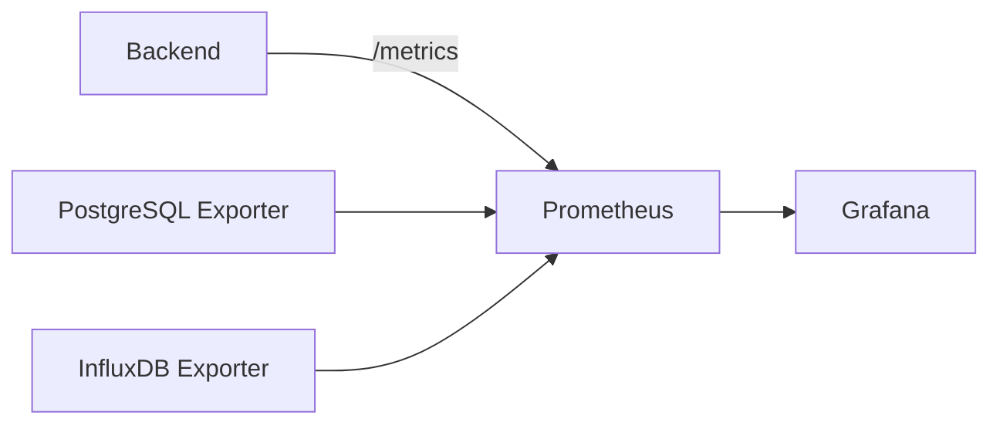

# Documento 7
# Observabilidad y Monitorización

# 7.1 Introducción y Objetivos

## Introducción

Los documentos anteriores definen qué hace EWControl, cómo persiste sus datos, cómo se despliega y cómo se protege. Ninguno de ellos responde a una pregunta distinta pero igualmente crítica en un sistema industrial distribuido: **¿cómo sabemos que el sistema funciona correctamente en cada momento?**

Este documento define la observabilidad de la propia plataforma: logs, métricas, health checks y alertas de infraestructura. Es importante distinguir esto del Alarm Engine (Documento 2, apartado 2.8), que supervisa el estado de las **máquinas industriales**; este documento supervisa el estado del **sistema EWControl** que las monitoriza.

---

## Objetivo

- Centralizar los logs de todos los componentes para facilitar el diagnóstico.
- Exponer métricas técnicas del sistema (latencia, throughput, uso de recursos).
- Definir health checks para cada componente de la arquitectura.
- Establecer alertas de infraestructura, distintas de las alarmas industriales.
- Permitir trazar un dato desde su origen en la máquina hasta su visualización en el Dashboard.

---

## Alarmas Industriales frente a Alertas de Sistema

| | Alarm Engine (Documento 2) | Observabilidad (este documento) |
|---|---|---|
| Qué supervisa | El valor de las Signals de una máquina | La salud de los componentes de EWControl |
| Ejemplo | Temperatura > 80°C | El Backend no responde a los health checks |
| A quién se notifica | Al cliente de EWControl (usuario de la máquina) | Al equipo que opera la plataforma |
| Dónde se define | `AlarmDefinition` (Documento 3) | Reglas de alerting de infraestructura (apartado 7.4) |

Ambos sistemas son independientes: una caída de InfluxDB (evento de observabilidad) no genera una alarma industrial, y una temperatura fuera de rango (alarma industrial) no genera una alerta de infraestructura.

---

## Decisión Arquitectónica

EWControl mantiene completamente separadas la supervisión del negocio del cliente (Alarm Engine) y la supervisión de la propia plataforma (observabilidad), evitando que ambos conceptos se confundan tanto en el modelo de datos como en los canales de notificación.

# 7.2 Logs Centralizados

## Objetivo

Concentrar los logs de todos los componentes distribuidos de la plataforma (Backend con múltiples réplicas, Data Providers embebidos o en el edge, Frontend) en un único lugar consultable.

---

## Qué se Registra

| Componente | Ejemplos de log |
|---|---|
| Backend | Peticiones API, errores de validación, resultado de casos de uso |
| Signal Engine / Alarm Engine | Errores de cálculo, cambios de estado de alarma |
| Data Provider | Conexión/desconexión con el Source, reintentos, errores de protocolo |
| Frontend | Errores de cliente relevantes (opcional, según necesidad) |

---

## Estructura de un Log

Todo log de la plataforma se emite en formato estructurado (JSON) e incluye, como mínimo:

| Campo | Descripción |
|---|---|
| timestamp | Momento del evento |
| nivel | debug / info / warning / error |
| componente | Backend, Data Provider, Alarm Engine... |
| company_id / machine_id | Cuando el evento está asociado a una entidad del dominio |
| mensaje | Descripción del evento |
| correlation_id | Identificador de correlación (apartado 7.6) |

---

## Librería de Logging

El Backend emite estos logs mediante **Pino** (vía `nestjs-pino`).

Se evaluaron tres opciones:

| | Pino | Winston | Logger propio de NestJS |
|---|---|---|---|
| Rendimiento | Muy alto (serialización asíncrona optimizada) | Medio | Medio-bajo a volumen alto |
| JSON estructurado | Nativo, sin configuración adicional | Requiere configurar el formato | No nativo, exige un formatter propio |
| Redacción de campos sensibles | Soporte integrado (`redact`) | Posible, pero manual | No integrado |
| Integración con NestJS | Vía `nestjs-pino` (interceptor de logging por petición) | Vía `nest-winston`, muy documentada | Nativa, sin dependencias |
| Ecosistema de transports | Menor que Winston | Muy amplio (archivo, HTTP, servicios externos) | Ninguno |

Se descarta **Winston** pese a su ecosistema más amplio de transports porque, con Signals actualizándose cada segundo por máquina (Documento 10) y potencialmente cientos de máquinas activas (Documento 2, "Escalabilidad"), el rendimiento de logging bajo carga alta pesa más que la flexibilidad de enrutado; Pino está diseñado específicamente para minimizar el coste de logging en el *hot path*. Se descarta el **Logger propio de NestJS** porque no emite JSON estructurado de forma nativa (obligando a construir a mano lo que Pino ya resuelve) y no soporta redacción de campos sensibles, relevante para cumplir la Regla 1 de este apartado (ningún log incluye credenciales/tokens en texto plano) sin depender únicamente de la disciplina manual de quien escribe el log.

---

## Centralización

Los logs de todas las réplicas del Backend y de todos los Data Providers se envían a un sistema centralizado de agregación de logs, evitando la necesidad de acceder individualmente a cada instancia o a cada planta para diagnosticar un problema.

---

## Reglas Arquitectónicas

**Regla 1.** Ningún log incluye información sensible en texto plano (credenciales, tokens, certificados).

**Regla 2.** Todo log estructurado incluye el `correlation_id` del evento al que pertenece, cuando existe.

**Regla 3.** La retención de logs es independiente de la retención de históricos industriales definida en el Documento 4.

---

## Decisión Arquitectónica

EWControl centraliza los logs de todos sus componentes distribuidos en un formato estructurado y correlacionable, permitiendo diagnosticar incidencias sin necesidad de acceder individualmente a cada instancia del Backend o a cada Data Provider desplegado en planta.

# 7.3 Métricas del Sistema

## Objetivo

Exponer métricas técnicas que permitan conocer el estado de rendimiento y carga de la plataforma en todo momento, mediante un modelo de recolección estándar (Prometheus) y visualización (Grafana).

---

## Métricas por Componente

| Componente | Métricas |
|---|---|
| Backend | Peticiones por segundo, latencia por endpoint, tasa de error, número de réplicas activas |
| Realtime Cache | Número de Signals en memoria, frecuencia de actualización |
| Alarm Engine | Evaluaciones por segundo, alarmas activas |
| PostgreSQL | Conexiones activas, latencia de consulta |
| InfluxDB | Escrituras por segundo, tamaño del bucket `signals_history` |
| Data Provider | Estado de conexión, eventos procesados por segundo, reintentos |

---

## Modelo de Recolección

Cada componente expone sus métricas en un endpoint que un recolector central (Prometheus) consulta periódicamente. Grafana consume esas métricas para construir paneles de operación.



---

## Paneles de Referencia

| Panel | Métricas incluidas |
|---|---|
| Estado del Backend | Latencia, errores, réplicas activas |
| Estado de la persistencia | Conexiones a PostgreSQL, escrituras a InfluxDB |
| Estado de adquisición | Data Providers conectados, eventos por segundo |

---

## Reglas Arquitectónicas

**Regla 1.** Toda métrica expuesta es técnica; nunca sustituye a las Signals ni a los históricos definidos en el Documento 4.

**Regla 2.** La recolección de métricas nunca introduce una carga significativa sobre los componentes monitorizados.

---

## Decisión Arquitectónica

EWControl adopta Prometheus como estándar de recolección de métricas técnicas y Grafana como capa de visualización, proporcionando al equipo operador una vista de rendimiento independiente de los datos de negocio del cliente.

# 7.4 Alerting de Infraestructura

## Objetivo

Definir cuándo el equipo que opera EWControl debe ser notificado ante una degradación del sistema, diferenciando estas alertas de las alarmas industriales del Alarm Engine (apartado 7.1).

---

## Condiciones de Alerta

| Condición | Severidad |
|---|---|
| El Backend no responde a los health checks durante más de un minuto | Crítica |
| La latencia media de la API supera el umbral configurado | Alta |
| PostgreSQL realiza un failover | Alta |
| InfluxDB deja de aceptar escrituras | Alta |
| Un Data Provider permanece desconectado más allá del tiempo esperado | Media |
| El uso de disco de InfluxDB supera el umbral de capacidad | Media |

---

## Canal de Notificación

Las alertas de infraestructura se dirigen exclusivamente al equipo que opera la plataforma, nunca a los clientes de EWControl. Esto contrasta deliberadamente con el Notification Service del Documento 2, cuyo destinatario es siempre el cliente final.

---

## Reglas Arquitectónicas

**Regla 1.** Ninguna alerta de infraestructura se envía al mismo canal que las notificaciones de alarmas industriales.

**Regla 2.** Toda alerta crítica se agrupa para evitar saturar al equipo operador con notificaciones repetidas de la misma causa raíz.

---

## Decisión Arquitectónica

El alerting de infraestructura opera como un sistema independiente del Notification Service, con destinatarios, canales y severidades propios, evitando cualquier confusión entre un problema de la plataforma y una alarma del negocio del cliente.

# 7.5 Health Checks

## Objetivo

Definir cómo cada componente de la plataforma expone su propio estado de salud, utilizado tanto por el balanceador de carga (Documento 5) como por el sistema de alerting (apartado 7.4).

---

## Health Check por Componente

| Componente | Verificación |
|---|---|
| Backend | Responde a peticiones; conexión activa con PostgreSQL, InfluxDB y Realtime Cache |
| PostgreSQL | Instancia primaria accesible y replicando correctamente |
| InfluxDB | Instancia accesible y aceptando escrituras |
| Data Provider | Conexión activa con el Source (Simulador o servidor OPC UA) |
| WebSocket | Canal activo, número de conexiones dentro de los límites esperados |

---

## Niveles de Verificación

Un health check distingue dos niveles:

- **Liveness**: el proceso está vivo y responde. Su fallo provoca el reinicio automático del componente (Documento 5).
- **Readiness**: el componente está listo para recibir tráfico (por ejemplo, el Backend tiene conexión establecida con sus dependencias). Su fallo retira temporalmente al componente del balanceador sin reiniciarlo.

---

## Reglas Arquitectónicas

**Regla 1.** Todo componente stateless expone un endpoint de liveness y otro de readiness, diferenciados.

**Regla 2.** Un fallo de readiness nunca provoca un reinicio; solo retira al componente del tráfico hasta que se recupere.

---

## Decisión Arquitectónica

Cada componente de EWControl expone su estado de salud distinguiendo entre estar vivo (liveness) y estar listo para recibir tráfico (readiness), permitiendo que el orquestador (Documento 5) reaccione de forma proporcional a cada tipo de fallo.

# 7.6 Trazabilidad End-to-End

## Objetivo

Permitir seguir el recorrido completo de un dato individual, desde que se genera en la máquina hasta que se muestra en el Dashboard, atravesando todos los componentes descritos en el Documento 2.

---

## Identificador de Correlación

Cada Variable que entra al sistema a través de un Data Provider recibe un `correlation_id` único. Este identificador se propaga a través de todo el flujo descrito en el Documento 2 (apartado 2.12) y en el Documento 4 (apartado 4.8):

```text
Data Provider → Signal Engine → Realtime Cache → Alarm Engine / History Service → WebSocket → Angular
```

Cada componente que procesa el dato incluye este `correlation_id` en sus logs (apartado 7.2), permitiendo reconstruir el recorrido completo consultando el sistema centralizado de logs.

---

## Caso de Uso

Ante una incidencia como "el Dashboard no refleja el último valor de una Signal", la trazabilidad end-to-end permite determinar en qué etapa se detuvo el dato: si nunca llegó desde el Data Provider, si se procesó pero no actualizó la Realtime Cache, o si se actualizó pero no se propagó por WebSocket.

---

## Reglas Arquitectónicas

**Regla 1.** Todo dato que entra al sistema a través de un Data Provider recibe un `correlation_id` en el origen.

**Regla 2.** Ningún componente del flujo descrito en el Documento 2 descarta el `correlation_id` al reenviar o transformar un dato.

---

## Decisión Arquitectónica

La trazabilidad end-to-end de EWControl se basa en un identificador de correlación único por dato, propagado a través de todos los componentes del flujo de la plataforma, permitiendo diagnosticar cualquier incidencia sin necesidad de inferir el recorrido del dato a posteriori.

# 7.7 Decisión Arquitectónica

## Resumen

La observabilidad de EWControl se apoya en logs estructurados y centralizados, métricas técnicas recolectadas mediante Prometheus y visualizadas en Grafana, alertas de infraestructura dirigidas exclusivamente al equipo operador, health checks diferenciados por componente y una trazabilidad end-to-end basada en un identificador de correlación único por dato.

---

## Decisión

Esta capa de observabilidad se mantiene completamente independiente del Alarm Engine y del Notification Service definidos en el Documento 2: uno supervisa el negocio del cliente, el otro supervisa la salud de la plataforma que lo hace posible. Ambos sistemas conviven sin mezclar sus datos, sus canales ni sus destinatarios.
