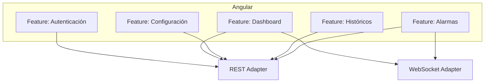
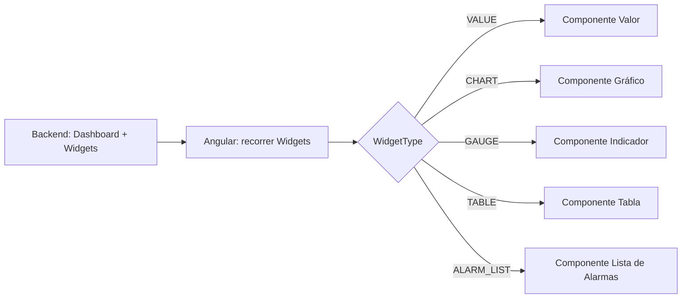
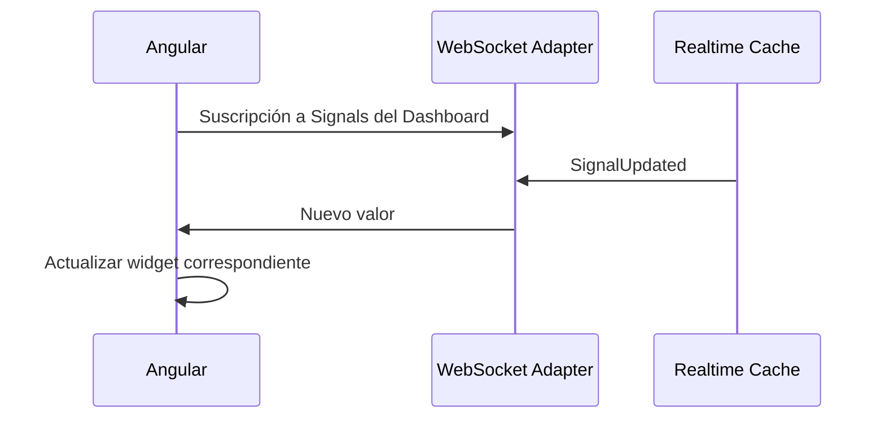

# Documento 8

# Frontend / Dashboard

# 8.1 Introducción y Objetivos

## Introducción

Los documentos anteriores describen el backend de EWControl: dominio, persistencia, despliegue, seguridad y observabilidad. Este documento describe la capa de presentación: la aplicación Angular 21 (Documento 1) mediante la que los usuarios de cada Company consultan sus máquinas, sus históricos y sus alarmas.

---

## Objetivo

- Definir la arquitectura general del Frontend y su relación con los Adapters del Backend (Documento 2, apartado 2.11).
- Describir el funcionamiento del Dashboard dinámico anticipado en el Documento 1.
- Definir cómo se visualizan datos en tiempo real, alarmas e históricos.
- Definir cómo se configuran máquinas, señales y alarmas desde la interfaz.
- Asegurar que el aislamiento multiempresa (Documento 3) se refleje también en la experiencia de usuario.

---

## Principio General

El Frontend nunca contiene lógica de negocio. Toda regla —qué es una alarma, cómo se calcula una Signal, qué histórico corresponde a qué máquina— reside en el Backend (Documento 2). El Frontend se limita a solicitar información, representarla y capturar la interacción del usuario.

---

## Decisión Arquitectónica

EWControl mantiene el Frontend como una capa de presentación pura, consumiendo exclusivamente los Adapters REST y WebSocket ya definidos en el Documento 2, sin duplicar en Angular ninguna regla que ya exista en el Backend.

# 8.2 Arquitectura del Frontend

## Objetivo

Definir cómo se organiza la aplicación Angular y cómo se comunica con el Backend.

---

## Estructura General

EWControl usa **Standalone Components** (sin `NgModule`), el modelo por defecto de Angular 21. Cada área funcional es una carpeta de _feature_ (`auth/`, `dashboard/`, `config/`, `history/`, `alarms/`) con sus propios componentes, rutas _lazy_ (`loadComponent`/`loadChildren` sobre rutas standalone) y servicios, sin un módulo agregador. Se descarta `NgModule` porque ya está en vía de desaparición en Angular y añadiría una capa de organización redundante frente a las carpetas de feature.

Cada feature de Angular se corresponde con un área funcional del dominio (Documento 3) y consume únicamente los Adapters expuestos por el Backend (Documento 2, apartado 2.11): nunca accede directamente a PostgreSQL, InfluxDB o la Realtime Cache.

---

## Comunicación con el Backend

| Necesidad                                            | Adapter utilizado |
| ---------------------------------------------------- | ----------------- |
| Login, CRUD de configuración, consulta de históricos | REST Adapter      |
| Actualización en tiempo real de Signals y alarmas    | WebSocket Adapter |

El Frontend nunca simula en el cliente el cálculo de una Signal ni la evaluación de una alarma; siempre solicita el resultado ya calculado al Backend.

---

## Equivalencia con Clean Architecture

El Frontend sigue los mismos principios de Clean Architecture que el Backend (Documento 0, "Clean Architecture"; Documento 2, "Equivalencia con Clean Architecture"), adaptados a una aplicación Angular sin lógica de negocio propia.

| Capa en Angular                               | Capa canónica de Clean Architecture | Contiene                                                                                                                                                                                                                                                                                                                                                                                                                                                                                                                                                                                                                                                            |
| --------------------------------------------- | ----------------------------------- | ------------------------------------------------------------------------------------------------------------------------------------------------------------------------------------------------------------------------------------------------------------------------------------------------------------------------------------------------------------------------------------------------------------------------------------------------------------------------------------------------------------------------------------------------------------------------------------------------------------------------------------------------------------------- |
| Modelos de dominio                            | Entities                            | Interfaces TypeScript que reflejan las entidades del Documento 3 (`Machine`, `Signal`, `AlarmDefinition`...); sin dependencias de Angular.                                                                                                                                                                                                                                                                                                                                                                                                                                                                                                                          |
| Servicios de aplicación / estado              | Use Cases                           | Orquestación de flujos de la interfaz (ej. "cargar Dashboard", "hacer login", "suscribirse a las Signals de una Machine"); coordinan Interface Adapters, sin conocer HTTP ni WebSocket directamente. Implementados con **Angular Signals** (`signal()`/`computed()`/`effect()`) como mecanismo de estado — se descarta una librería externa (NgRx/Akita) por ser sobreingeniería para el volumen de estado compartido actual (Documento 2, "Simplicidad"), y se descarta RxJS puro como estado persistente porque Signals ofrece un modelo más simple de lectura síncrona para plantillas, reservando RxJS para flujos verdaderamente asíncronos (WebSocket, HTTP). |
| Adapters REST/WebSocket, Guards, Interceptors | Interface Adapters                  | Traducción entre los servicios de aplicación y el mundo exterior: llamadas HTTP al Documento 11, gestión del canal WebSocket, `AuthGuard` de rutas, interceptor de refresh de token (ver [specs/05-auth-login.md](specs/05-auth-login.md)).                                                                                                                                                                                                                                                                                                                                                                                                                         |
| Componentes de UI, routing, Angular en sí     | Frameworks & Drivers                | El framework Angular (Standalone Components, sin `NgModule`), sus componentes visuales y su router; el detalle de renderizado nunca se filtra hacia los Use Cases.                                                                                                                                                                                                                                                                                                                                                                                                                                                                                                  |

La regla de dependencia se cumple igual que en el Backend: un componente visual puede depender de un servicio de aplicación, pero un modelo de dominio nunca depende de un componente ni de Angular.

---

## Reglas Arquitectónicas

**Regla 1.** El Frontend nunca implementa lógica de negocio; toda regla proviene del Backend.

**Regla 2.** El Frontend nunca se conecta directamente a una base de datos ni a un Data Provider.

**Regla 3.** Toda actualización en tiempo real llega exclusivamente a través del WebSocket Adapter.

---

## Decisión Arquitectónica

La arquitectura del Frontend organiza sus módulos según las áreas funcionales del dominio, consumiendo el Backend exclusivamente a través de sus Adapters REST y WebSocket ya definidos, sin introducir un canal de comunicación propio.

# 8.3 Dashboard Dinámico

## Objetivo

Implementar el principio de "Dashboard dinámico" anticipado en el Documento 1: no existen pantallas específicas por máquina; cada Dashboard se construye automáticamente a partir de su configuración.

---

## Construcción del Dashboard

Un Dashboard (Documento 3, apartado 3.2.8) se compone de DashboardWidgets (apartado 3.2.9), cada uno con un `WidgetType` y una `WidgetConfig`. El Frontend recorre esta configuración y renderiza dinámicamente el componente Angular correspondiente a cada tipo de widget, sin que el código del Frontend conozca de antemano qué máquinas o señales existen.

---

## Añadir un Nuevo Tipo de Widget

Incorporar un nuevo `WidgetType` (Documento 3, apartado 3.5) requiere únicamente añadir el componente Angular correspondiente; no requiere modificar la estructura del Dashboard ni la forma en que el Frontend recorre su configuración.

---

## Reglas Arquitectónicas

**Regla 1.** El Frontend nunca programa una pantalla específica para una máquina o Company concreta.

**Regla 2.** Un nuevo `WidgetType` se incorpora añadiendo un componente, sin modificar el mecanismo de renderizado dinámico.

---

## Decisión Arquitectónica

El Dashboard se genera siempre a partir de su configuración en tiempo de ejecución, nunca mediante pantallas codificadas por máquina, cumpliendo el principio de "Dashboard dinámico" establecido desde el Documento 1.

# 8.4 Visualización en Tiempo Real

## Objetivo

Definir cómo el Frontend refleja los cambios de las Signals a medida que ocurren, sin recargar la página ni realizar consultas periódicas.

---

## Suscripción por WebSocket

Al abrir un Dashboard, Angular se suscribe mediante el WebSocket Adapter a las Signals referenciadas por sus widgets. Cada `SignalUpdated` recibido (Documento 2, apartado 2.7) actualiza únicamente el widget correspondiente, sin refrescar el resto de la pantalla.

---

## Estado de Conexión

Cuando una Machine pasa a estado OFFLINE (Documento 2, apartado 2.6), el Frontend refleja visualmente esta condición en los widgets afectados, mostrando el último valor conocido junto con un indicador de pérdida de comunicación, tal y como establece el Documento 2.

---

## Reglas Arquitectónicas

**Regla 1.** El Frontend nunca consulta el valor de una Signal mediante sondeo periódico (_polling_) mientras exista una conexión WebSocket activa.

**Regla 2.** La pérdida de conexión con una Machine se muestra explícitamente al usuario, nunca de forma silenciosa.

---

## Decisión Arquitectónica

La visualización en tiempo real del Frontend depende exclusivamente de eventos recibidos por WebSocket, evitando el sondeo periódico y reflejando fielmente el estado de calidad y conexión definido por el Backend.

# 8.5 Gestión de Alarmas en el Frontend

## Objetivo

Definir cómo se visualizan y gestionan las alarmas industriales (Documento 3, apartados 3.2.6 y 3.2.7) desde el Frontend.

---

## Visualización de Alarmas

| Vista                     | Contenido                                                                 |
| ------------------------- | ------------------------------------------------------------------------- |
| Widget de tipo ALARM_LIST | Alarmas activas de las Signals asociadas al Dashboard                     |
| Panel de alarmas          | Todas las alarmas activas de la Company, independientemente del Dashboard |
| Histórico de alarmas      | Consulta de `AlarmState` pasados, obtenidos vía REST                      |

Las alarmas activas se actualizan en tiempo real por WebSocket, igual que cualquier otra Signal; el histórico de alarmas se consulta bajo demanda vía REST, igual que un histórico de Signal.

---

## Interacción del Usuario

El reconocimiento manual de alarmas (ACK) está disponible desde el panel de alarmas y el detalle de una alarma (spec 11): el usuario puede reconocer una alarma, acción que se traduce en `POST /api/v1/alarm-states/:id/ack` (Documento 11, sección "AlarmState"); el Frontend nunca marca una alarma como reconocida antes de recibir la confirmación del Backend. El widget `ALARM_LIST` del Dashboard permanece de solo lectura (glance view compacto) y no ofrece esta acción.

---

## Reglas Arquitectónicas

**Regla 1.** El Frontend nunca decide por sí mismo si una condición constituye una alarma; siempre refleja el `AlarmState` que le comunica el Backend.

**Regla 2.** El reconocimiento de una alarma desde el Frontend siempre se confirma contra el Backend antes de reflejarse como definitivo en la interfaz.

---

## Decisión Arquitectónica

La gestión de alarmas en el Frontend es puramente de presentación e interacción; toda regla de evaluación y todo cambio de estado se delegan siempre al Alarm Engine a través del Backend.

# 8.6 Configuración desde el Frontend

## Objetivo

Definir cómo un usuario administrador configura Machines, Signals, AlarmDefinitions y Dashboards desde la interfaz, sin necesidad de intervención técnica.

---

## Operaciones de Configuración

| Operación                      | Entidad afectada           | Rol requerido             |
| ------------------------------ | -------------------------- | ------------------------- |
| Registrar una Machine          | Machine, MachineConnection | AdminCliente / SuperAdmin |
| Definir una Signal             | Signal                     | AdminCliente / SuperAdmin |
| Definir una regla de alarma    | AlarmDefinition            | AdminCliente / SuperAdmin |
| Crear o modificar un Dashboard | Dashboard, DashboardWidget | AdminCliente / SuperAdmin |
| Dar de alta una Company        | Company                    | SuperAdmin                |
| Gestionar Users de la Company  | User                       | AdminCliente / SuperAdmin |

Cada formulario del Frontend se corresponde con una entidad del dominio (Documento 3) y con los endpoints de escritura definidos en el Documento 11. El Frontend valida el formato de los datos introducidos, pero la validación de negocio (por ejemplo, que una Signal FORMULA solo referencie Variables de su misma Machine) siempre se revalida en el Backend.

Las dos últimas filas de la tabla anterior (Company, User) están especificadas en detalle en [docs/specs/10-gestion-companies-users.md](specs/10-gestion-companies-users.md), incluyendo el auto-servicio de cambio/recuperación de contraseña de un User.

---

## Reglas Arquitectónicas

**Regla 1.** Toda operación de configuración respeta los roles definidos en el Documento 3 (`UserRole`); el Frontend oculta las opciones no autorizadas, pero el Backend las rechaza igualmente si se solicitan.

**Regla 2.** Ninguna validación de negocio se considera definitiva en el Frontend; el Backend es siempre la última autoridad.

---

## Decisión Arquitectónica

La configuración desde el Frontend traduce cada formulario en un caso de uso de escritura del Backend, sin implementar reglas de negocio propias y respetando siempre los roles de usuario definidos en el dominio.

# 8.7 Históricos y Gráficos

## Objetivo

Definir cómo el Frontend consulta y representa la información histórica almacenada en InfluxDB (Documento 4, apartado 4.3).

---

## Consulta de Históricos

El Frontend solicita un histórico indicando la Signal (o Machine) y el rango temporal deseado; nunca solicita agregaciones concretas de InfluxDB directamente, sino que delega en el Backend la selección de resolución adecuada (Documento 4, apartado 4.3).

| Rango solicitado | Resolución típica devuelta por el Backend |
| ---------------- | ----------------------------------------- |
| Últimas horas    | Valores en bruto                          |
| Últimos días     | Media por minuto u hora                   |
| Últimos meses    | Media diaria o mensual                    |

---

## Representación Gráfica

Los widgets de tipo CHART (Documento 3, apartado 3.5) representan la serie temporal devuelta por el Backend. El widget permite ajustar el rango temporal consultado, disparando una nueva petición REST sin necesidad de recargar el Dashboard completo.

---

## Reglas Arquitectónicas

**Regla 1.** El Frontend nunca calcula agregaciones sobre los datos históricos; siempre las recibe ya calculadas del Backend.

**Regla 2.** Un cambio de rango temporal en un widget nunca afecta a los demás widgets del mismo Dashboard.

---

## Decisión Arquitectónica

La representación de históricos en el Frontend es una capa de visualización pura sobre las series temporales que el Backend ya resuelve con la resolución adecuada, evitando duplicar en Angular la lógica de agregación definida en el Documento 4.

# 8.8 Multiempresa en el Frontend

## Objetivo

Reflejar en la experiencia de usuario el aislamiento multiempresa establecido como principio de seguridad en el Documento 6 (apartado 6.7).

---

## Contexto de Company

Tras el login, el Frontend opera siempre dentro del contexto de la Company asociada al token del usuario (Documento 6, apartado 6.2). Ningún elemento de la interfaz permite a un usuario AdminCliente seleccionar o visualizar otra Company.

---

## Experiencia del SuperAdmin

Un usuario SuperAdmin dispone de una vista adicional para seleccionar la Company sobre la que desea operar. Una vez seleccionada, el resto de la interfaz se comporta exactamente igual que para un AdminCliente de esa Company, sin mezclar información de varias Companies en una misma pantalla.

---

## Reglas Arquitectónicas

**Regla 1.** Ninguna pantalla del Frontend combina información de más de una Company simultáneamente.

**Regla 2.** El cambio de Company por parte de un SuperAdmin siempre se realiza de forma explícita, nunca implícita.

---

## Decisión Arquitectónica

El Frontend refuerza visualmente el aislamiento multiempresa exigiendo que toda pantalla opere dentro del contexto de una única Company, coherente con el principio de seguridad establecido en el Documento 6.

# 8.9 Decisión Arquitectónica

## Resumen

El Frontend de EWControl es una aplicación Angular organizada por áreas funcionales del dominio, que construye Dashboards dinámicamente a partir de su configuración, se actualiza en tiempo real mediante WebSocket, delega toda regla de negocio y de alarmas en el Backend, y refuerza visualmente el aislamiento multiempresa.

---

## Decisión

Ninguna capacidad de EWControl se implementa dos veces en Frontend y Backend: el Frontend consume, representa e interactúa; el Backend decide, calcula y valida. Esta separación, ya establecida como principio arquitectónico en el Documento 2, se mantiene sin excepciones en la capa de presentación.

---

## Estado de este documento

A diferencia de una fase previa en la que el Frontend se consideraba diferido, este documento se mantiene activo: cada nueva feature vertical (Documento 0, "Specs verticales") amplía las secciones correspondientes de este documento a medida que se implementa, empezando por el Módulo de Autenticación ([specs/05-auth-login.md](specs/05-auth-login.md)).
