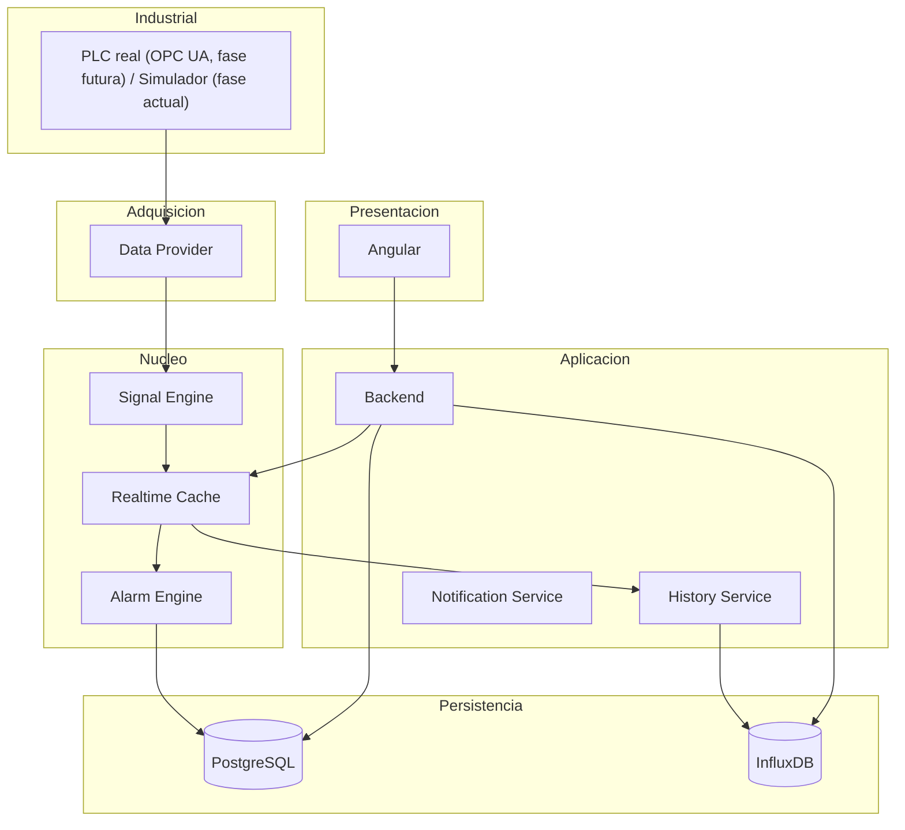
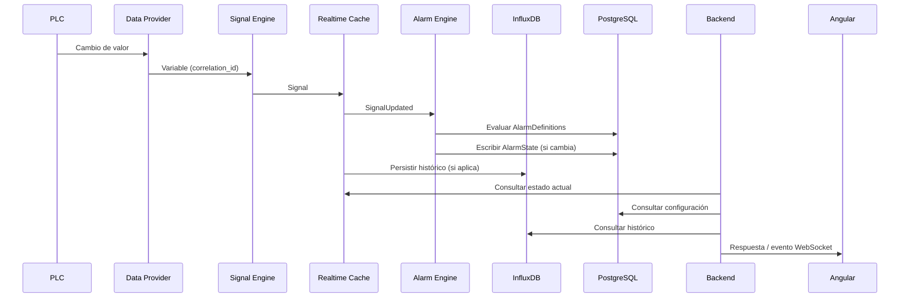

# Documento 9
# Conclusión y Visión Global

# 9.1 Resumen de la Arquitectura Completa

## Introducción

Los documentos anteriores construyen EWControl capa a capa: metodología (Documento 0), visión y objetivos (Documento 1), arquitectura y componentes (Documento 2), modelo de dominio (Documento 3), persistencia (Documento 4), despliegue (Documento 5), seguridad (Documento 6), observabilidad (Documento 7), Frontend (Documento 8), Simulador de datos demo (Documento 10) y API REST (Documento 11). Este documento cierra la documentación con una visión unificada del sistema **objetivo**, no del sistema ya construido — el estado real de implementación, fase a fase, está en el [README](../README.md), sección Roadmap.

---

## Mapa de la Documentación

| Documento | Responde a |
|---|---|
| 0. Metodología y Calidad | Cómo se trabaja: specs, Clean Architecture, TDD, OWASP |
| 1. Visión | Qué es EWControl y para quién |
| 2. Arquitectura | Cómo se organizan los componentes del sistema |
| 3. Modelo de Datos | Qué conceptos de negocio existen y cómo se relacionan |
| 4. Persistencia | Dónde y cómo se almacena cada dato |
| 5. Despliegue e Infraestructura | Cómo se ejecuta el sistema en producción |
| 6. Seguridad Global | Cómo se protege el sistema completo |
| 7. Observabilidad y Monitorización | Cómo se sabe que el sistema funciona |
| 8. Frontend / Dashboard | Cómo interactúa el usuario con el sistema |
| 9. Conclusión | Cómo encajan todas las piezas entre sí |
| 10. Simulador y Datos Demo | Cómo se generan datos sin hardware real |
| 11. API REST | Contrato de la API HTTP y WebSocket |

---

## Componentes del Sistema

---

## Decisión Arquitectónica

EWControl se sostiene sobre un único flujo de datos coherente —de la máquina al Dashboard— documentado de forma independiente en cada capa, pero diseñado desde el inicio como un sistema único, sin fronteras arbitrarias entre documentos.

# 9.2 Flujo End-to-End

## Objetivo

Consolidar en una única secuencia el recorrido completo de un dato, integrando lo descrito en los Documentos 2, 4, 6 y 7.

---

## Recorrido Completo

---

## Etapas y Documentos de Referencia

| Etapa | Documento |
|---|---|
| Adquisición (PLC → Data Provider → Variable) | Documento 2, apartado 2.4 |
| Transformación (Variable → Signal) | Documento 2, apartado 2.5 |
| Estado en tiempo real | Documento 2, apartado 2.6; Documento 4, apartado 4.4 |
| Evaluación de alarmas | Documento 2, apartado 2.8; Documento 4, apartado 4.5 |
| Persistencia histórica | Documento 4, apartado 4.3 |
| Orquestación y API | Documento 4, apartado 4.6 (orquestación de persistencia); Documento 11 (contrato de API) |
| Seguridad del canal | Documento 6, apartado 6.2 (JWT, fase actual); apartados 6.3 y 6.5 (mTLS/cifrado edge, fase futura) |
| Trazabilidad del recorrido | Documento 7, apartado 7.6 |
| Visualización | Documento 8 |

---

## Decisión Arquitectónica

Cada dato de EWControl recorre siempre la misma secuencia, independientemente de si el Data Provider está embebido junto al Backend o distribuido en el edge (Documento 5), y ese recorrido es exactamente el que permite reconstruir la trazabilidad end-to-end definida en el Documento 7.

# 9.3 Principios Transversales

## Objetivo

Sintetizar los principios que se repiten, bajo distintas formas, a lo largo de los nueve documentos.

---

## Principios Consolidados

| Principio | Dónde se aplica |
|---|---|
| Signal como unidad universal de negocio | Documento 2 (Signal Engine), Documento 3 (entidad Signal), Documento 8 (widgets) |
| Separación entre configuración y estado | Documento 3 (Machine/MachineConnection, AlarmDefinition/AlarmState), Documento 4 (PostgreSQL/Realtime Cache) |
| Aislamiento multiempresa (Company) | Documento 3 (regla de dominio), Documento 4 (tags/filtros), Documento 6 (principio de seguridad) |
| Desacoplamiento del protocolo industrial | Documento 2 (Data Provider), Documento 5 (despliegue en el edge), Documento 6 (frontera OT/IT) |
| El dominio no depende de la infraestructura | Documento 3 (principio de diseño), Documento 4 (persistencia desacoplada) |
| Evolución controlada, sin sobreingeniería | Documento 1 (filosofía), Documento 5 (escalado progresivo), Documento 8 (widgets extensibles) |
| Fallo aislado, nunca propagado | Documento 2 (Signal Engine), Documento 5 (alta disponibilidad), Documento 8 (widgets independientes) |

---

## Decisión Arquitectónica

Estos principios no son exclusivos de un documento: constituyen el criterio con el que se evalúa cualquier cambio futuro sobre EWControl, independientemente de en qué capa de la arquitectura se proponga.

# 9.4 Decisiones Finales del Sistema

## Resumen de Decisiones por Documento

| Documento | Decisión clave |
|---|---|
| 0. Metodología | Spec-Driven Development con specs verticales Back+Front, Clean Architecture, Docs as Code, TDD, OWASP Top 10 transversal |
| 1. Visión | Plataforma SaaS multiempresa, con Dashboard dinámico y sustitución del origen de datos sin afectar al resto del sistema |
| 2. Arquitectura | Arquitectura en capas (equivalente a Clean Architecture), comunicación mediante eventos internos, Signal como unidad de negocio |
| 3. Modelo de Datos | Nueve entidades organizadas en torno a Company (seguridad) y Signal (negocio) |
| 4. Persistencia | PostgreSQL como sistema de registro, InfluxDB para series temporales, relacionados por `signal_id` |
| 5. Despliegue | Docker Compose en desarrollo (fase actual); Kubernetes, edge y alta disponibilidad como diseño de referencia diferido |
| 6. Seguridad | Autenticación JWT access+refresh con alcance de Company (fase actual); mTLS para el edge y segmentación OT/IT como diseño de referencia diferido; checklist OWASP Top 10 |
| 7. Observabilidad | Logs, métricas y alertas de infraestructura completamente separados del Alarm Engine industrial |
| 8. Frontend | Angular como capa de presentación pura, sin lógica de negocio propia, desarrollado como features verticales junto al backend |
| 10. Simulador | Random walk acotado por señal, seeds por tipo de máquina, fallos controlables vía API, aislado por Company |
| 11. API REST | Catálogo CRUD completo + WebSocket formalizado, versionado `/api/v1/`, base para las features verticales |

---

## Decisión Arquitectónica

Ninguna de estas decisiones se toma de forma aislada: cada una asume y se apoya en las anteriores, formando una cadena coherente desde la visión del producto hasta la experiencia final del usuario.

# 9.5 Evolución Futura

## Objetivo

Consolidar, en un único lugar, las líneas de evolución ya apuntadas de forma dispersa en los documentos anteriores.

---

## Líneas de Evolución por Área

| Área | Evolución futura |
|---|---|
| Dominio (Documento 3) | Entidad `Site` para múltiples plantas, nuevos roles de usuario, condiciones de alarma compuestas |
| Adquisición (Documento 2) | Nuevos Data Providers (MQTT, Modbus, API REST, Edge Gateway) |
| Persistencia (Documento 4) | Retención diferenciada por Signal o Company, clustering de InfluxDB |
| Despliegue (Documento 5) | Canal de mensajería compartido entre réplicas del Backend para WebSocket, alta disponibilidad activa de InfluxDB |
| Seguridad (Documento 6) | Autenticación multifactor, rotación automática de certificados |
| Observabilidad (Documento 7) | Paneles predictivos, detección automática de anomalías de infraestructura |
| Frontend (Documento 8) | Dashboards compartidos entre usuarios, widgets combinados multi-Signal |
| Notificaciones (Documento 2) | Nuevos canales: Telegram, Microsoft Teams, SMS, WhatsApp |

---

## Criterio de Incorporación

Toda evolución futura se incorporará únicamente cuando exista una necesidad funcional real que la justifique, respetando el principio de "Evolución Controlada" establecido desde el Documento 1: EWControl no implementa hoy soluciones para problemas que todavía no existen.

---

## Decisión Arquitectónica

La arquitectura descrita en estos nueve documentos está preparada para absorber cada una de estas evoluciones sin rediseñar su núcleo, siempre que se respeten los principios transversales consolidados en el apartado 9.3.

# 9.6 Cierre

## Síntesis Final

EWControl nace como una plataforma SaaS de monitorización industrial multiempresa, construida alrededor de un único concepto central —la Signal— que atraviesa la adquisición de datos, el procesamiento en tiempo real, la persistencia, la evaluación de alarmas, la seguridad, la observabilidad y la visualización.

Cada documento de esta serie añade una capa sobre la anterior sin contradecirla: el dominio no conoce la infraestructura, la infraestructura no conoce el dominio, y el Frontend no conoce ninguna regla de negocio que no le haya sido entregada ya resuelta por el Backend.

---

## Estado de la Documentación

Con este documento se completa la primera versión integral de la **documentación arquitectónica** de EWControl: la arquitectura objetivo, cubriendo desde la visión de producto hasta la operación en producción del sistema completo.

Esto no significa que el sistema esté construido. El estado real de implementación es el descrito en el [README](../README.md), sección Roadmap: en el momento de escribir este documento, el proyecto está en la Fase 1 (fundación backend: Simulador + API REST), sin Frontend, Auth ni conexión OPC UA real implementados todavía. Las secciones de este documento que hablan de Frontend, mTLS, Kubernetes o alta disponibilidad describen diseño ya acordado, no funcionalidad ya operativa.

---

## Decisión Final

Cualquier extensión futura de EWControl —nuevas máquinas, nuevos protocolos, nuevos canales de notificación, nuevas capacidades de Frontend— debe evaluarse contra los principios consolidados en este documento antes de implementarse, garantizando que el sistema crezca de forma coherente con la arquitectura aquí definida.
