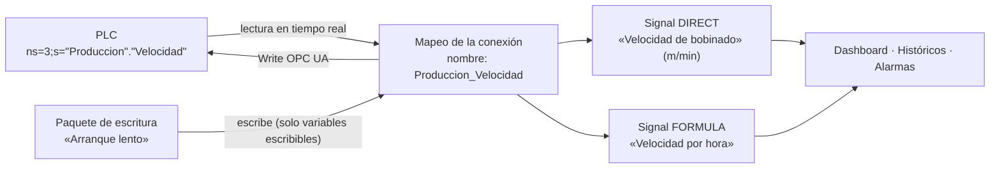

# Guía: configurar una máquina OPC UA

Esta guía explica cómo se pasa de «una variable dentro del PLC» a «un valor en el Dashboard» o «un botón que escribe en la máquina», y para qué sirve cada pantalla de la configuración de una Machine.

Vale para cualquier PLC con servidor OPC UA. Los ejemplos usan un **Siemens S7-1500 imaginario**, con un bloque de datos `Produccion` (lo que se lee) y otro `Consignas` (lo que se escribe). Sustituye sus nombres por los de tu máquina.

Está pensada para `AdminCliente` y `SuperAdmin`, que son los roles que pueden configurar. Las reglas técnicas detalladas están en las specs [18](../specs/18-integracion-opc-ua.md), [20](../specs/20-paquetes-escritura-opc-ua.md), [21](../specs/21-sincronizacion-variables-opc-ua.md) y [22](../specs/22-anadir-carpeta-opc-ua-desde-explorador.md).

## 1. La idea en una frase

**El PLC tiene variables; EWControl les pone un nombre (mapeo); con esos nombres se crean Signals (lo que se ve) y paquetes de escritura (lo que se escribe).**

Tres niveles, de abajo arriba:

| Nivel                | Qué es                                                                                                | Ejemplo                           | Dónde se configura                      |
| -------------------- | ----------------------------------------------------------------------------------------------------- | --------------------------------- | --------------------------------------- |
| **Variable del PLC** | Un dato dentro del PLC, identificado por su NodeId. EWControl no lo inventa: lo lee.                  | `ns=3;s="Produccion"."Velocidad"` | En el programa del PLC, no en EWControl |
| **Variable mapeada** | Esa variable con un **identificador** corto que usa EWControl. Solo lo mapeado se lee en tiempo real. | `Produccion_Velocidad`            | «Conexión» o «Variables OPC UA»         |
| **Signal**           | Lo que ve el usuario: nombre, unidad, Dashboard, histórico y alarmas.                                 | «Velocidad de bobinado», `m/min`  | Detalle de la Machine → «Nueva Signal»  |

> **Importante:** mapear una variable no la muestra en ningún sitio. Para verla en el Dashboard, guardarla en el histórico o ponerle alarmas hace falta crear una **Signal** que la use.

### Cómo son los NodeIds según el PLC

Cada fabricante organiza el servidor OPC UA a su manera. No hace falta escribirlos a mano (el explorador de nodos los rellena), pero ayuda reconocerlos:

| PLC                       | Carpeta típica                                                             | Variable                                             |
| ------------------------- | -------------------------------------------------------------------------- | ---------------------------------------------------- |
| Siemens S7-1500           | Un bloque de datos: `ns=3;s="Produccion"`                                  | `ns=3;s="Produccion"."Velocidad"`                    |
| CODESYS (Inovance, WAGO…) | Una lista de variables globales: `ns=4;s=\|var\|<PLC>.Application.GVL_HMI` | `ns=4;s=\|var\|<PLC>.Application.GVL_HMI.rVelocidad` |

## 2. Las pantallas, una a una

Todas cuelgan del detalle de la Machine (Configuración → Machines → tu máquina).

### 2.1 «Conexión»: con qué servidor hablar y qué variables leer

Sirve para tres cosas:

1. **Elegir el proveedor de datos**: «Simulador» (datos de prueba) u «OPC UA» (máquina real).
2. **Indicar el servidor**: el endpoint, de la forma `opc.tcp://<ip-del-plc>:4840` (por ejemplo `opc.tcp://192.168.0.10:4840`). «Probar conexión» comprueba que responde, sin guardar nada.
3. **Editar el mapeo**, la tabla «Variables mapeadas». Cada fila es una variable del PLC que EWControl lee:
   - **NodeId**: dónde está la variable en el PLC.
   - **Tipo**: `Boolean`, `Int16`, `Float`…
   - **Nombre de variable**: el identificador que usarán las Signals y los paquetes.
   - **Escribible** y **Límites**: si los paquetes de escritura pueden escribir en ella, y entre qué valores.

Para añadir filas, pulsa **«Explorar nodos»**. Aparece el árbol del servidor:

- **«Añadir»** en una variable suelta añade esa variable.
- **«Añadir todas»** en una carpeta (o en un array) añade todas las variables que cuelgan de ella de una vez.

Los cambios **no se aplican hasta pulsar «Guardar»**. Al guardar, EWControl reinicia la lectura de esa máquina con el mapeo nuevo.

### 2.2 «Variables OPC UA»: traer una carpeta entera y vigilar sus cambios

Hace lo mismo que «Añadir todas», pero pensado para mantener al día una carpeta grande:

- Lista **todas** las variables de la carpeta con su ruta, su tipo de PLC (`BOOL`, `INT`, `REAL`…) y su tipo OPC UA.
- Permite ponerles **identificador** y además una **etiqueta** libre («Velocidad de bobinado»).
- Al volver a sincronizar otro día, **avisa de lo que ha cambiado en el PLC**: variables nuevas, eliminadas o con el tipo cambiado. Nada se borra solo: tú decides.
- Recuerda la carpeta: la primera vez la escribes; las siguientes ya aparece puesta.
- Sincronizar **solo lee**; no escribe nada en la máquina.

¿Cuál usar?

| Quiero…                                                              | Usa                                      |
| -------------------------------------------------------------------- | ---------------------------------------- |
| Añadir una o pocas variables sueltas                                 | «Conexión» → «Explorar nodos» → «Añadir» |
| Añadir una carpeta entera rápido                                     | «Conexión» → «Añadir todas»              |
| Añadir una carpeta entera con etiquetas y saber qué cambia en el PLC | «Variables OPC UA»                       |
| Marcar variables como escribibles y ponerles límites                 | «Conexión» (columna «Escribible»)        |

Las dos pantallas editan **el mismo mapeo**: lo que añades en una aparece en la otra.

### 2.3 «Categorías»: organizar las variables como en el PLC

Con cientos de variables, conviene agruparlas como las tiene organizadas el programador del PLC. En CODESYS:

1. Exporta la lista de variables globales (por ejemplo `GVL_HMI`) a CSV.
2. En EWControl, abre la máquina → **«Categorías»**, indica la carpeta OPC UA de esa lista y sube el CSV.

Los títulos de los comentarios del CSV enmarcados en `####` se convierten en **categorías** y los enmarcados en `****`, en **subcategorías**. Cada variable queda en la última categoría que aparece antes que ella. Los comentarios sueltos de una variable («Home», «% de la velocidad…») se usan como **etiqueta propuesta**.

Después puedes **renombrar** cada categoría desde la misma pantalla (por ejemplo, para poner las tildes que faltan en el PLC). Volver a importar sustituye todas las categorías y sus nombres.

Las categorías aparecen en «Variables OPC UA» (columna y filtro «Categoría») y ordenan las sugerencias al crear una Signal. No cambian qué se lee de la máquina.

### 2.4 «Signals»: lo que se ve en el Dashboard

Una Signal convierte una variable mapeada en algo visible. Hay dos tipos:

- **DIRECT**: muestra el valor de **una** variable tal cual. Se elige en el campo «Variable» (el desplegable sugiere los identificadores del mapeo, ordenados por categoría y con su etiqueta).
- **FORMULA**: calcula un valor a partir de **varias** variables de la misma Machine con una expresión, p. ej. `Produccion_Velocidad * 60`.

Cada Signal tiene nombre y unidad, aparece en el Dashboard, se guarda en el histórico y admite alarmas.

### 2.5 «Paquetes de escritura»: valores fijos que se escriben en el PLC

Un paquete es una **receta cerrada**: un nombre y una lista fija de «variable = valor». Por ejemplo, «Formato 120 mm»: `Consignas_Ancho = 120`, `Consignas_ModoAuto = true`.

- Solo pueden usar variables marcadas como **Escribible** en «Conexión», y respetan sus límites.
- Al **ejecutarlo**, EWControl escribe todos los valores en el PLC de una vez y lo deja registrado.
- El `Operador` puede ejecutar paquetes, pero nunca elegir valores.

> **Cuidado:** ejecutar un paquete **escribe en la máquina real**. Con la máquina en marcha puede mover cosas.

## 3. Paso a paso: de cero a ver la velocidad en el Dashboard

Ejemplo con el Siemens S7-1500 imaginario. El bloque de datos `Produccion` tiene estas variables:

| Variable en el PLC | Tipo PLC | NodeId                                 | Identificador por defecto   |
| ------------------ | -------- | -------------------------------------- | --------------------------- |
| `Velocidad`        | `REAL`   | `ns=3;s="Produccion"."Velocidad"`      | `Produccion_Velocidad`      |
| `EnMarcha`         | `BOOL`   | `ns=3;s="Produccion"."EnMarcha"`       | `Produccion_EnMarcha`       |
| `PiezasHoy`        | `DINT`   | `ns=3;s="Produccion"."PiezasHoy"`      | `Produccion_PiezasHoy`      |
| `PiezasObjetivo`   | `DINT`   | `ns=3;s="Produccion"."PiezasObjetivo"` | `Produccion_PiezasObjetivo` |

**Paso 1. Comprobar la conexión.**
Conexión → elige «OPC UA» → endpoint `opc.tcp://192.168.0.10:4840` → «Probar conexión». Debe salir «Conexión establecida con el servidor OPC UA». Si es la primera vez que la Machine usa OPC UA, pulsa «Guardar».

**Paso 2. Traer las variables del bloque `Produccion`.** Elige una de las dos formas:

- **A. Con etiquetas y control de cambios (recomendado):**
  1. Detalle de la Machine → «Variables OPC UA».
  2. Carpeta: `ns=3;s="Produccion"`.
  3. «Sincronizar con OPC UA». Salen las 4 variables como «Nueva». Si la carpeta tuviera arrays o tipos no soportados, aparecerían como «omitidas» (los elementos de los arrays sí salen en la lista).
  4. Si quieres, cambia identificadores y pon etiquetas. Ejemplo: fila `Velocidad`, identificador `Produccion_Velocidad`, etiqueta «Velocidad de bobinado».
  5. «Guardar».
- **B. Rápido:**
  1. Conexión → «Explorar nodos».
  2. Despliega hasta `Produccion` y pulsa «Añadir todas».
  3. Revisa la tabla y pulsa «Guardar».

**Paso 3. Crear la Signal.**
Detalle de la Machine → «Nueva Signal»:

- Nombre: `Velocidad de bobinado`
- Unidad: `m/min`
- Tipo: `DIRECT`
- Variable: `Produccion_Velocidad`

Guarda. A partir de aquí el valor llega en tiempo real.

**Paso 4. Verla.**
Dashboard → añadir un widget con la Signal «Velocidad de bobinado». En Históricos ya se guardan sus valores, y en Alarmas puedes crear una («Velocidad > 300»).

**Paso 5 (opcional). Una fórmula.**
«Nueva Signal» → tipo `FORMULA`:

- Nombre: «Piezas pendientes»
- Expresión: `Produccion_PiezasObjetivo - Produccion_PiezasHoy`
- Variables: `Produccion_PiezasObjetivo, Produccion_PiezasHoy`
- Unidad: `uds`

**Paso 6 (opcional). Un paquete de escritura.**
Supón un segundo bloque `Consignas` con `VelocidadObjetivo` (`REAL`).

1. Añade `ns=3;s="Consignas"."VelocidadObjetivo"` al mapeo (identificador `Consignas_VelocidadObjetivo`).
2. En «Conexión», marca «Escribible» en esa fila y pon límites: mín `0`, máx `200`. Guardar.
3. Detalle de la Machine → «Nuevo paquete» → nombre «Arranque lento» → `Consignas_VelocidadObjetivo = 50`.
4. «Ejecutar» lo escribe en el PLC. Hazlo solo sabiendo qué hace esa variable en la máquina.

## 4. Mantenerlo al día cuando cambia el programa del PLC

Cuando el programador del PLC añade, quita o cambia variables de una carpeta ya sincronizada:

1. «Variables OPC UA» → «Sincronizar con OPC UA» (la carpeta ya está puesta).
2. El resumen dice, por ejemplo, «3 nuevas · 1 eliminada · 2 con tipo cambiado». Filtra por estado para verlas.
   - **Nuevas**: se añaden al guardar.
   - **Tipo cambiado**: se actualiza el tipo al guardar. Revisa las Signals y los paquetes que la usan.
   - **Eliminadas**: aparecen aparte. Solo se quitan del mapeo si marcas «Quitar del mapeo».
3. «Guardar».

Si intentas renombrar o quitar una variable que usa una Signal o un paquete, EWControl no lo permite y te dice cuáles la usan. Cambia o borra primero esa Signal o ese paquete.

**Si se sustituye el PLC por otro** (otro fabricante u otro programa), los NodeIds antiguos dejan de existir:

1. Borra las Signals y los paquetes que usan las variables antiguas.
2. Sincroniza las carpetas del PLC nuevo.
3. Quita del mapeo las variables antiguas. «Variables OPC UA» las mostrará como **eliminadas**.
4. Crea las Signals y los paquetes nuevos.

## 5. Preguntas frecuentes

**He mapeado variables pero no veo nada en el Dashboard.**
Falta crear Signals que las usen (paso 3).

**Una Signal no muestra valor.**
O la máquina no está conectada (todas sus Signals salen `OFFLINE`), o su variable ya no existe en el PLC (por ejemplo, tras cambiar el programa o el PLC). Sincroniza la carpeta para comprobarlo.

**¿«Añadir todas» y «Variables OPC UA» escriben en la máquina?**
No. Las dos solo leen. Lo único que escribe en la máquina es **ejecutar un paquete de escritura**.

**¿Por qué «Añadir todas» está deshabilitado?**
Porque la conexión no está guardada, o porque has cambiado el endpoint en el formulario. Guarda primero.

**¿Hay un máximo de variables?**
500 en el mapeo de una Machine, y 2.000 por carpeta al sincronizar.
